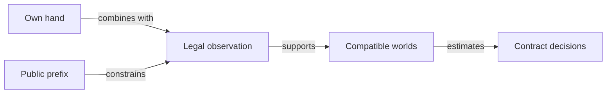

# Honors, covers and contract safety

This guide describes general strategy principles for Romanian Whist. Mandatory rules belong to [How to play](../game/ATF_RulesEn.md), while the [learning architecture](README.md) defines how hypotheses become tested policy changes.

## Sources and responsibilities

| Source | Responsibility |
|---|---|
| [Pattern catalog](../../config/whist-hand-patterns.yaml) | Holding classes, required context, hint scope and research status. |
| [Pattern extraction](../../scripts/whist-hand-patterns.mjs) | Derives holding descriptors from the actor's cards. |
| [Calibration](../../scripts/whist-heuristic-calibrate.mjs) | Descriptive associations from validated development games. |
| [Context manifest](../../config/whist-contextual-discard.yaml) | Conditional rules, information boundaries, implementations and tests. |
| [Policy objectives](../../config/whist-play-objectives.yaml) | Active priorities and isolated experimental alternatives. |

## General principles

- Low covers can help consume higher ranks; promotion still depends on lead, entries, distribution and ruffing.
- Evaluate honor sequences jointly and avoid counting the same card through overlapping patterns.
- Distinguish card rank, suit length and the number of tricks a suit can produce.
- A side honor can be ruffed or legally discarded; its rank alone does not guarantee a trick.
- Mandatory trump can force an unwanted trick after the target has been reached.
- Turned cards, completed-trick cards and cards still on the table have different effects.
- Recompute signed remaining need and feasible opportunities after each public action.
- The table's aggregate auction imbalance never replaces an individual attainable contract.

## Information and inference

Legend: observable information

Actual opponent hands and future actions are absent from the policy input. Legal deductions restrict possible worlds; bid-conditioned behavioral likelihood is a separate model hypothesis requiring qualification.

An observed capture frequency depends on the policy that generated it, including deliberate discards. It is not an intrinsic or counterfactual probability for the holding.

## YAML and policy changes

The pattern catalog declares zero direct runtime influence. Changing a hint requires an explicit code consumer, independently justified components and separate evaluation of a frozen candidate.

Development games, fitted outputs, concrete selections and evaluation results remain in the external archive. Stable documentation records the mechanism, the generalized conditions and their limits.

[Romanian guide](ATF_HandPatternsRo.md) · [Training protocol](../learning/README.md) · [Contextual decisions](ATF_ContextualPlay.md)
