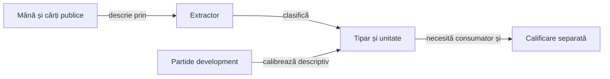

# Onoruri, acoperiri și siguranța contractului

O combinație de cărți oferă indicii condiționate de legalitate, necesar și informația publică. [Regulile jocului](../game/ATF_RulesRo.md) stabilesc acțiunile permise; catalogul descrie mâna, fără influență runtime directă.

## De la observație la indiciu



<details>
<summary>Legendă: descriere, măsurare și activare</summary>

[Extractorul](../../whist-lab-app/ai-lab/tools/patterns/whist-hand-patterns.mjs) identifică ranguri, acoperiri și cărți superioare încă nevăzute. [Calibratorul](../../whist-lab-app/ai-lab/tools/patterns/whist-heuristic-calibrate.mjs) măsoară rezultate ale unor politici deja jucate; niciuna dintre operații nu activează o regulă în Hard.

</details>

## Unitatea indiciului

`hint_scope` stabilește ce descrie `trick_hint`. Două valori cu unități diferite nu se adună și nu se interpretează ca aceeași probabilitate.

| Câmp sau domeniu | Semnificație și limită |
|---|---|
| `HIGHEST_CARD_CAPTURE` | Indicatorul că cea mai mare carte proprie a culorii a fost jucată într-o levată câștigată de acel loc. Nu numără toate levatele culorii. |
| `SUIT_TRICKS` | Numărul levatelor câștigate de loc prin cărți din acea culoare. Se citește separat de captura cărții maxime. |
| Rata contractului exact | Rezultatul întregii mâini pentru acel loc; repetarea lui în categorii nu creează rezultate independente. |
| Suportul și ponderarea | Descriu observațiile grupate și apropierea de indiciul inițial. Nu sunt probabilități calibrate de câștig sau coeficienți runtime. |

[Catalogul YAML](../../config/whist-hand-patterns.yaml) păstrează statutul `RESEARCH_CATALOG_NOT_RUNTIME_CONFIGURATION`. Tiparele suprapuse nu acordă credit repetat aceleiași cărți.

## Reguli de interpretare

- **Promovarea unui onor:** cărțile mici pot ajuta consumarea rangurilor superioare; poziția, intrările și tăierile pot împiedica realizarea levatei.
- **Secvențe și lungime:** onorurile se evaluează împreună; rangul, numărul cărților și numărul levatelor posibile sunt mărimi distincte.
- **Ieșire legală:** un onor lateral poate fi aruncat când lipsesc culoarea cerută și atuul; existența atuului poate impune o levată nedorită.
- **Memorie publică:** cartea întoarsă, o carte dintr-o levată încheiată și cartea încă pe masă au roluri diferite.
- **Obiectiv:** necesarul individual și oportunitățile rămase se citesc din [modelul deciziei](ATF_DecisionModel.md#starea-care-schimbă-decizia); dezechilibrul mesei nu le înlocuiește.

## Intrarea extractorului

| Câmp JSON pentru `describe` | Contract |
|---|---|
| `hand` | Cărți proprii distincte: rang `A`, `K`, `Q`, `J`, `10` sau `2`–`9`, urmat de `S`, `H`, `C` ori `D`; compatibile cu pachetul redus. |
| `trump` | `S`, `H`, `C`, `D` sau `NT`. |
| `players` | Întreg între 3 și 6; implicit 4. |
| `handSize` | Mărime inițială declarată între 1 și 8; absența folosește lungimea mâinii furnizate. |
| `publicOut` | Cărți publice excluse din bazinul necunoscut; implicit lista goală, fără intersecție cu mâna proprie. |

Extractorul verifică aceste limite locale ale cărților și parametrilor. Apelantul deține coerența observației și prefixul legal; descrierea unei mâini nu validează singură o partidă completă.

Din rădăcina proiectului, cu Node.js și fișiere externe alese explicit:

```powershell
$inputFile = Read-Host 'Fișierul JSON al observației permise'
node whist-lab-app/ai-lab/tools/patterns/whist-hand-patterns-cli.mjs describe $inputFile
```

## Calibrare descriptivă

Calibratorul citește toate fișierele JSON din `games/development` ale arhivei furnizate și validează regulile și scorul înaintea interpretării. Nu rezolvă automat pointerul corpusului activ; intrarea și costul ei trebuie alese explicit.

1. Refuză jocurile din altă partiție și elimină urmele de acțiuni repetate.
2. Grupează observațiile după distribuția inițială, loc și culoare; variațiile aceleiași unități sunt mediate în interiorul grupului.
3. Agregă grupurile și păstrează separat captura maximului, levatele culorii și exactul; gruparea nu demonstrează independență statistică între categorii.
4. Scrie într-un director nou YAML-ul calibrat, inventarul complet al contextelor, hash-urile surselor și înregistrarea comparațiilor.

```powershell
$archive = Read-Host 'Arhiva externă pentru calibrarea development'
$output = Read-Host 'Director extern nou; părintele trebuie să existe'
node whist-lab-app/ai-lab/tools/patterns/whist-heuristic-calibrate.mjs $archive $output
```

Frecvențele depind de politica ce a produs jocurile și nu estimează efectul unei acțiuni alternative nejucate. Pragurile și suportul se citesc din catalog și implementare; fișierele obținute rămân externe și au influență runtime zero.

## Verificare și promovare

Componentele folosesc intrări construite pentru onoruri, unități distincte, duplicate și medierea grupurilor:

```powershell
node --test whist-lab-app/ai-lab/tools/patterns/whist-hand-patterns.test.mjs whist-lab-app/ai-lab/tools/patterns/whist-heuristic-calibrate.test.mjs
```

[Configurarea regulilor](ATF_RulesConfiguration.md) deține consumatorul și domeniul activării, iar [protocolul offline](../learning/README.md) deține promovarea. Indiciul, estimarea simulată și certificatul finit au niveluri de garanție distincte.

[English guide](ATF_HandPatternsEn.md) · [Joc contextual](ATF_ContextualPlay.md) · [Corpus și integritate](../learning/ATF_Corpus.md)
