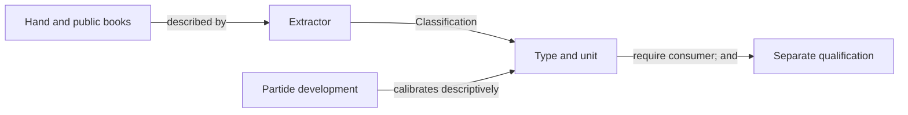

# Honors, cover cards and contract safety

## Overview

A combination of cards provides conditional clues of legality, necessary and public information. [Rules of the game](../game/ATF_RulesRo.md) sets the permitted actions; the catalogue describes the hand without direct runtime influence.

## From observation to clue



<details>
<summary>Legend: description, measurement and activation</summary>

[Extractorul](../../whist-lab-app/ai-lab/tools/patterns/whist-hand-patterns.mjs) identifies ranks, covers and higher cards as yet unseen. [Calibratorul](../../whist-lab-app/ai-lab/tools/patterns/whist-heuristic-calibrate.mjs) measures results of some already played policies; none of the operations activate a rule in Hard.

</details>

## Unit of the clue

`hint_scope` determines what `trick_hint` describes. Two values with different units shall not be added or interpreted as the same probability.

| Field or domain | Meaning and limit |
|---|---|
| `HIGHEST_CARD_CAPTURE` | The indicator that the greatest own color card was played in a trick won by that place. Not counting all the color tricks. |
| `SUIT_TRICKS` | The number of tricks won at all by cards of that color. Read separately from the capturing of the maximum card. |
| Accurate contract rate | The result of the entire hand for that place; repeating it into categories does not create independent results. |
| Support and weighting | I describe the grouped comments and the approximation to the original clue. There are no calibrated odds of winning or runtime coefficients. |

[Catalogul YAML](../../config/whist-hand-patterns.yaml) retains the status `RESEARCH_CATALOG_NOT_RUNTIME_CONFIGURATION`. Overlay patterns do not give repeated credit to the same card.

## Rules of interpretation

- **Promotion of an honor: ** small cards can help consume higher ranks; position, inputs and cuts can prevent levatation.
- **Sequences and length: ** honors are valued together; rank, number of cards and number of possible levatas are distinct sizes.
- **Legal exit: ** a side honor may be discarded when the required color and the asset are missing; the existence of the asset may require an unwanted trick.
- **Public memory: ** the card turned, a card from a finished trick and the card still on the table have different roles.
- **Objective:** individual needs and remaining opportunities are read from [modelul deciziei](ATF_DecisionModel.md#the-status-changing-the-decision); table imbalance does not replace them.

## Extractor input

| JSON field for `describe` | Contract |
|---|---|
| `hand` | Distinguishing own cards: rank `A`, `K`, `Q`, `J`, `10` or `2`-`9`, followed by `S`, `H`, `C` or `D`; compatible with reduced package. |
| `trump` | `S`, `H`, `C`, `D` sau `NT`. |
| `players` | Whole between 3 and 6; default 4. |
| `handSize` | Initial size declared between 1 and 8; absence uses the length of hand provided. |
| `publicOut` | Public cards excluded from the unknown pool; implicitly the empty list without intersection with his own hand. |

The extractor shall check these local limits of cards and parameters. The caller has the consistency of the observation and the legal prefix; the description of a hand does not validate a complete match on its own.

From the project root, with Node.js and explicitly selected external files:

```powershell
$inputFile = Read-Host 'Fișierul JSON al observației permise'
node whist-lab-app/ai-lab/tools/patterns/whist-hand-patterns-cli.mjs describe $inputFile
```

## Descriptive calibration

The calibrator reads all the `games/development` JSON files of the archive provided and validates the rules and scores before the performance. It does not automatically resolve the active body's pointerus; its entry and cost must be explicitly chosen.

1. Refuse games from another partition and remove repeated action.
2. It groups the observations after the initial distribution, place and colour; the variations of the same unit are mediated within the group.
3. It binds groups and keeps the maximum catch, colour tricks and accurate separately; the grouping does not demonstrate statistical independence between categories.
4. Write in a new calibrated YAML directory, full inventory of contexts, source hashes and comparison record.

```powershell
$archive = Read-Host 'Arhiva externă pentru calibrarea development'
$output = Read-Host 'Director extern nou; părintele trebuie să existe'
node whist-lab-app/ai-lab/tools/patterns/whist-heuristic-calibrate.mjs $archive $output
```

Frequencies depend on the policy that has produced the games and do not estimate the effect of an unplayed alternative action. The thresholds and the support shall be read from the catalogue and implementation; the files obtained shall remain external and have zero runtime influence.

## Verification and promotion

Components shall use inputs built for honors, distinct units, duplicates and mediation of groups:

```powershell
node --test whist-lab-app/ai-lab/tools/patterns/whist-hand-patterns.test.mjs whist-lab-app/ai-lab/tools/patterns/whist-heuristic-calibrate.test.mjs
```

[Set up the rules](ATF_RulesConfiguration.md) owns the consumer and the field of activation and [protocolul offline](../learning/README.md) holds the promotion. The indication, simulated estimation and the finished certificate have distinct guarantee levels.

[English guide](ATF_HandPatternsEn.md) · [Context game](ATF_ContextualPlay.md) · [Corpus and integrity](../learning/ATF_Corpus.md)
