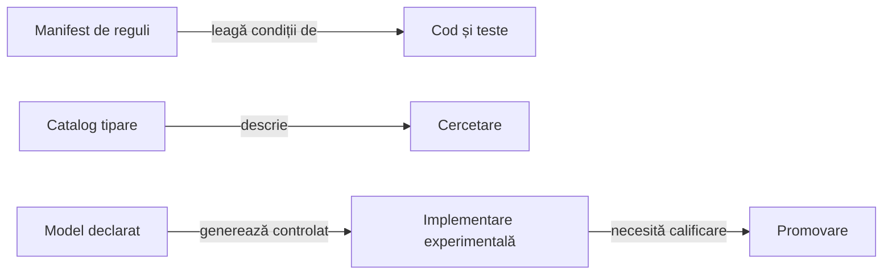
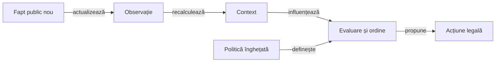

# Reguli, YAML-uri și ponderi dependente de context

O regulă definește condiția, acțiunea și limitele ei. O pondere are sens numai împreună cu caracteristica măsurată, unitatea, consumatorul din cod și criteriul după care este calificată.

## Tipuri de configurare

| Tip | Contract | Efect |
|---|---|---|
| Reguli obligatorii | Pachet, licitații permise, culoare, atu și scor | Filtrează acțiuni și calculează rezultate în motor. |
| Manifest legat de cod | Condiții, priorități, surse și teste | Documentează și verifică implementarea declarată. |
| Parametru de estimator | Buget, mix de continuare sau prag de departajare | Influențează calculul numai prin consumatorul implementat. |
| Catalog de tipare | Clase de combinații, indicii și statut | Cercetare; influența în aplicație cere consumator implementat și promovare separată. |
| Model învățat | Caracteristici, coeficienți, dispersie și identitate | Produce estimări numai prin consumatorul implementat și domeniul calificat. |
| Date de experiment | Partide, selecții concrete și rezultate | Intrări externe pentru dezvoltare și evaluare. |

## Cine consumă manifestele



<details>
<summary>Legendă: declarație și execuție</summary>

Manifestele AI curente nu formează un interpretor general de reguli YAML. Fiecare efect executabil are o cale de consum explicită și un statut de activare; editarea unui text declarativ nu modifică de la sine politica aplicației.

</details>

| Manifest | Rol |
|---|---|
| [Obiective Normal/Hard](../../config/whist-play-objectives.yaml) | Priorități active, condiții de schimbare a obiectivului și profiluri experimentale. |
| [Reguli contextuale](../../config/whist-contextual-discard.yaml) | Necesare, oportunități, discard, informație publică și legături către componente. |
| [Catalog de tipare](../../config/whist-hand-patterns.yaml) | Clase de combinații și indicii neaditive, fără influență runtime directă. |
| [Salvare certificată](../../config/whist-contract-salvage.yaml) | Domeniu, limite universale și fallback-ul gărzii active. |
| [Presiune contextuală](../../config/whist-contract-pressure.yaml) | Model de continuare experimental, separat de politica acceptată. |
| [Inferență din licitații](../../config/whist-public-beliefs.yaml) | Model experimental de comportament observat și contractul generării sale. |
| [Licitații viitoare](../../config/whist-future-bid-forecast.yaml) | Experiment de propagare a prefixului ipotetic al licitației. |
| [Legalitatea situațiilor](../../config/whist-legal-evidence.yaml) | Contractul martorului legal și al observației disponibile testului. |

## Cum se schimbă influența unei reguli

Tabelul separă mecanisme posibile; nu afirmă că fiecare este activ în toate domeniile. [Modelul deciziei](ATF_DecisionModel.md#estimarea-alternativelor) precizează că modelul condiționat de o carte este activ, iar ponderarea generală a distribuirilor pentru 2–8 cărți rămâne experimentală.

| Mecanism | Ce se schimbă în joc | Ce rămâne fix în politica înghețată |
|---|---|---|
| Activare condițională | Condiția poate deveni adevărată sau falsă după o carte. | Regula și ordinea priorităților. |
| Caracteristică contextuală | Necesar, oportunități, ranguri public eliminate, lipsuri și prefix. | Definiția și normalizarea caracteristicii. |
| Poartă de obiectiv | Contract recuperabil sau imposibil public. | Criteriul care dovedește schimbarea stării. |
| Ponderare de model | Plauzibilitatea lumilor se recalculează din observație. | Coeficienții și mecanismul de regularizare. |
| Învățare offline | Un candidat poate schimba parametri sau implementare. | Politica acceptată până la o promovare explicită. |

## Modelul formal al influenței

„Pondere” poate numi mecanisme diferite. Identificați mai întâi ce se cântărește și cine consumă valoarea; mărirea unui număr nu are aceeași semnificație în toate modelele.

| Tip de influență | Unitate și efect | Stadiu în implementare |
|---|---|---|
| Prioritate de obiectiv | Ordinea dintre exact, puncte și efectul asupra rivalilor. | [DecisionOrdering](../../whist-lab-app/game-core/src/main/java/ro/whistlab/core/ai/engine/DecisionOrdering.java) ordonează criterii, fără o sumă arbitrară de scoruri. |
| Amestec de continuări | Proporția dintre două estimări ale aceleiași utilități. | [DecisionEvaluation](../../whist-lab-app/game-core/src/main/java/ro/whistlab/core/ai/engine/DecisionEvaluation.java) combină rollout și căutare în domeniul mic eligibil. |
| Plauzibilitatea lumii | Influența unei distribuții ipotetice în agregare. | Domeniul specializat de o carte este activ; modelul general de 2–8 cărți rămâne experimental. |
| Coeficient învățat | Contribuția unei caracteristici normalizate la predicție. | Ajustare offline și generare de sursă pentru candidați identificați. |
| Indiciu despre onoruri | Descrierea potențialului unei combinații în context. | Catalog de cercetare, neaditiv și fără influență runtime directă. |

### Parametru fix, context care evoluează



<details>
<summary>Legendă: adaptarea deciziei păstrează identitatea politicii</summary>

Necesarul, cărțile publice și oportunitățile se schimbă după acțiuni; parametrul și regula rămân cele ale implementării identificate. Poarta de fezabilitate poate schimba obiectivul prioritar, fără reantrenarea coeficienților în timpul mâinii.

</details>

<details>
<summary>Forma aditivă și corecția experimentală de presiune</summary>

```text
scor_contextual(acțiune, stare) =
  suma_j θ_j × φ_j(acțiune, stare)

θ_j = parametru al unei politici identificate
φ_j = caracteristică definită și normalizată din informația permisă
```

Această formă descrie un model aditiv numai acolo unde codul îl implementează. Prioritățile lexicografice și filtrele de legalitate au alte semantici, iar indiciile care se suprapun nu se însumează automat.

Definițiile necesarului, oportunităților și dezechilibrului sunt în [modelul deciziei](ATF_DecisionModel.md#starea-care-schimbă-decizia). Modelul experimental de [presiune](../../whist-lab-app/game-core/src/test/java/ro/whistlab/core/research/bidding/ContractPressure.java) ajustează densitatea prin dezechilibru, progres și oportunități. El are ramuri distincte pentru necesar zero, rezervă suficientă și necesitatea tuturor levatelor, cu ponderi fixe asupra unor caracteristici care evoluează.

```text
ρ = clamp(necesar / oportunități, 0, 1)
progres = 1 − oportunități / mărimea_inițială
ρ_contextual = clamp(ρ + β × (1 + progres) × Δ / oportunități, 0, 1)
```

Corecția contextuală se aplică doar în ramura eligibilă a modelului experimental. Formula nu este activă implicit în rollout-ul Hard acceptat, iar dezechilibrul semnat Δ rămâne constant în timpul unei mâini.

</details>

### Cum ajustăm un model offline

[Constructorul modelului de ofertă](../../whist-lab-app/ai-lab/tools/bidding/whist-bid-evidence.mjs) extrage mâna actorului și prefixul existent la licitare din partide development validate. Grupează observațiile după seed pentru ponderare și separarea ajustării de validarea predictivă; eticheta este oferta observată, fără afirmația că ar fi fost optimă.

[Generatorul de sursă](../../whist-lab-app/ai-lab/tools/bidding/whist-bid-evidence-codegen.mjs) verifică vocabularul, formele numerice și criteriul predictiv, apoi păstrează hash-ul modelului în implementarea generată. Acest control califică generarea; [procedura de evoluție](../learning/ATF_PolicyEvolution.md#când-promovăm) cere separat componentele și progresul strategic pe lot nou înaintea activării.

## Inferența comportamentului

Această secțiune descrie modelul general de cercetare pentru 2–8 cărți. Modelul runtime specializat de o carte și fallback-ul său sunt documentate în [modelul deciziei](ATF_DecisionModel.md#estimarea-alternativelor); controlul automat al coerenței manifestului cu acel domeniu rămâne [criteriu deschis](../feedback/ATF_Ai.md#coordonarea-evaluării-și-delimitarea-mecanismelor).

[Modelul experimental de licitații](../../whist-lab-app/ai-lab/experiments/bid-models/shared/game-core/src/main/java/ro/whistlab/core/LearnedBidEvidence.java) folosește coeficienți fixați și caracteristici ale mâinii ipotetice originale și prefixului disponibil atunci. Cărțile rămase și cele jucate de același loc se reunesc fără dublarea mesei curente.

<details>
<summary>Plauzibilitate, regularizare și mărimea efectivă a eșantionului</summary>

```text
μ = clamp(scală × θ · φ(mână_inițială, prefix), 0, mărime)
p(licitare legală) =
  masă_uniformă / număr_licitații_legale
  + masă_model × distribuție_normalizată(licitare, μ, dispersie)

pondere_lume =
  limitare(produsul rapoartelor de plauzibilitate ale licitațiilor observate)

eșantion_efectiv = suma_ponderilor² / suma_pătratelor_ponderilor
```

- Regula ultimei licitații elimină numai valoarea interzisă legal.
- Masa uniformă păstrează suport pentru comportamente neobișnuite, inclusiv contracte mici cu cărți mari.
- Concentrarea excesivă sau ponderile constante păstrează estimarea de bază prin fallback.
- O licitație proprie ipotetică este țintă de simulare și nu este folosită retrospectiv drept dovadă despre un adversar.
- Modelul prezice comportament observat, fără etichetarea lui ca optim sau posterior comun calibrat.

</details>

## Licitațiile viitoare în simulare

Licitațiile deja depuse rămân fapte publice, iar contractul propriu evaluat este ținta ipotetică a acelei alternative. Estimarea următorilor actori folosește ordinea licitării și prefixul disponibil în continuarea simulată.

- Politica acceptată folosește estimatorul din `MonteCarloAi.biddingTargets` pentru contractele încă necunoscute.
- [Modelul condiționat experimental](../../whist-lab-app/ai-lab/experiments/bid-models/r16-bid-forecast/game-core/src/main/java/ro/whistlab/core/BidForecast.java) actualizează prefixul după fiecare predicție și respectă restricția ultimului ofertant.
- Alegerea modului unei distribuții produce o singură continuare a licitației; integrarea tuturor licitațiilor viitoare este un mecanism diferit.
- O predicție este context de simulare și nu devine observație reală sau dovadă despre cărțile adverse.

## Contractul unei reguli întreținute

| Câmp | Responsabilitate |
|---|---|
| Identitate și statut | Regulă stabilă, activă sau de cercetare. |
| Domeniu și precondiții | Variantă, observație permisă și condiție de aplicare. |
| Semnificație | Filtru, prioritate, scor, estimator sau certificat. |
| Parametri | Unități, intervale, normalizare și sursa valorii. |
| Limite și fallback | Comportament în afara domeniului, fără date sau la buget epuizat. |
| Cod și verificare | Consumator explicit, componentă independentă și criteriu de promovare. |

[Modelul deciziei](ATF_DecisionModel.md) · [Protocolul de îmbunătățire](../learning/README.md)
