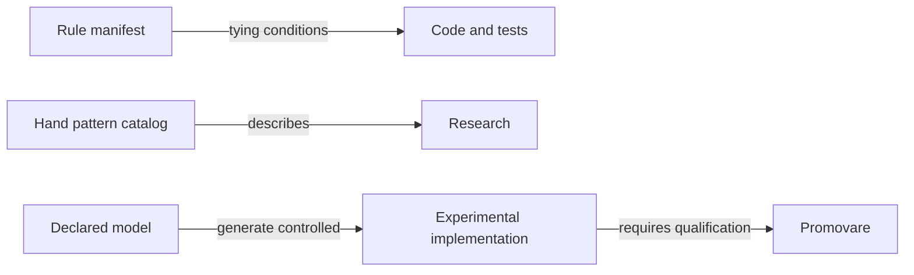
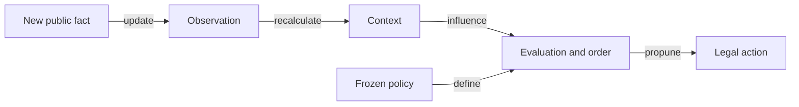

# Rules, YAMLs and context-dependent weightings

## Overview

A rule defines its condition, action and limits. A weighting shall only make sense in conjunction with the measured characteristic, the unit, the consumer in the code and the criterion by which it is qualified.

## Types of configuration

| Tip | Contract | Efect |
|---|---|---|
| Mandatory rules | Package, allowed bids, color, trump and score | Filter actions and calculate results in the engine. |
| Code Manifesto | Conditions, priorities, sources and tests | Documenting and verifying the declared implementation. |
| Estimator parameter | Budget, follow-on mix or cut-off threshold | It only influences the calculation through the implemented consumer. |
| Typing catalogue | Classes of combinations, indices and status | Research; influence in the application requires implemented consumer and separate promotion. |
| Model learned | Features, coefficients, dispersion and identity | It produces estimates only through the implemented consumer and the qualified field. |
| Experimental data | Parties, concrete selections and results | External inputs for development and evaluation. |

## Who consumes the manifests



<details>
<summary>Legend: declaration and execution</summary>

Current AI manifests do not form a general YAML rule interpreter. Each executable effect has an explicit consumption path and activation status; editing a declarative text does not change the application policy on its own.

</details>

| Manifest | Rol |
|---|---|
| [Obiective Normal/Hard](../../config/whist-play-objectives.yaml) | Active priorities, objective change conditions and experimental profiles. |
| [Background rules](../../config/whist-contextual-discard.yaml) | Necessary, opportunities, discord, public information and links to components. |
| [Typing catalogue](../../config/whist-hand-patterns.yaml) | Classes of combinations and non-additive indices, without direct runtime influence. |
| [Certified rescue](../../config/whist-contract-salvage.yaml) | Domain, universal limits and active guard fallback. |
| [Contextual pressure](../../config/whist-contract-pressure.yaml) | Model experimental follow-up, separate from accepted policy. |
| [Bidding](../../config/whist-public-beliefs.yaml) | Experimental pattern of observed behavior and the contract of its generation. |
| [Future bids](../../config/whist-future-bid-forecast.yaml) | Experiment to propagate the hypothetical prefix of the bid. |
| [Legal status of situations](../../config/whist-legal-evidence.yaml) | The test shall be performed on the test chemical. |

## How does a rule change influence?

The table separates possible mechanisms; it does not say that each is active in all areas. [Modelul deciziei](ATF_DecisionModel.md#estimate-of-alternatives) states that the model conditioned by a card is active and the general weighting of distributions for 2–8 cards remains experimental.

| Mechanism | What changes in the game | What remains fixed in the frozen policy |
|---|---|---|
| Conditional activation | The condition can be true or false by a card. | Rule and order of priorities. |
| Contextual characteristic | Necessary, opportunities, public ranks eliminated, gaps and prefix. | Definition and normalization of the characteristic. |
| Target gate | Contract recoverable or publicly impossible. | The criterion that proves the change of status. |
| Model weighting | The Plausibility of the Worlds is recalculated from observation. | Coefficients and the settlement mechanism. |
| Offline learning | A candidate may change parameters or implement. | Policy accepted until an explicit promotion. |

## Formal model of influence

"Weight" may call different mechanisms. Identify first what is weighed and who consumes value; increasing a number does not have the same meaning in all models.

| Type of influence | Unit and effect | Stage in implementation |
|---|---|---|
| Priority objective | The order between exact points and effect on rivals. | [DecisionOrdering](../../whist-lab-app/game-core/src/main/java/ro/whistlab/core/ai/engine/DecisionOrdering.java) orders criteria without an arbitrary amount of scores. |
| Conversion | The proportion of two estimates of the same utility. | [DecisionEvaluation](../../whist-lab-app/game-core/src/main/java/ro/whistlab/core/ai/engine/DecisionEvaluation.java) combines rollout and search in the small eligible domain. |
| Plauzibilitatea lumii | The influence of a hypothetical distribution in aggregation. | The specialized domain of a card is active; the general model of 2–8 cards remains experimental. |
| Liabilities to other financial institutions | Contribution of a normalized feature to prediction. | Offline adjustment and source generation for identified candidates. |
| Hint of honors | Description of the potential of a combination in context. | Research catalogue, non-additive and without direct runtime influence. |

### Fixed parameter, evolving context



<details>
<summary>Legend: Adaptation of the decision retains the identity of policy</summary>

The need, public cards and opportunities change after action; the parameter and rule remain those of the identified implementation. The feasibility gate can change the priority objective without retraining coefficients during hand.

</details>

<details>
<summary>Additive form and experimental pressure correction</summary>

```text
scor_contextual(acțiune, stare) =
  suma_j θ_j × φ_j(acțiune, stare)

θ_j = parametru al unei politici identificate
φ_j = caracteristică definită și normalizată din informația permisă
```

This form describes an additive model only where the code implements it. Lexicographic priorities and legal filters have other semantics, and overlapping clues do not automatically add up.

The definitions of necessity, opportunities and imbalance are in [modelul deciziei](ATF_DecisionModel.md#state-that-influences-the-decision). Experimental model [presiune](../../whist-lab-app/game-core/src/test/java/ro/whistlab/core/research/bidding/ContractPressure.java) It has distinct branches for zero need, sufficient reserve and the need for all levatates, with fixed weights on evolving features.

```text
ρ = clamp(necesar / oportunități, 0, 1)
progres = 1 − oportunități / mărimea_inițială
ρ_contextual = clamp(ρ + β × (1 + progres) × Δ / oportunități, 0, 1)
```

The contextual correction shall apply only in the eligible branch of the experimental model. The formula is not by default active in the accepted Hard Rollout, and the signed imbalance is constant during a hand.

</details>

### How to adjust an offline model

[The manufacturer of the tender model](../../whist-lab-app/ai-lab/tools/bidding/whist-bid-evidence.mjs) draws the actor's hand and the existing prefix at bidding from validated development games. It groups the post-seed observations for weighting and separation of the adjustment from predictive validation; the label is the offer observed without claiming that it would have been optimal.

[Source generator](../../whist-lab-app/ai-lab/tools/bidding/whist-bid-evidence-codegen.mjs) checks vocabulary, numerical forms and predictive criteria, then keeps the model hash in the generated implementation. This control qualifies generation; [procedure for evolution](../learning/ATF_PolicyEvolution.md#when-we-promote) requires separately components and strategic progress on the new batch prior to activation.

## Behavior inference

This section describes the general research model for 2–8 The runtime model specialized in a card and its fallback are documented in [modelul deciziei](ATF_DecisionModel.md#estimate-of-alternatives); automatic control of the consistency of the manifest with that domain remains [criteriu deschis](../feedback/ATF_Ai.md#coordination-of-evaluation-and-delimitation-of-mechanisms).

[Experimental tender model](../../whist-lab-app/ai-lab/experiments/bid-models/shared/game-core/src/main/java/ro/whistlab/core/LearnedBidEvidence.java) uses fixed coefficients and features of the original hypothetical hand and prefix available then. The remaining and the cards played by the same place meet without doubling the current table.

<details>
<summary>Plausibility, regularisation and actual sample size</summary>

```text
μ = clamp(scală × θ · φ(mână_inițială, prefix), 0, mărime)
p(licitare legală) =
  masă_uniformă / număr_licitații_legale
  + masă_model × distribuție_normalizată(licitare, μ, dispersie)

pondere_lume =
  limitare(produsul rapoartelor de plauzibilitate ale licitațiilor observate)

eșantion_efectiv = suma_ponderilor² / suma_pătratelor_ponderilor
```

- The rule of the last bid only eliminates the legally prohibited value.
- The uniform table keeps support for unusual behaviors, including small contracts with large cards.
- Excessive concentration or constant weights keep the base estimate by fallback.
- A hypothetical own bid is the target of simulation and is not used retrospectively as evidence of an opponent.
- The pattern predicts observed behavior without its labelling as optimally or posterior-calibrated joint.

</details>

## Future bids in simulation

Bidding already submitted remains public facts and the contract itself assessed is the hypothetical target of that alternative. The estimation of the following actors shall use the order of bidding and the prefix available in the simulated continuation.

- The accepted policy uses the `MonteCarloAi.biddingTargets` estimate for contracts still unknown.
- [Experimental conditioning model](../../whist-lab-app/ai-lab/experiments/bid-models/r16-bid-forecast/game-core/src/main/java/ro/whistlab/core/BidForecast.java) updates the prefix after each prediction and complies with the restriction of the last bidder.
- The choice of how a distribution is made produces a single continuation of the bid; the integration of all future bids is a different mechanism.
- A prediction is a simulation context and does not become real observation or evidence of adverse cards.

## Contract of a maintained rule

| Field | Responsibility |
|---|---|
| Identity and status | Stable, active or research rule. |
| Scope and preconditions | Variant, allowed observation and condition of application. |
| Meaning | Filter, priority, score, estimate or certificate. |
| Parametri | Units, intervals, normalisation and value source. |
| Limits and fallback | Behaviour outside the domain, no data or budget exhausted. |
| Code and verification | Explicit consumer, independent component and promotion criterion. |

[Modelul deciziei](ATF_DecisionModel.md) · [Improving protocol](../learning/README.md)
