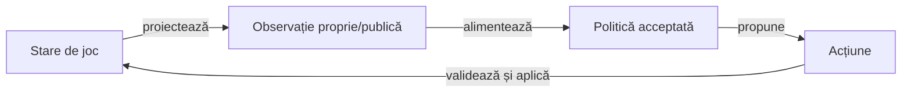
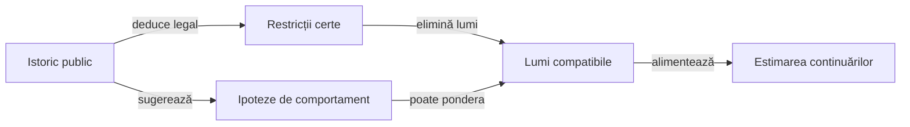

# Arhitectura jucătorilor AI

## Pe scurt

Politica transformă mâna proprie și informația publică într-o decizie legală, potrivită contractului rămas. Algoritmul și parametrii unei politici sunt identificați; îmbunătățirea lor urmează separat [ciclul de calificare offline](../learning/README.md).

## Ghiduri complementare

| Mecanism | Ghid |
|---|---|
| Observație, simulare, utilitate și certificate | [Modelul deciziei](ATF_DecisionModel.md) |
| Rolul manifestelor și influența contextului | [Reguli și configurare](ATF_RulesConfiguration.md) |
| Necesar, oportunități și ieșiri legale | [Joc contextual](ATF_ContextualPlay.md) |
| Bugete, anulare și măsurare pe mediul JVM | [Calificarea costului AI](ATF_CostQualification.md) |
| Onoruri și acoperiri, cu statut de cercetare | [Română](ATF_HandPatternsRo.md) și [engleză](ATF_HandPatternsEn.md) |

## Decizia din timpul jocului

Legendă: decizia din timpul jocului

Observația conține mâna actorului, contractele cunoscute, cărțile publice, necesarul și scorurile. Motorul verifică legalitatea acțiunii înainte de schimbarea stării; mâinile reale ale adversarilor nu intră în politica de decizie.

## Straturi și surse de adevăr

| Strat | Responsabilitate | Implementare |
|---|---|---|
| Domeniu | Legalitate, distribuire, tranziții și scor | [game-core](../../whist-lab-app/game-core/README.md) |
| Politică runtime | Licitare și alegerea cărții din observația permisă | `AiPolicy`, politicile Normal și `MonteCarloAi` |
| Politică independentă | Model separat pentru verificare și comparații | [ai-lab](../../whist-lab-app/ai-lab/README.md) |
| Corpus | Validarea jocurilor și selecția explicită a datelor de dezvoltare | [whist-corpus](../../whist-lab-app/ai-lab/tools/corpus/whist-corpus.mjs), [whist-active-corpus](../../whist-lab-app/ai-lab/tools/corpus/whist-active-corpus.mjs) |
| Tipare | Descrierea combinațiilor și calibrare descriptivă | [catalog și limite](ATF_HandPatternsRo.md) |
| Experiment | Copie izolată, candidat identificat, comparații pereche | [runnerul colecțiilor](../../scripts/run-whist-collection.ps1), [arena](../learning/ATF_Arena.md) |
| Promovare | Criterii fixate, lot neatins și păstrarea gărzilor de domeniu | [protocolul evaluării](../learning/README.md) |

## Rolul YAML-urilor

Manifestele leagă condiții și surse de verificare, iar efectul executabil depinde de consumatorul din cod. [Reguli și configurare](ATF_RulesConfiguration.md) este ghidul responsabil pentru statutul fiecărui manifest, parametrii fixați și activarea contextuală.

Catalogul de tipare rămâne un instrument de cercetare. [Ghidul onorurilor](ATF_HandPatternsRo.md) explică interpretarea lui, separat de politica runtime.

## Datele susțin mecanismul

- Schema, validatoarele, selecția și criteriile aparțin surselor proiectului.
- Partidele, calibrările, selecțiile concrete, registrele loturilor și rezultatele sunt date externe.
- [Configurația corpusului](../../config/learning-corpus.json) indică arhiva și pointerul activ; analiza corpusului activ citește manifestul selectat și verificat. [Calibrarea onorurilor](ATF_HandPatternsRo.md#calibrare-descriptivă) are intrare separată: toate fișierele development din arhiva furnizată explicit.
- Selecția elimină urmele duplicate, păstrează originile protejate și urmărește categorii noi în limita bugetului.
- O categorie observată măsoară varietatea setului, fără să demonstreze acoperirea codului sau optimalitatea unei acțiuni.
- Regresia implicită păstrează cazuri mici generate sau construite pentru o proprietate generală, cu așteptare independentă.

## Interpretarea adversarilor

Legendă: certitudine și estimare

Obligația de culoare sau atu permite deducții despre lipsa unei culori. Licitația și o alegere voluntară sugerează intenții numai printr-un model declarat; o carte jucată forțat nu dovedește intenția de a câștiga sau de a evita levata.

La 2–8 cărți, Hard folosește contractele cunoscute ca ținte și constrânge lumile prin informația publică; ponderarea generală după comportamentul advers rămâne cercetare. La licitarea de o carte există deja un model specializat condiționat de ofertele observate, cu domeniu și fallback proprii, descris în [modelul deciziei](ATF_DecisionModel.md#estimarea-alternativelor).

## Condiții pentru progres

[Protocolul offline](../learning/README.md) deține ciclul diagnostic–componentă–candidat–evaluare rezervată–promovare. [Arena](../learning/ATF_Arena.md) deține comparațiile pe aceleași distribuții și locuri, iar [proiectarea componentelor](../testing/ATF_AiComponents.md) deține justificarea independentă a cazului mic.

Schimbarea arhitecturii păstrează observația permisă și identitatea politicii evaluate. O modificare concurentă cere reconcilierea sursei înaintea calificării.

## Limite de transfer către alte sisteme

| Abstracție reutilizabilă | Adaptor specific domeniului |
|---|---|
| Proiecția observației | Ce informație este permisă fiecărui actor. |
| Filtrul de acțiuni | Legalitatea definită de varianta jocului. |
| Reducerea istoricului | Faptele și restricțiile deduse din acțiunile publice. |
| Generatorul de lumi | Distribuțiile compatibile cu observația și ipotezele samplerului. |
| Utilitatea și prioritățile | Contractul, scorul, seria și obiectivul politicii. |
| Verificarea și promovarea | Proprietăți independente, comparații controlate și criterii fixate. |

[Modelul deciziei](ATF_DecisionModel.md), [regulile și ponderile](ATF_RulesConfiguration.md) și [proiectarea testelor](../testing/ATF_AiComponents.md) detaliază aceste limite fără a depinde de o partidă concretă.
