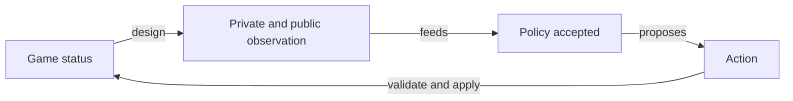
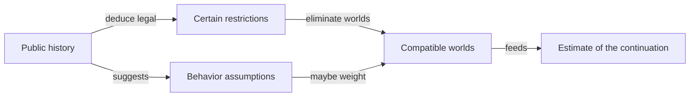

# AI Player Architecture

## Overview

Policy turns its own hand and public information into a legal decision, appropriate to the remaining contract. The algorithm and parameters of a policy are identified; their improvement follows separately [offline qualification cycle](../learning/README.md).

For the full route, start with [how we build and improve the Ail](../learning/ATF_PolicyEvolution.md). The game is updated in context and estimates; changes in rules, weights and implementation are qualified between experiments.

## Complementary guides

| Mechanism | Guide |
|---|---|
| Observation, simulation, utility and certificates | [Decision model](ATF_DecisionModel.md) |
| Role of the manifestations and influence of the context | [Rules and configuration](ATF_RulesConfiguration.md) |
| Necessary, opportunities and legal outflows | [Context game](ATF_ContextualPlay.md) |
| Budget, cancellation and measurement on JVM environment | [Cost of AI qualification](ATF_CostQualification.md) |
| Rates and coatings with research status | [Romanian](https://github.com/crististefanita/whist/blob/main_RO/docs/ai/ATF_HandPatternsRo.md) and [English](ATF_HandPatternsEn.md) |

## Decision during the game

Legend: the decision during the game

The observation contains the actor's hand, known contracts, public cards, needs and scores. The engine verifies the legality of the action before changing the condition; the actual hands of the opponents are not covered by the decision-making policy.

## Layer and source of truth

| Layer | Responsibility | Implementation |
|---|---|---|
| Scope | Legality, distribution, transitions and score | [game-core](../../whist-lab-app/game-core/README.md) |
| Runtime policy | Bidding and choosing the card in the permitted observation | `AiPolicy`, Normal and `MonteCarloAi` policies |
| Independent policy | Distinguishing number of the country where the goods are located | [ai-lab](../../whist-lab-app/ai-lab/README.md) |
| Corpus | Game validation and explicit selection of development data | [whist-corpus](../../whist-lab-app/ai-lab/tools/corpus/whist-corpus.mjs), [whist-active-corpus](../../whist-lab-app/ai-lab/tools/corpus/whist-active-corpus.mjs) |
| Patterns | Description of combinations and descriptive calibration | [catalogue and limits](https://github.com/crististefanita/whist/blob/main_RO/docs/ai/ATF_HandPatternsRo.md) |
| Experiment | Isolated copy, identified candidate and paired comparisons | [collection runner](../../scripts/run-whist-collection.ps1), [arena](../learning/ATF_Arena.md) |
| Promotion | Criteria fixed, batch not reached and keeping the guards of the domain | [evaluation protocol](../learning/README.md) |

## The role of YAML

The manifests link conditions and sources of verification, and the enforceable effect depends on the consumer in the code. [Rules and configuration](ATF_RulesConfiguration.md) is the guide responsible for the status of each manifest, fixed parameters and contextual activation.

The pattern catalogue remains a research tool. [Honor guide](https://github.com/crististefanita/whist/blob/main_RO/docs/ai/ATF_HandPatternsRo.md) explains his interpretation, separate from runtime policy.

## Data support mechanism

- The scheme, validators, selection and criteria belong to the project's sources.
- Parties, calibrations, concrete selections, lots registers and results are external data.
- [Body configuration](../../config/learning-corpus.json) indicates the archive and active pointerus; the analysis of the active body reads the selected and verified manifest. [Calibration of the fees](https://github.com/crististefanita/whist/blob/main_RO/docs/ai/ATF_HandPatternsRo.md) has separate input: all development files in the archive provided explicitly.
- The selection eliminates duplicate traces, keeps the origins protected and follows new categories within the budget limit.
- An observed category measures the variety of the set without demonstrating the coverage of the code or the optimal of an action.
- Default regression keeps small cases generated or built for general property with independent waiting.

## Interpretation of opponents

Legend: certainty and estimation

The color obligation or the trump allows inference about the lack of a colour. The bid and a voluntary choice suggest intentions only by a declared model; a forced card does not prove the intention to win or avoid trick.

La 2–8 cards, Hard uses contracts known as targets and constrains worlds through public information; general weighting after adverse behavior remains research. At the bid of a card there is already a specialized model conditioned by observed offers, with its own domain and fallback, described in [decision model](ATF_DecisionModel.md#estimate-of-alternatives).

## Conditions for progress

[Protocol offline](../learning/README.md) holds the diagnostic-component-candidate-registered evaluation-promotion cycle. [Arena](../learning/ATF_Arena.md) holds comparisons on the same distributions and places, and [design of components](../testing/ATF_AiComponents.md) holds the independent justification of the small case.

The change of architecture shall retain the permitted observation and the identity of the policy evaluated. A competing change requires reconciliation of the source prior to the qualification.

## Transfer limits to other systems

| Reusable abstraction | Domain specific adapter |
|---|---|
| Projection of the observation | What information is allowed to each actor. |
| The share filter | Legality defined by the game option. |
| Reduction of history | Facts and restrictions deducted from public actions. |
| The Generator of Worlds | Distributions compatible with the observation and assumptions of the sampler. |
| Utility and priorities | The contract, the score, the series and the policy objective. |
| Verification and promotion | Independent properties, controlled comparisons and criteria. |

[Decision model](ATF_DecisionModel.md), [rules and weights](ATF_RulesConfiguration.md) and [test design](../testing/ATF_AiComponents.md) details these limits without depending on a concrete match.
