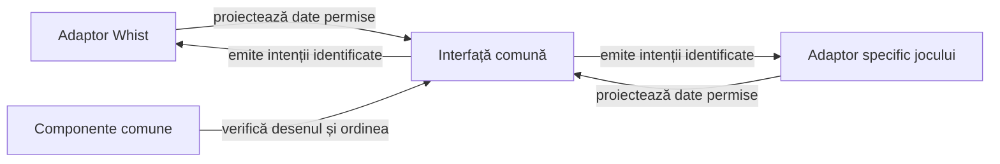

# Refactorizarea interfeței comune pentru jocuri de cărți

## Pe scurt

**P1 · nucleu extras și integrat în Whist.** [Nucleul atf-card-table-ui](../../whist-lab-app/atf-card-table-ui/README.md) deține meniul de pornire, dialogul numelui, widgeturile, tema Android, chenarele, geometria mesei, mâna și depunerile publice. Finisarea scorului și calificarea nativă rămân distincte. Interfața și testele Whist se păstrează.

## Diagnosticul sursei live

Nucleul extras este independent de motoare și ATF. Compoziția mesei, configurarea jocului și proiecția scorului păstrează încă tipurile Whist; acestea delimitează continuarea extragerii.

| Zonă | Sursă și cuplaj | Consecință pentru extragere |
|---|---|---|
| Meniu și configurare | [MenuScreens](../../whist-lab-app/app/src/main/java/ro/whistlab/app/screens/MenuScreens.java) integrează meniul comun, iar [SetupScreen](../../whist-lab-app/app/src/main/java/ro/whistlab/app/screens/SetupScreen.java) construiește `GameConfig`. | Verificați nativ focusul, ordinea, textele și navigarea. Configurația și validarea opțiunilor rămân în adaptorul Whist. |
| Nume | [Dialogul comun](../../whist-lab-app/atf-card-table-ui/src/main/java/ro/cardtable/ui/profile/PlayerNameDialog.java) limitează lungimea în unități UTF-16. [Politica Whist](../../whist-lab-app/card-table-names/src/main/java/ro/cardtable/names/PlayerNames.java) numără puncte de cod. | Reconciliați limita la introducere și la lipire. Proba acceptă zece litere din afara planului multilingv de bază, respinge a unsprezecea și verifică perechile surrogate la frontieră. |
| Masă și mână | [GameTablePanel](../../whist-lab-app/app/src/main/java/ro/whistlab/app/table/GameTablePanel.java) păstrează `GameSession.Snapshot`, `Card` și `PlayedCard`; [GameScreen](../../whist-lab-app/app/src/main/java/ro/whistlab/app/screens/GameScreen.java) calculează legalitatea prin `GameRules`. | Proiecție tipizată, imuabilă și limitată la informația permisă; legalitatea și comanda se decid în adaptor, înainte și după intenția UI. Mutarea fișierelor cu aceleași importuri nu închide criteriul. |
| Geometrie | Tema, desenul și geometria măsurată sunt implementate în [bibliotecă](../../whist-lab-app/atf-card-table-ui/README.md). | Comparați nativ rotunjirile, ancorele și lizibilitatea pe același profil, înainte și după schimbare. |
| Scor | [ScoreHistoryColumn](../../whist-lab-app/app/src/main/java/ro/whistlab/app/score/ScoreHistoryColumn.java) proiectează licitatul, rezultatul contractului și totalul Whist. | Extrageți măsurarea, grila, cadrul dialogului și derularea; proiecția și marcajele de serie rămân Whist. Semantica valorilor aparține adaptorului jocului. |
| Mișcare | [Colectarea levatei](../../whist-lab-app/atf-card-table-ui/src/main/java/ro/cardtable/ui/animation/TrickCollectionRun.java) are deja un coordonator comun. | Calificați nativ scena Whist la refacere, anulare și ultima levată. [Criteriile Android](ATF_Android.md#calificarea-modificărilor-vizuale) |

Nu este justificată extragerea întregii activități sau a motorului într-un modul numit generic. Biblioteca grafică nu primește seed, mâini adverse, `GameSession`, motor AI sau acces direct la salvările consumatorului.

## Contractul bibliotecii și extinderile rămase

Modulul Android Library `atf-card-table-ui` este produs în proiectul Whist și publică un AAR/POM versionat. Implementarea curentă și porturile sunt descrise în README-ul modulului; tabelul următor delimitează și extensiile încă propuse pentru masa completă.

[Ghidul Android Library](https://developer.android.com/studio/projects/android-library) justifică AAR pentru clase, resurse și manifest reutilizabile între aplicații. [Separarea stării UI](https://developer.android.com/topic/architecture/ui-layer/stateholders) susține proiecțiile și evenimentele delimitate; propunerea locală păstrează Views și nu cere rescrierea interfeței în alt toolkit.

Legendă: reutilizare vizuală și responsabilitate de domeniu

Diagrama descrie relația dintre adaptoare și biblioteca comună; meniul, profilul, chenarele, mâna și depunerile sunt extrase, iar compoziția modului de joc păstrează integrarea locală. Fiecare adaptor validează intenția în propriul motor și publică starea rezultată o singură dată.

| Suprafață API | Limită necesară |
|---|---|
| Meniu și profil | Texte, limbă, capabilități, starea reluării, valoarea numelui și porturi de salvare/validare. Fără `HowToPlay.Language`, chei globale de preferințe sau reguli de clasament în bibliotecă. |
| Masă și cărți | Identități stabile de loc și carte, stare activă, valori publice, carte legală și intenție de selecție. Fără reordonare după nume ori tură și fără tipuri din `ro.whistlab.core`. |
| Regiunea centrală | Compoziție extensibilă pentru conținutul activ al jocului. Interfața nu inventează licitație, atu sau alte date de domeniu. |
| Scor | Rânduri, grupuri și coloane cu semnificație furnizată de consumator, valori exacte și etichete accesibile. Calculul punctelor și migrarea istoricului rămân în joc. |
| Viewport și evenimente | Spațiu util, densitate, font, insets, ceas și porturi de programare injectabile. Starea tactilă nu mută chenarele și nu schimbă motorul. |

Modelați numai variațiile demonstrate de cele două jocuri. Evitați un constructor cu zeci de flag-uri, dependențele de activitățile consumatorilor și un serviciu comun care preia implicit persistența sau execuția AI.

## Priorități și condiții de închidere

Contractele pentru nume, animația levatei și rândurile din chenar sunt în ghidurile modulelor responsabile. Aici rămân integrarea consumatorilor și calificarea nativă. [Nume la masă](../../whist-lab-app/card-table-names/README.md) · [Biblioteca UI](../../whist-lab-app/atf-card-table-ui/README.md)

Rezultatele unei calificări aparțin dosarului release care identifică sursa și selecțiile executate; acest registru păstrează contractele și lacunele, nu copii de rapoarte istorice.

**Criterii pentru starea restaurată.** După restaurarea unui checkpoint, colectarea ultimei levate trebuie să aibă efect o singură dată, iar scorul să rămână identic. Temporizatorul pornește la primul cadru vizibil și își păstrează timpul rămas la refacerea mesei. Numele și statisticile rămân lizibile la font mărit.

| ID și stare | Lucrare chirurgicală | Acceptanță |
|---|---|---|
| **UIX01 · PARȚIAL** | Fixați reperul Whist înaintea mutării. | Surse, configurație și probe identificate; aceleași intrări, nume, seed și profil înainte/după. Interfața live și ultimul APK calificat sunt reconciliate, fără a atribui unui release schimbări ulterioare. |
| **UIX02 · PARȚIAL** | Calificați nativ geometria, tema și desenul comun. | Aceleași ancore și aceeași randare Whist la aceiași parametri. [Contractul bibliotecii](../../whist-lab-app/atf-card-table-ui/README.md) |
| **UIX03 · PARȚIAL** | Calificați integrarea meniului, profilului și localizării. | Aceleași controale, ordini, texte, tag-uri, identificatori accesibili, focus și callback-uri Whist. Reconciliați limita Unicode și verificați salvarea și resetarea numelui. |
| **UIX04 · PARȚIAL** | Calificați nativ proiecțiile comune ale mesei și mâinii. | Poziții, raportul cărții, indici, ridicare și z-order păstrate la 3–6 locuri. Verificați legalitatea și aplicarea unică în integrarea Whist. |
| **UIX05 · DESCHIS** | Verificați cadrul comun de scor pe doi consumatori și scena nativă a levatei în Whist. | Coloane, valori, marcaje, legendă și derulare conforme jocului. [Criteriile scenei Whist](ATF_Android.md#calificarea-modificărilor-vizuale) |
| **UIX06 · PARȚIAL** | Măsurați costul și verificați acceptanța nativă a consumatorilor AAR. | Compilați din sursă și din AAR cu aceleași intrări, comparați duratele și testați aceleași controale native ale versiunii admise. [Împachetarea și admiterea](../../whist-lab-app/atf-card-table-ui/README.md#împachetare-și-consum) |

**Whist Lab admite numai refactorizare în această lucrare.** O corecție vizuală, schimbarea regulilor numelui, o animație de distribuire nouă sau modificarea scorului se raportează separat; nu se ascund în extragere și nu se rescrie oracolul pentru a accepta noul rezultat.

## Etapa calificată și limitele ei

Starea curentă se confruntă cu sursele, testele și selecția din dosarul release relevant. Un raport istoric nu închide singur paritatea sau comportamentul nativ.

- **UIX01 — parțial:** reper de sursă înghețat și selecție de componente trecută înainte/după; comparația nativă cu APK-ul de referință rămâne distinctă.
- **UIX02–UIX04:** suprafețele extrase și frontiera adaptorului sunt inventariate în [ghidul bibliotecii](../../whist-lab-app/atf-card-table-ui/README.md). Verificările rămase sunt în tabelul de acceptanță de mai sus.

## P1 · Calificarea controlului comun „Automat”

**Responsabil · biblioteca de interfață și adaptorul Whist**

Whist folosește `GameTitleBar` din modulul `atf-card-table-ui`. Calificați același renderer în consumatori, pe versiunea AAR efectiv admisă. [Antetul comun](../../whist-lab-app/atf-card-table-ui/README.md#antetul-mesei)

| Zonă | Criteriu de închidere |
|---|---|
| Control comun | Text vizibil „Automat” în RO și „Auto play” în EN, stare bifată nativă, cheie stabilă și țintă de cel puțin 48 × 48 dp. Inițializarea și refacerea vederii trimit zero comenzi. Fiecare atingere trimite o singură intenție. |
| Poziționare | Bifa în dreapta titlului când încape. La lățime mică sau font mărit, bifa are un rând propriu aliniat la dreapta. Atuul, numărul mâinii și rezumatul licitațiilor rămân dedesubt în Whist. |
| Stare | Adaptorul stabilește vizibilitatea, activarea și limita mâinii. Refacerea antetului păstrează valoarea furnizată de joc. Debifarea oprește mutările automate ale locului uman după ultima mutare deja confirmată. |
| Probe | Componente pentru poziționare cu măsurători controlate, 320/360/393/600 dp, text la 100/150/200%, RO/EN și stările bifat, debifat, indisponibil. O probă Android focalizată verifică atingerea și lipsa suprapunerilor în profil compact. |
| Guvernanță | Producătorul publică un AAR versionat. Verificarea manifestului și a checksum-ului precede adoptarea. Protejați în consumatori identificatorul, textele, poziția și existența unui singur control de delegare. |

În Whist, `AutoGameHand` rămâne responsabil de licitare și joc pentru mâna curentă. Verificați bifarea în licitație, debifarea în joc cu o decizie în așteptare și oprirea la scor, pauză și reluare. Folosiți un executant controlat în testul de componentă pentru a livra răspunsul AI după debifare și a confirma că revizia rămâne aceeași. [Activitatea Whist](../../whist-lab-app/app/src/main/java/ro/whistlab/app/MainActivity.java)

## Adopție între jocuri

| Prioritate | Suprafață | Limită de adopție |
|---|---|---|
| P1 | Realizări | Whist și Rentz folosesc lista, detaliile și notificările comune. Adopția în Hold’em poate folosi aceleași proiecții după fixarea versiunii AAR. Catalogul, eligibilitatea, progresul și stocarea se păstrează în fiecare joc. |
| P1 | Probe native pentru antet și chenare | Verificați antetul comun cu două rânduri de titlu și control automat în Rentz. Verificați așezarea adaptivă a statisticilor în Hold’em și stabilitatea chenarelor la text mărit. |
| P2 | Scor și clasament | Extrageți cadrul tabelului după demonstrarea unui contract de coloane în doi consumatori. Istoricul levatelor, totalurile, premiile și clasamentul de turneu au proiecții proprii. |

Măsurarea comparativă și calificarea nativă a consumatorilor rămân la UIX06. [Procesul de consum al AAR](../../whist-lab-app/atf-card-table-ui/README.md#împachetare-și-consum)

## Testele care protejează extragerea

| Nivel | Controale obligatorii |
|---|---|
| Componente comune | Geometrie, măsurare, ordine, denumiri, selectare și evenimente; caz nominal, limite, defect injectat și vecin valid. Golden-urile sau coordonatele așteptate provin din reperul anterior, nu din aceeași implementare comună apelată de două ori. |
| Integrare Whist | Păstrați [MatchSetup](../../whist-lab-app/app/src/test/java/ro/whistlab/app/screens/MatchSetupComponentTest.java), [ordinea reală](../../whist-lab-app/app/src/test/java/ro/whistlab/app/table/TableSeatOrderComponentTest.java), [navigarea](../../whist-lab-app/app/src/test/java/ro/whistlab/app/navigation/AppNavigationComponentTest.java), [viewport-ul](../../whist-lab-app/app/src/test/java/ro/whistlab/app/table/GameTableLayoutComponentTest.java) și familiile de mână, istoric și colectare. Testele cu motor nu dispar odată cu mutarea testelor geometrice. |
| Raster | Aceleași proiecții, fonturi și regiuni măsurate înainte/după, cu restaurare și text mărit; fixture-uri deterministe și diferențe explicate. Rasterul JVM nu declară paritate Android. |
| Sanity Android | Meniu → limbă → nume → configurare → masă → istoric → revenire/relansare; apoi numai extremele geometrice relevante. Aceeași captură de referință și același profil, fără repetarea partidei complete pe toate rezoluțiile. |
| Consumator extern | Contractele vizuale se verifică prin adaptorul real; regulile, alegerile și secvențele au oracole proprii. Copierea fixture-ului Whist și înlocuirea etichetelor nu înseamnă acceptanță. |

Inventariați selecția înainte și după mutare: clasă, metodă, invocare și proprietarul testului. O clasă mutată nu devine caz nou; un caz exclus de filtrul Gradle sau de suita agregată este omisiune, nu optimizare.

[Testele JVM locale](https://developer.android.com/training/testing/local-tests) verifică rapid logica izolată, cu limite față de framework-ul Android. De aceea matricea păstrează distincte geometria pură, rasterul JVM și controlul nativ al widgeturilor.

## Integrare, guvernanță și documentație

[Componentele native ale marcajelor](../../whist-lab-app/app/src/androidTest/README.md) protejează coordonatele textului în părinte, inclusiv derularea internă `TextView`. Păstrați această probă la extragerea cadrului scorului; vizibilitatea decorului și vecinul fără marcaj se verifică în clasele Android efectiv consumate.

- Înregistrați modulul în Gradle, inventarul surselor, copiile de build și filtrele de componente/raster; păstrați aplicația instalabilă și regulile Whist neschimbate. Nu adăugați un modul Android în reactorul Maven al algoritmului doar pentru a-i reutiliza numele.
- Politica actuală a bibliotecilor ATF verifică perechi JAR/POM cu proprietar comun. AAR-ul UI are producătorul Whist și o admitere tipizată proprie; nu relaxați acea politică pentru un fișier suplimentar necunoscut.
- Biblioteca de produs nu depinde de Core/Reporting/Kit ATF. Publicarea testelor folosește adaptoarele consumatorului; componentele și E2E păstrează expected/actual, pași, identitate și capturi după nivelul lor.
- Testele JVM Gradle și [suita Android de componente](../../atf-test-android/src/test/java/atf/android/suites/AndroidDisplayComponentSuite.java) sunt selecții distincte. Documentați intrarea care publică efectiv comparațiile capturate; numerele din XML sau un screenshot nu reconstruiesc aserțiuni necolectate.
- Înainte de închidere, actualizați harta pachetelor, README-ul aplicației, [catalogul componentelor](../testing/ATF_DisplayComponents.md), comenzile și ghidul consumatorului. Indicați ce s-a mutat, ce a rămas specific și ce selecții native sunt încă necalificate.
- Construiți detașat de surse conform procesului fiecărui proiect; consumatorul folosește propriul workspace extern înregistrat. Împachetarea reutilizabilă nu justifică reutilizarea key-store-ului, datelor sau salvărilor utilizatorului între aplicații.

[Arhitectura aplicației](../../whist-lab-app/app/src/main/java/ro/whistlab/app/README.md) · [Strategia testării](../testing/README.md) · [Calificări Android rămase](ATF_Android.md)
