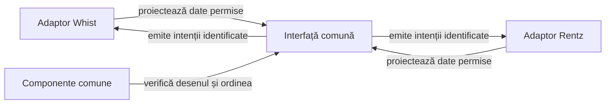

# Refactorizarea interfeței comune pentru jocuri de cărți

## Pe scurt

**P1 · nucleu extras și consumat.** [Nucleul card-table-ui](../../whist-lab-app/card-table-ui/README.md) deține meniul de pornire, dialogul numelui, widgeturile, tema Android, chenarele, geometria mesei, mâna și depunerile publice. Rentz consumă AAR-ul în UI-ul live; finisarea scorului și paritatea completă rămân distincte. Interfața și testele Whist se păstrează.

## Diagnosticul sursei live

Nucleul extras este independent de motoare și ATF. Compoziția mesei, configurarea jocului și proiecția scorului păstrează încă tipurile Whist; acestea delimitează continuarea extragerii.

| Zonă | Sursă și cuplaj | Consecință pentru extragere |
|---|---|---|
| Meniu și configurare | [MenuScreens](../../whist-lab-app/app/src/main/java/ro/whistlab/app/screens/MenuScreens.java) primește `WhistUiText` și `HowToPlay.Language`; [SetupScreen](../../whist-lab-app/app/src/main/java/ro/whistlab/app/screens/SetupScreen.java) construiește `GameConfig`. | Extrageți compoziția vizuală și callback-urile; opțiunile, regulile și construirea configurației rămân în adaptorul Whist. |
| Nume | [Dialogul](../../whist-lab-app/app/src/main/java/ro/whistlab/app/profile/PlayerSettingsDialog.java) și [preferințele](../../whist-lab-app/app/src/main/java/ro/whistlab/app/profile/PlayerPreferences.java) folosesc `PlayerNames`. | Dialog comun prin porturi de validare și salvare; păstrați regulile, cheile, erorile și efectele actuale în integrarea Whist. Nu faceți motorul dependent de Android. |
| Masă și mână | [GameTablePanel](../../whist-lab-app/app/src/main/java/ro/whistlab/app/table/GameTablePanel.java) păstrează `GameSession.Snapshot`, `Card` și `PlayedCard`; [GameScreen](../../whist-lab-app/app/src/main/java/ro/whistlab/app/screens/GameScreen.java) calculează legalitatea prin `GameRules`. | Proiecție tipizată, imuabilă și limitată la informația permisă; legalitatea și comanda se decid în adaptor, înainte și după intenția UI. Mutarea fișierelor cu aceleași importuri nu închide criteriul. |
| Geometrie | [CardFaceMetrics](../../whist-lab-app/app/src/main/java/ro/whistlab/app/cards/CardFaceMetrics.java), [HandLayoutMetrics](../../whist-lab-app/app/src/main/java/ro/whistlab/app/hand/HandLayoutMetrics.java), [TableGeometry](../../whist-lab-app/app/src/main/java/ro/whistlab/app/table/TableGeometry.java). | Implementare comună, cu fațade Whist și aceleași rotunjiri, ancore și rezultate înainte/după. Testele existente din pachetele Whist păstrează oracolele și identitățile. |
| Scor | [ScoreHistoryColumn](../../whist-lab-app/app/src/main/java/ro/whistlab/app/score/ScoreHistoryColumn.java) proiectează licitatul, rezultatul contractului și totalul Whist. | Extrageți măsurarea, grila, cadrul dialogului și derularea; proiecția și marcajele de serie rămân Whist. Rentz furnizează propriile coloane și date. |
| Mișcare | [Colectarea levatei](../../whist-lab-app/card-table-ui/src/main/java/ro/cardtable/ui/animation/TrickCollectionRun.java), [navigarea](../../whist-lab-app/app/src/main/java/ro/whistlab/app/navigation/AppNavigation.java) și [refacerea](../../whist-lab-app/app/src/main/java/ro/whistlab/app/presentation/PresentationRefresh.java). | Decuplați scena și evenimentele de tipurile jocului, păstrând timpul vizibil, anularea, generația rutei și aplicarea unică. Colectarea nu este animație de distribuire. |

Nu este justificată extragerea întregii activități sau a motorului într-un modul numit generic. Biblioteca grafică nu primește seed, mâini adverse, `GameSession`, motor AI sau acces direct la salvările consumatorului.

## Contractul bibliotecii și extinderile rămase

Modulul Android Library `card-table-ui` este produs în proiectul Whist și publică un AAR/POM versionat. Implementarea curentă și porturile sunt descrise în README-ul modulului; tabelul următor delimitează și extensiile încă propuse pentru masa completă.

[Ghidul Android Library](https://developer.android.com/studio/projects/android-library) justifică AAR pentru clase, resurse și manifest reutilizabile între aplicații. [Separarea stării UI](https://developer.android.com/topic/architecture/ui-layer/stateholders) susține proiecțiile și evenimentele delimitate; propunerea locală păstrează Views și nu cere rescrierea interfeței în alt toolkit.

Legendă: reutilizare vizuală și responsabilitate de domeniu

Diagrama descrie relația dintre adaptoare și biblioteca comună; meniul, profilul, chenarele, mâna și depunerile sunt extrase, iar compoziția modului de joc păstrează integrarea locală. Fiecare adaptor validează intenția în propriul motor și publică starea rezultată o singură dată.

| Suprafață API | Limită necesară |
|---|---|
| Meniu și profil | Texte, limbă, capabilități, starea reluării, valoarea numelui și porturi de salvare/validare. Fără `HowToPlay.Language`, chei globale de preferințe sau reguli de clasament în bibliotecă. |
| Masă și cărți | Identități stabile de loc și carte, stare activă, valori publice, carte legală și intenție de selecție. Fără reordonare după nume ori tură și fără tipuri din `ro.whistlab.core`. |
| Regiunea centrală | Compoziție extensibilă pentru levată, licitație sau tabla Rentz. Interfața nu inventează licitație ori atu pentru un joc care nu le are. |
| Scor | Rânduri, grupuri și coloane cu semnificație furnizată de consumator, valori exacte și etichete accesibile. Calculul punctelor și migrarea istoricului rămân în joc. |
| Viewport și evenimente | Spațiu util, densitate, font, insets, ceas și porturi de programare injectabile. Starea tactilă nu mută chenarele și nu schimbă motorul. |

Modelați numai variațiile demonstrate de cele două jocuri. Evitați un constructor cu zeci de flag-uri, dependențele de activitățile consumatorilor și un serviciu comun care preia implicit persistența sau execuția AI.

## Priorități și condiții de închidere

| Contract comun | Responsabilitate și verificare |
|---|---|
| Nume la masă · EXTRAS | `card-table-names` păstrează ordinea listei, seed-ul derivat, excluderea numelui uman și asocierea cu locul. Gradle și reactorul Maven includ sursa Java comună. |
| Colectarea levatei · EXTRASĂ | Temporizarea, geometria, animatorul și curățarea Android sunt în `card-table-ui`. Componentele Whist păstrează cazurile de anulare, redimensionare, animație dezactivată și termen unic. |
| Rândurile din chenar · EXTRASE | Consumatorul alege explicit varianta cu etichetă și valoare pe o singură linie. Afișarea Whist cu două coloane rămâne reper pentru apelul implicit. |

Integrarea unui consumator și calificarea lui nativă se urmăresc separat de contractele și verificările bibliotecii comune.

[Dosarul extracției](../../../../whist_back/ui-extraction/shared-seats-collection/README.md) leagă versiunile exportate, componentele Whist și verificarea sursei live.

**Criterii pentru starea restaurată.** După restaurarea unui checkpoint, colectarea ultimei levate trebuie să aibă efect o singură dată, iar scorul să rămână identic. Temporizatorul pornește la primul cadru vizibil și își păstrează timpul rămas la refacerea mesei. Numele și statisticile rămân lizibile la font mărit.

| ID și stare | Lucrare chirurgicală | Acceptanță |
|---|---|---|
| **UIX01 · PARȚIAL** | Fixați reperul Whist înaintea mutării. | Surse, configurație și probe identificate; aceleași intrări, nume, seed și profil înainte/după. Interfața live și ultimul APK calificat sunt reconciliate, fără a atribui unui release schimbări ulterioare. |
| **UIX02 · PARȚIAL** | Extrageți întâi geometria, tema și desenul cărții; păstrați fațade temporare când protejează integrarea. | Aceleași rezultate geometrice și aceeași randare Whist la aceiași parametri. Nicio dependență nouă a motorului către Android, UI sau Reporting. |
| **UIX03 · PARȚIAL** | Decuplați meniul, profilul și localizarea prin proiecții și porturi. | Aceleași controale, ordini, texte, tag-uri, identificatori accesibili, focus, back și callback-uri Whist. Validarea numelui, resetarea, stocarea și efectele asupra partidei au aceeași semantică, inclusiv la eșec. |
| **UIX04 · PARȚIAL** | Extrageți compoziția mesei și interacțiunea cu mâna. | Poziții, raportul cărții, indici, ridicare și z-order păstrate la 3–6 locuri și în toate profilurile existente. Legalitatea și aplicarea unică rămân verificate în integrarea Whist. |
| **UIX05 · TODO** | Separați cadrul scorului și scena levatei de proiecțiile Whist. | Aceleași coloane, valori, marcaje, legendă, derulare, checkpoint-uri și timp vizibil. Pauza, dialogurile, resize-ul și callback-urile depășite păstrează contractele actuale. |
| **UIX06 · PARȚIAL** | Împachetați și admiteți consumul Rentz. | AAR/POM, versiune, SHA-256, namespace, manifest și dependențe verificate; compilare offline în ambele proiecte din workspaces izolate. Păstrați compatibilitatea Whist `minSdk 24` și Rentz `minSdk 26`, fără a ridica pragul aplicației prin manifestul bibliotecii. Fără referință la checkout-ul vecin și fără publicarea codului jocului în AAR. |

**Whist Lab admite numai refactorizare în această lucrare.** O corecție vizuală, schimbarea regulilor numelui, o animație de distribuire nouă sau modificarea scorului se raportează separat; nu se ascund în extragere și nu se rescrie oracolul pentru a accepta noul rezultat.

## Etapa calificată și limitele ei

[Prima etapă](../../../../whist_back/ui-extraction/793832b0a5/README.md) și [extragerea mesei](../../../../whist_back/ui-extraction/a4c96eeb71/README.md) identifică snapshot-urile anterioare, componentele și build-urile în TMP, AAR-ul și admiterea tehnică Rentz. Raportul Extent păstrează comparațiile evaluate, sursele înainte/după și proveniența; nu declară o nouă execuție Android a interfeței.

- **UIX01 — parțial:** reper de sursă înghețat și selecție de componente trecută înainte/după; comparația nativă cu APK-ul de referință rămâne distinctă.
- **UIX02 — nucleu extras:** tema, desenul, widgeturile și geometria mâinii au implementare comună, cu fațade Whist. `TableGeometry`, locurile, regiunile măsurate și renderer-ele mâinii/depunerilor sunt comune; adaptorul Whist păstrează proiecțiile și compoziția modurilor.
- **UIX02 — temă extrasă:** `CardTableTheme` păstrează cele șase atribute, iar [AppTheme](../../whist-lab-app/app/src/main/res/values/styles.xml) rămâne alias în Whist. Consumatorul adoptă explicit resursa; pixelii și focusul nativ nu sunt calificate prin build.
- **UIX03 — parțial:** meniul de pornire, dropdown-ul și dialogul numelui sunt comune; textele, politica numelui, preferințele, configurarea și rutele rămân ale jocului.
- **Consumator JVM — pregătire:** modelul de prezentare nu impune licitat, atu sau punctaj. O aplicație de consolă nu folosește direct modulul Android; un front-end Android viitor cere adaptor și componente proprii, inclusiv geometrie pentru alte populații de locuri.
- **UIX06 — consum activ:** Rentz folosește AAR-ul local fixat prin hash, tema, meniul și adaptoarele proprii. [Calificarea consumatorului](../../../../rentz_back/ui-review/shared-ui-cb695c1461/README.md) identifică 49 de componente și sanity API 28; nu închide întreaga paritate U02–U07 sau calificarea unui release Whist.

**UIX04 este extras la nivel de prezentare:** `SeatContent`, `HandCard` și `PlayedCardContent` sunt neutre; `WhistTableContent` rămâne adaptorul jocului. `GameTablePanel` păstrează licitația, alegerea levatei vizibile și animația.

Rentz are adaptor live și probe native focalizate; comparația nativă pereche Whist și UIX05 rămân distincte, iar componentele de reguli Whist rămân în consumator.

**UIX03 — reconciliere necesară:** dialogul comun aplică `InputFilter.LengthFilter(10)` pe unități UTF-16, iar politica numelui acceptă zece puncte de cod. Permiteți un filtru furnizat de consumator sau un contract echivalent, cu probe pentru litere suplimentare și perechi surrogate; schimbarea comportamentului Whist se califică separat de refactorizare.

## Testele care protejează extragerea

| Nivel | Controale obligatorii |
|---|---|
| Componente comune | Geometrie, măsurare, ordine, denumiri, selectare și evenimente; caz nominal, limite, defect injectat și vecin valid. Golden-urile sau coordonatele așteptate provin din reperul anterior, nu din aceeași implementare comună apelată de două ori. |
| Integrare Whist | Păstrați [MatchSetup](../../whist-lab-app/app/src/test/java/ro/whistlab/app/screens/MatchSetupComponentTest.java), [ordinea reală](../../whist-lab-app/app/src/test/java/ro/whistlab/app/table/TableSeatOrderComponentTest.java), [navigarea](../../whist-lab-app/app/src/test/java/ro/whistlab/app/navigation/AppNavigationComponentTest.java), [viewport-ul](../../whist-lab-app/app/src/test/java/ro/whistlab/app/table/GameTableLayoutComponentTest.java) și familiile de mână, istoric și colectare. Testele cu motor nu dispar odată cu mutarea testelor geometrice. |
| Raster | Aceleași proiecții, fonturi și regiuni măsurate înainte/după, cu restaurare și text mărit; fixture-uri deterministe și diferențe explicate. Rasterul JVM nu declară paritate Android. |
| Sanity Android | Meniu → limbă → nume → configurare → masă → istoric → revenire/relansare; apoi numai extremele geometrice relevante. Aceeași captură de referință și același profil, fără repetarea partidei complete pe toate rezoluțiile. |
| Consumator Rentz | Aceleași contracte vizuale pe adaptoare Rentz reale; modelul de scor, alegerile și secvențele au propriile oracole. Copierea fixture-ului Whist și înlocuirea etichetelor nu înseamnă acceptanță. |

Inventariați selecția înainte și după mutare: clasă, metodă, invocare și proprietarul testului. O clasă mutată nu devine caz nou; un caz exclus de filtrul Gradle sau de suita agregată este omisiune, nu optimizare.

[Testele JVM locale](https://developer.android.com/training/testing/local-tests) verifică rapid logica izolată, cu limite față de framework-ul Android. De aceea matricea păstrează distincte geometria pură, rasterul JVM și controlul nativ al widgeturilor.

## Integrare, guvernanță și documentație

[Componentele native ale marcajelor](../../whist-lab-app/app/src/androidTest/README.md) protejează coordonatele textului în părinte, inclusiv derularea internă `TextView`. Păstrați această probă la extragerea cadrului scorului; vizibilitatea decorului și vecinul fără marcaj se verifică în clasele Android efectiv consumate.

- Înregistrați modulul în Gradle, inventarul surselor, copiile de build și filtrele de componente/raster; păstrați aplicația instalabilă și regulile Whist neschimbate. Nu adăugați un modul Android în reactorul Maven al algoritmului doar pentru a-i reutiliza numele.
- Politica actuală a bibliotecilor ATF verifică perechi JAR/POM cu proprietar comun. AAR-ul UI are producătorul Whist și o admitere tipizată proprie; nu relaxați acea politică pentru un fișier suplimentar necunoscut.
- Biblioteca de produs nu depinde de Core/Reporting/Kit ATF. Publicarea testelor folosește adaptoarele consumatorului; componentele și E2E păstrează expected/actual, pași, identitate și capturi după nivelul lor.
- Testele JVM Gradle și [suita Android de componente](../../atf-test-android/src/test/java/atf/android/suites/AndroidDisplayComponentSuite.java) sunt selecții distincte. Documentați intrarea care publică efectiv comparațiile capturate; numerele din XML sau un screenshot nu reconstruiesc aserțiuni necolectate.
- Înainte de închidere, actualizați harta pachetelor, README-ul aplicației, [catalogul componentelor](../testing/ATF_DisplayComponents.md), comenzile și ghidul consumatorului. Indicați ce s-a mutat, ce a rămas specific și ce selecții native sunt încă necalificate.
- Construiți detașat de surse conform procesului fiecărui proiect; consumatorul folosește propriul workspace extern înregistrat. Împachetarea reutilizabilă nu justifică reutilizarea key-store-ului, datelor sau salvărilor utilizatorului între aplicații.

[Arhitectura aplicației](../../whist-lab-app/app/src/main/java/ro/whistlab/app/README.md) · [Strategia testării](../testing/README.md) · [Calificări Android rămase](ATF_Android.md)
