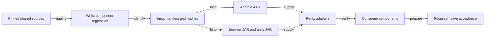

# Common card game interface

## Overview

Whist already integrates the common Android module. The register follows checks on APK and other consumers, the Unicode limit of names and extensions that need a joint contract. [Library contract](../../whist-lab-app/atf-card-table-ui/README.md)

## Priorities and closing conditions

| ID | What remains | Closure criterion |
|---|---|---|
| UIX01 · UIX02 | Geometry and drawing in consumers | On the AARs fixed for each game, compare the anchors, rounding and legibility to the same screen profile. Record configuration, region captured and APK. |
| UIX03 | Keyboard, selection and focus on APK | Confirm in RO/EN typing and sticking to ten non-BMP letters, refusing to 11 and maintaining selection and focus. [Entry components](../testing/ATF_Android.md#profile-history-leaderboards-and-series) qualify the Whist rule and simulated Android intervals. |
| UIX04 | Table positions and projections | [Android matrix](ATF_Android.md#native-acceptance-of-proportions-and-order) for Whist next. For each consumer, it is a local order of seats and a legal move applied only once. |
| UIX05 | Adoption of common score and history widgets | `score` now owns neutral content, Android rendering, measured columns and synchronized panes. Keep Whist and Rentz captions, awards and row actions in their adapters. Qualify native scrolling, focus, restoration and unchanged game-specific columns in each consumer before closing parity. [Widget contract](../../whist-lab-app/atf-card-table-ui/src/main/java/ro/cardtable/ui/score/README.md) |
| UIX06 | Cost and acceptance of AAR consumers | Compare the source build with the AAR on the same inputs. Run native samples on the admitted version and keep her identity. [Packaging and consumption](../../whist-lab-app/atf-card-table-ui/README.md#packaging-and-consumption) |

## Shared AutoGame control

- Check the touch and control space on the compact APK and with increased text in both languages. Retrieval of the header keeps the value provided by the game, and a touch produces one intention. [Header contract](../../whist-lab-app/atf-card-table-ui/README.md#table-header)
- Keep the active control stoppable while an AI response is pending. A controlled executor delivers that response after stopping; the revision and command journal must remain unchanged.
- Confront the ticker at bid, the score stop, break and replay in Whist. Check separately the header positioning in the consumer using the AAR.[Native acceptance](ATF_Android.md#native-acceptance-of-proportions-and-order)

For each consumer, attach to the UIX06 coordinated AAR and native verdict for header, checkboxes and notifications. The criterion of packaging and qualification of the Web JARs belongs to [Adapter documentation](../../atf-ui-browser/README.md#adapter-library).

## Regression and delivery

Legend

- Sources and manifests identify the reusable library independently of each game adapter.
- Consumer components verify integration; native acceptance observes platform rendering and input.

- Run the UI library and Whist display, command, bidding, history and achievement components in one Gradle launch; verify each Extent report against JUnit. Keep rule and documentation checks as a distinct selection. [Component process](../testing/README.md)
- Reuse a passed selection only when its relevant production inputs, tests and evidence are unchanged. A failed documentation control requires a corrected rerun of that selection without repeating unrelated display tests.
- Compare production manifests and artifacts before building: unchanged inputs reuse the same AAR/JAR bytes, while changed inputs require a new version. Deliver runtime, tests, checksums and provenance receipts together.
- Rentz verifies binary adoption, the shared viewport contract and its public projections. Keep sequence layout, scoring and rules in game adapters; require consumer evidence before closing UIX06.

The shared matrix covers 3–6 seats, compact and tall windows, enlarged fonts and anchors that remain fixed across phases. Browser components cover the 414 × 896 reference frame, phone viewports and desktop height/width constraints; browser checks measure the actual DOM and scaling. [Display strategy](../testing/ATF_DisplayComponents.md)

## Result action acceptance

The shared roles and adapter components qualify the logical text and callback contract. Native raster acceptance must additionally observe complete wrapped labels, vertical scrolling and the last action on identified Whist and Rentz APKs, with RO/EN and enlarged text. A source or AAR comparison alone does not certify Android clipping.

## Next shared-library version format

Use two-part 0.x coordinates for the next newly published Browser and Android UI packages. Keep already published three-part coordinates and their hashes immutable. Before the next packaging, align both packaging entry points and add component controls for the new format, legacy immutable reuse and refusal to overwrite an existing coordinate with different bytes.
