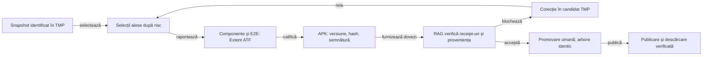

# Guvernanța RAG pentru calificarea livrărilor

## Domeniu și limite

Guvernanța descrie cum se agregă dovezile deja produse pentru o livrare și cum se blochează contradicțiile dintre surse, rezultate, manifest și linkuri publice. Evaluatorul RAG este acum un CLI read-only care verifică receipt-urile fixate și emite un verdict JSON citat. El nu execută build-uri, teste, comenzi Git, semnare sau publicare și nu avansează ciclul candidatului.

- RAG-ul califică un candidat pe baza receipt-urilor și a provenienței.
- Lansatorul/operatorul produce build-ul, testele și APK-ul; RAG-ul nu le execută.
- Operatorul promovează snapshot-ul numai după `READY_FOR_HUMAN_REVIEW`; lucrul intermediar rămâne în TMP.

Ediția curentă declară numai Android. Un APK și un IPA/Archive sunt livrabile distincte: testele motorului comun pot susține mai multe platforme, dar nu califică build-ul nativ, semnarea sau distribuția alteia. O platformă viitoare trebuie declarată separat și trece prin porțile proprii.

## Contract de guvernanță

| Prioritate | Cerință | Criteriu de închidere |
|---|---|---|
| P1 | Snapshot și corpus fixate | Sursele sunt allowlistate; raportul identifică repository-ul, commitul, arborele, starea worktree-ului și hash-ul fiecărei surse. Schimbarea unei intrări invalidează citările și receipt-urile afectate. Evaluatorul recalculează acum formatul ordinal declarat și compară setul sursă APK cu sursa fiecărei suite Extent. Manifestul istoric `0.14.0` nu trece încă această reconciliere: lista sa nu este în ordine ordinală, iar sursa componentelor are diferențe de fișiere și JAR față de sursa APK-ului. Păstrați receiptele istorice ca atare; următorul candidat trebuie să genereze toate intrările din același snapshot. |
| P1 | Citate verificabile | Fiecare afirmație de stare citează calea, linia și SHA-256 din snapshot, plus JSON Pointer pentru receiptele JSON. README-ul, feedback-ul sau un rezumat nu produce `PASS`. |
| P1 | Stări fail-closed | Se folosesc `PASS`, `FAIL`, `BLOCKED`, `NOT_RUN`, `NOT_APPLICABLE` și `NOT_IMPLEMENTED`. O dovadă lipsă nu devine trecută; o funcție absentă nu este prezentată drept test neexecutat. |
| P1 | Catalog coerent | Versiunea din index, manifest, dosar și linkurile publice trebuie să coincidă. Orice contradicție blochează verdictul; README-ul nu este autoritatea pentru identitatea artefactului. |
| P1 | Porți independente pe platformă | Android cere APK, identitate, semnare și descărcare proprie. iOS cere probe Xcode, puntea nativă, identitate și semnare proprie, plus distribuție iOS verificată. Android nu poate satisface nicio poartă nativă iOS. |
| P1 | Agregare conservatoare | Verdictul de pregătire cere trecerea tuturor platformelor declarate. Rezultatul maxim este `READY_FOR_HUMAN_REVIEW`; numai procesul existent și operatorul pot publica. |
| P1 | RAG read-only | RAG-ul citește receipt-uri deja produse; nu rulează comenzi, nu construiește, nu semnează, nu modifică surse, tag-uri sau asset-uri și nu publică. Raportul și indexul se scriu în afara checkout-ului. |
| P1 | Evaluator executabil | [CLI-ul read-only](../../atf-tests/tools/evaluate-release-rag.mjs) consumă planul, manifestul, payload-ul, receipt-urile Extent și snapshot-ul indicat; scrie JSON extern cu citări. Testele componente acoperă verdict pozitiv, sursă APK diferită de sursa raportului, fișiere/APK alterate, profil de semnare incompatibil, omitere E2E și refuzul ieșirii în arborele candidat. Rămâne deschisă integrarea verdictului ca handoff controlat și uniformizarea producătorului manifestului APK; CLI-ul nu orchestrează etapele. |
| P1 | Ciclu candidat verificabil | Sursele, rapoartele și APK-ul se califică în afara checkout-ului activ. Promovarea cere verdictul RAG și egalitatea amprentei arborelui din `main` cu snapshot-ul calificat; publicarea cere același hash APK în candidat, asset și descărcarea anonimă. |
| P1 | Risc înaintea versiunii | Selecția unit/component/E2E rezultă din contractele schimbate și riscul lor. Un refactor nu primește automat acoperire redusă doar fiindcă nu schimbă comportamentul; un E2E neales cere motiv explicit, păstrat în receipt. |
| P1 | Extent pentru suite executate | Orice selecție componentă sau E2E executată are un HTML canonic randat prin `atf-reporting`, identități și rezultate comparate exact cu JUnit-ul temporar, proveniența snapshot-ului și capturile efectiv produse inline Base64. XML-ul nu rămâne duplicat în release după audit. |
| P1 | Semnare dependentă de canal | Declarați dacă APK-ul este local, de test public sau de producție; `signing=PASS` singur nu stabilește profilul. Manifestul activ `0.14.0` declară `Android Debug` și `productionManagedKey=false`; RAG-ul trebuie să îl distingă de o livrare cu cheie gestionată și să ceară compatibilitatea certificatului la upgrade. |
| P2 | Probe negative controlate | Testele demonstrează sursă/APK divergente, plan invalid, receipt lipsă, gate blocat și substituție Android→iOS; fiecare caz trebuie să rămână blocat cu diagnostic și pas următor. Expirarea temporală a receipt-urilor nu este încă modelată și trebuie rezolvată înaintea unui flux automat de publicare. |

Contractul executabil este fixat de [politica de dovezi pe platforme](../../config/release-platform-rag-policy.json), [evaluator](../../atf-tests/tools/evaluate-release-rag.mjs) și testele componente [ReleaseRagEvaluatorComponentTest](../../atf-tests/src/test/java/atf/tests/governance/documentation/release/rag/ReleaseRagEvaluatorComponentTest.java) și [ReleaseRagPlatformGovernanceTest](../../atf-tests/src/test/java/atf/tests/governance/documentation/release/ReleaseRagPlatformGovernanceTest.java).

| Control | Condiție pentru Android |
| --- | --- |
| Componente | Sunt obligatorii `atf-validation`, `atf-test-android`, `atf-tests` și cele patru selecții Gradle `whist-lab-app-{commands,bidding,history,display}`. Fiecare selecție are propriul HTML Extent și receipt; nu se concatenează rapoarte pentru a fabrica o suită agregată. JUnit XML singur nu satisface poarta. |
| Calificare | Build APK, identitate și semnare au receipte incluse în payload. |
| Publicare | Este necesar receipt pentru descărcarea anonimă. |
| Integritate | CLI-ul verifică payload-ul, APK-ul, ordinea și amprenta sursei, setul sursă comun și canalul de semnare. Documentația nu poate produce `PASS`. |

## Ciclul candidatului

Legendă: TMP păstrează candidatul până la verdict

Fiecare săgeată reprezintă o predare de responsabilitate. RAG-ul verifică receipt-urile și proveniența; operatorul păstrează controlul asupra promovării și publicării.

1. **Fixare:** copia TMP înregistrează commitul de bază, amprenta completă a arborelui, modificările locale și hash-urile dependențelor/copiate. Orice schimbare după fixare invalidează numai receipt-urile dependente și cere rerularea lor. Evaluatorul confruntă commitul declarat, amprenta input manifestului și hash-urile tuturor fișierelor enumerate cu rădăcina de surse furnizată.
2. **Selecție:** proprietarul schimbării declară riscul din contractele afectate. Versiunea Android decide numărul versiunii, nu micșorează automat testele. Componentele unit și componentă țintesc oracolul schimbat; E2E se adaugă pentru fluxul utilizatorului afectat sau pentru risc de livrare. O omisiune motivată rămâne `NOT_APPLICABLE`, nu `PASS`.
3. **Raportare:** fiecare suită executată publică un singur Extent HTML prin `atf-reporting`. Pentru componentă și E2E se păstrează scope-uri diferite; raportul confruntă inventarul și rezultatul JUnit, explicațiile/comparațiile și proveniența aceleiași amprente. Imaginile capturate sunt inline Base64. JUnit XML poate fi oracol temporar al egalității, nu a doua raportare finală.
4. **APK:** build-ul semnat se produce în TMP din snapshot-ul fixat. Versiunea, `versionCode`, package, dimensiunea, hash-ul, CRC-ul, semnătura și alinierea se validează înaintea promovării. Raportul și APK-ul nu se reconstruiesc dintr-un checkout care s-a schimbat între timp.
5. **Verdict și promovare:** rulează CLI-ul doar după ce selecțiile au produs receipt-urile și HTML-ul Extent. El emite `BLOCKED` sau `READY_FOR_HUMAN_REVIEW`, cu citări și ieșire în afara checkout-ului/candidatului/snapshot-ului. `NOT_RUN` rămâne distinct de `PASS`; fluxurile E2E ale aplicației rămân înghețate cât timp nu se schimbă fluxul utilizatorului. O schimbare de flux cere E2E trecut și receipt-uri explicite. După verdictul pozitiv, operatorul promovează sursa și dosarul candidatului; egalitatea amprentei arborelui rezultat cu snapshot-ul calificat rămâne control separat.
6. **Publicare:** publicarea leagă APK-ul de commit-ul promovat. Descărcarea anonimă trebuie să aibă același număr de octeți și SHA-256 cu APK-ul calificat. Abia apoi indexul și README-urile indică noua versiune curentă.

Limitele verdictului RAG:

- Nu rulează `git`, nu verifică indexul Git și nu inspectează fișiere omise din input manifest.
- Nu declară singur checkout-ul curat și nu înlocuiește revizia operatorului pentru snapshot, release sau URL public.
- Nu repară retroactiv manifestul `0.14.0`; rapoartele istorice rămân necalificate ca proveniență comună a APK-ului.
- Ghidurile [calificării](../testing/ATF_ReleaseQualification.md) și [retenției](../platform/ATF_ReleaseRetention.md) dețin comenzile și mutarea dosarelor.

Pentru o livrare iOS viitoare sunt necesare build și teste Xcode, identitatea Bundle ID/build, semnare cu identitate de distribuție și o rută verificată TestFlight/App Store. APK-ul Android rămâne un artefact Android; un IPA sau o arhivă nu poate fi redenumit ori prezentat ca APK.

## Închiderea

Păstrați motorul de recuperare și arhitectura aplicației în proprietarii lor existenți.

- Evoluați evaluatorul prin teste pozitive și negative pe fixture-uri controlate.
- Conectați verdictul drept handoff auditabil în procesul release existent.
- Înaintea unei iterații E2E, verificați API-ul Android, ADB și dispozitivul. Indisponibilitatea lasă selecția `NOT_RUN`.
- Verdictul maxim este `READY_FOR_HUMAN_REVIEW`; publicarea rămâne în procesul existent.
