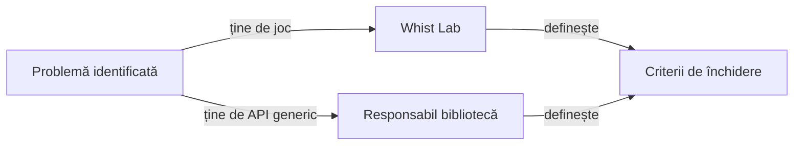

# Feedback Whist Lab

## Pe scurt

Acest index păstrează lacunele de produs și de testare ale Whist Lab. Proiectul
definește regulile, AI-ul, salvările, UI-ul, acțiunile Android și așteptările
consumatorului pentru verificare și publicare.

## Proprietatea schimbărilor

Defectele neutre ale componentelor Core și Reporting, inclusiv contractul HTML
și componentele de randare principală și de rezervă, aparțin modulului comun și se înregistrează în
[feedback-ul responsabilului atf_j0](../../../atf_j0/docs/feedback/README.md).
Feedback-ul Whist Lab definește contractele jocului prin acțiuni, stări, aserțiuni și capturi reale.

## Rutarea cerințelor

Legendă și limite

Feedback-ul descrie problema generalizabilă, responsabilitatea și criteriul de rezolvare. Datele unei execuții și rapoartele aferente rămân externe.

## Feedback activ

| Subiect | Document |
|---|---|
| Coeziunea pachetelor, limitele modulelor și verificatoare reutilizabile | [Guvernanța calității](ATF_QUALITY_GOVERNANCE_Feedback.md) |
| Intervale Android, atribuirea acțiunilor și limitele publicării | [Contracte consumator](ATF_Android_Reporting_Feedback.md) |
| Semantica verificărilor de joc și datele de intrare pentru publicare | [Așteptări consumator Android](ATF_Android_Alignment_Feedback.md) |
| Guvernanță reutilizabilă pentru README-urile consumatorilor | [Cerință către modulul comun](DOCUMENTATION_GOVERNANCE_CONSUMER_Feedback.md) |
| Publicare atomică, scopuri și stările predării rezultatelor | [Predarea rezultatelor UI](UI_REPORT_HANDOFF_Feedback.md) |
| Partiții, retenție și integritatea datelor externe | [Guvernanța datelor](EVIDENCE_RETENTION_Feedback.md) |
| Meniu, atu, cărți și istoricul scorului | [Utilizarea aplicației](WHIST_LAB_User_Experience_Feedback.md) |
| Contractele meniului și registrul partidei | [Criterii de integrare](MENU_AND_SCORE_HISTORY_Feedback.md) |
| Inferență publică, coeficienți și limite ale modelelor | [Contractul informației](AI_INFORMATION_MODEL_Feedback.md) |
| Promovarea politicilor, variante de rezervă și criterii independente | [Guvernanța AI](AI_POLICY_GOVERNANCE_Feedback.md) |

[Arhitectura publicării](../reporting/README.md) definește responsabilitățile consumatorului și contractele bibliotecii. [Indexul documentației](../README.md) leagă
contractele curente de implementare și teste.

## Închiderea unei cerințe

- Reproducerea numește versiunea, profilul și intrările afectate.
- Testul păstrează un rezultat așteptat independent și cazul negativ relevant.
- Rezultatul separă componentele, construirea APK-ului, interacțiunea UI, auditul
  capturilor și obiectivul jocului.
- Un raport nou nu rescrie o încercare anterioară și nu transformă lipsa de
  dovadă într-un PASS.
- Schimbările concurente se reconciliază înainte de promovarea surselor.

## Biblioteci comune

[Contractul consumului binar](../ATF_Platform_Libraries.md) separă implementarea comună de adaptoarele și acceptanța locală. Cerințele comune urmează aceeași rutare către responsabilul bibliotecilor.
