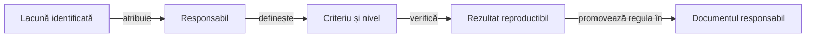

# Feedback Whist Lab

## Pe scurt

Acest registru grupează lacunele, limitele de cercetare și calificările încă necesare.
Contractele stabile aparțin ghidurilor tematice; fiecare criteriu rămâne deschis până la verificarea nivelului cerut.

## Registre active

[Dosarul activ](../../release/README.md) reunește APK-ul și dovezile versiunii calificate. Candidații intermediari rămân în staging extern; [calificarea livrării](../testing/ATF_ReleaseQualification.md) condiționează înlocuirea dosarului activ.

| Arie | Responsabilitate și criterii |
|---|---|
| [Jucători AI](ATF_Ai.md) | Inferență, estimări, cost și calificarea politicilor pe date noi. |
| [Android](ATF_Android.md) | Istoric complet, persistență, geometrie, localizare și accesibilitate. |
| [Interfață comună](ATF_CardUi_Extraction.md) | Limitele dintre prezentarea reutilizabilă și adaptorul Whist: meniu, profil, masă, istoric și animații. |
| [Raportare](ATF_Reporting.md) | Calificarea autonomiei, comparațiilor și consumului de memorie în Extent. |
| [Guvernanța RAG a livrărilor](ATF_Release_RAG.md) | Legătura dintre riscuri și testele selectate, predarea candidatului și valabilitatea receipt-urilor. |
| [Guvernanță](ATF_Governance.md) | API reutilizabil, perimetru explicit și coeziunea codului. |
| [Infrastructură locală](ATF_TestInfrastructure.md) | Concurența Kitului, izolarea configurației și costul validării API. |
| [Realizări Whist](ATF_Achievements.md) | Restaurarea stării ecranului Android și calibrarea cu jucători umani. |

## ToDo-uri prioritizate

Scorul 1–100 exprimă ordinea recomandată de lucru, nu calitatea sau procentul de finalizare. Evaluarea combină impactul asupra utilizatorului, mărimea golului de verificare, riscul pentru release și claritatea criteriului de închidere. Fiecare rând indică registrul normativ; scorul se revizuiește când se schimbă riscul ori dovada, iar criteriile rămân deschise până la închiderea lor acolo.

| ID | Prioritate | Scor | ToDo rămas și criteriul scurt de închidere |
|---|---:|---:|---|
| RPT-01 | P1 | 95 | Verifică fiecare producător prin HTML detașat și controale negative pentru conținut lipsă, extern ori atribuit greșit. [Registru](ATF_Reporting.md#rpt-android-html-only--livrabilul-de-audit-fără-copii-auxiliare) |
| RPT-02 | P1 | 94 | Probează pe producătorii rămași respingerea invocărilor pierdute și utilitatea comparațiilor originale, inclusiv la FAIL, ERROR și SKIP. [Registru](ATF_Reporting.md#rpt-android-component-html--comparații-capturate-nu-doar-junit-xml) |
| AND-01 | P1 | 93 | Demonstrează recuperarea checkpoint-ului după corupere sau întrerupere, păstrând datele utilizatorului ori raportând eroarea explicit. [Registru](ATF_Android.md) |
| AND-02 | P1 | 92 | Califică pe APK actorul, geometria stabilă și mâna vizibilă în licitație/joc/AutoGame pentru 3–6 locuri, RO/EN și text mărit. [Registru](ATF_Android.md) |
| AI-01 | P1 | 91 | Calibrează inferența Hard pentru 2–8 cărți din licitații și cărți jucate pe loturi noi; separă exactitatea probabilităților de scorul simulat. [Registru](ATF_Ai.md) |
| ACH-01 | P1 | 90 | Califică pe APK restaurarea poziției și selecției din Realizări, apoi reluarea notificărilor după recrearea activității. [Registru](ATF_Achievements.md) |
| AND-03 | P1 | 89 | Califică API 37, navigarea sistemului, reluarea, fonturile mărite și memoria pe un dispozitiv identificat. [Registru](ATF_Android.md) |
| RPT-03 | P1 | 88 | Publică suite mari în limita de heap declarată, fără copii repetate ale HTML-ului și fără să piardă JUnit sau comparațiile la eșec. [Registru](ATF_Reporting.md#rpt-bounded-report-heap--finalizare-sigură-pentru-suite-mari) |
| GOV-01 | P1 | 87 | Oferă validatoare cu API/CLI autonom, rădăcini explicite și inventar complet; controalele negative resping surse sau excepții neacoperite. [Registru](ATF_Governance.md#api-reutilizabil-pentru-verificatoare) |
| UI-01 | P1 | 86 | Califică antetul, chenarele și notificările pe APK-urile consumatorilor și reconciliază limita Unicode a numelui. [Registru](ATF_CardUi_Extraction.md#priorități-și-condiții-de-închidere) |
| RAG-03 | P2 | 85 | Leagă prospețimea receipt-urilor și cronologia etapelor de politica de reutilizare și de expirarea dovezilor. [Registru](ATF_Release_RAG.md#lacune-deschise) |
| TEST-01 | P2 | 84 | Separă ceasul, procesele și acțiunile driverului în teste controlate, păstrând timeout-ul, ordinea comenzilor și cauza originală. [Registru](ATF_TestInfrastructure.md) |
| AI-02 | P2 | 82 | Măsoară ocaziile, conversiile la 500, efectul asupra clasamentului și latența pe loturi noi, cu joc natural separat de prefixul controlat. [Registru](ATF_Ai.md#joc-la-0) |
| GOV-02 | P2 | 80 | Validează baza Git, căile schimbate și expirarea controalelor `testChanges`. [Registru](ATF_Governance.md#confruntarea-afirmațiilor-documentare) |
| AND-04 | P2 | 78 | Izolați fabricarea fixture-urilor deterministe din MainActivity într-un seam exclus din Release; păstrați scenariile Debug și refuzați activarea fixture-urilor prin intent extras. [Owner](ATF_Android.md#persistență-și-coordonare) |
| AI-03 | P2 | 76 | Extrageți gestionarea și reutilizarea mostrelor din MonteCarloAi fără să schimbați fațada; fixați ordinea aleatoare, replay-ul, anularea și bugetul prin componente. [Owner](ATF_Ai.md#evoluția-motorului) |
| GOV-03 | P2 | 74 | Reduceți responsabilitățile rămase în GameSession fără schimbarea mutărilor, scorului sau checkpoint-ului; verificați comportamentul nominal și refuzurile cu oracol fixat. [Owner](ATF_Governance.md#lizibilitatea-coordonatorilor-de-domeniu) |

## Responsabilitatea schimbării

Legendă: închiderea unui criteriu

Un criteriu numește comportamentul, sursa și nivelul de verificare necesar. Regula stabilă se documentează la responsabil, iar rezultatele concrete și materialele de investigație rămân externe.

Core, Reporting, Console și Mock sunt consumate ca perechi binare versionate JAR/POM. Acest proiect deține verificarea contractelor pe care le folosește, proveniența perechii, integrarea locală și documentarea oricărei limitări observate; hash-ul și coordonatele sunt sursa de identitate.
[Ghidul editorial Whist](../governance/ATF_Documentation.md) deține regulile documentare și verificarea lor în checkout.

## Închiderea și promovarea

- Păstrați distincte defectul demonstrat, calificarea lipsă și ipoteza de cercetare.
- Verificați cazul nominal, refuzul relevant și identitatea surselor înainte de închidere.
- Promovați regula stabilă în ghidul său și eliminați numai criteriul demonstrat.
- Fiecare lucrare deschisă are un singur registru responsabil; README-urile explică mecanismul și trimit la acel criteriu.
- Păstrați controalele tehnice active până la reconcilierea lor explicită.
- Actualizați toate referințele la consolidare; o schimbare de director nu dovedește rezolvarea comportamentului.

## Contractul comun de autonomie

Rapoartele trebuie să se deschidă și să poată fi auditate fără runner, JAR adițional sau fișiere auxiliare. HTML-ul păstrează contextul, comparațiile și capturile inline; consumatorul verifică acest contract în [feedback-ul raportării](ATF_Reporting.md).

## Suportul comun al testelor

Kitul este consumat după perechea JAR/POM fixată. Testele locale verifică integrarea, lifecycle-ul, concurența folosită și propagarea cauzelor; rezultatele unei biblioteci nu înlocuiesc calificarea adaptorului Android sau a suitei de produs.
