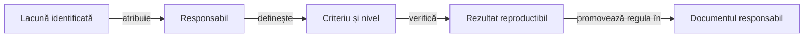

# Feedback Whist Lab

## Pe scurt

Acest registru grupează lacunele, limitele de cercetare și calificările încă necesare.
Contractele stabile aparțin ghidurilor tematice; fiecare criteriu rămâne deschis până la verificarea nivelului cerut.

## Registre active

[Dosarul activ](../../release/README.md) reunește APK-ul și dovezile versiunii calificate. Candidații intermediari rămân în staging extern; [calificarea livrării](../testing/ATF_ReleaseQualification.md) condiționează înlocuirea dosarului activ.

| Arie | Responsabilitate și criterii |
|---|---|
| [Jucători AI](ATF_Ai.md) | Inferență, estimări, cost și calificarea politicilor pe date noi. |
| [Android](ATF_Android.md) | Istoric complet, persistență, geometrie, localizare și accesibilitate. |
| [Interfață comună](ATF_CardUi_Extraction.md) | Limitele dintre prezentarea reutilizabilă și adaptorul Whist: meniu, profil, masă, istoric și animații. |
| [Publicare](ATF_Reporting.md) | HTML autonom, componente auditabile și calificarea publicării. |
| [Guvernanța RAG a livrărilor](ATF_Release_RAG.md) | Legătura dintre riscuri și testele selectate, predarea candidatului și valabilitatea receipt-urilor. |
| [Guvernanță](ATF_Governance.md) | API reutilizabil, perimetru explicit și coeziunea codului. |
| [Infrastructură locală](ATF_TestInfrastructure.md) | Concurența Kitului, izolarea configurației și costul validării API. |
| [Realizări Whist](ATF_Achievements.md) | Praguri exacte, calificarea Android, compatibilitatea progresului și calibrarea pe configurațiile eligibile. |

## Responsabilitatea schimbării

Legendă: închiderea unui criteriu

Un criteriu numește comportamentul, sursa și nivelul de verificare necesar. Regula stabilă se documentează la responsabil, iar rezultatele concrete și materialele de investigație rămân externe.

Core, Reporting, Console și Mock au [responsabilul comun al bibliotecilor](https://github.com/crististefanita/atf_j0/blob/master/docs/feedback/README.md).
[Ghidul editorial Whist](../governance/ATF_Documentation.md) deține regulile documentare și verificarea lor în checkout.

## Închiderea și promovarea

- Păstrați distincte defectul demonstrat, calificarea lipsă și ipoteza de cercetare.
- Verificați cazul nominal, refuzul relevant și identitatea surselor înainte de închidere.
- Promovați regula stabilă în ghidul său și eliminați numai criteriul demonstrat.
- Fiecare lucrare deschisă are un singur registru responsabil; README-urile explică mecanismul și trimit la acel criteriu.
- Păstrați controalele tehnice active până la reconcilierea lor explicită.
- Actualizați toate referințele la consolidare; o schimbare de director nu dovedește rezolvarea comportamentului.

## Contractul comun de autonomie

[Criteriul comun de autonomie a raportului](https://github.com/crististefanita/atf_j0/blob/master/docs/feedback/ATF_Reporting_Feedback.md#report-artifact-autonomy-150--calificare-f%C4%83r%C4%83-dependen%C8%9Be-externe) aparține responsabilului bibliotecilor. [Feedback-ul consumatorului Android](ATF_Reporting.md) păstrează colectarea, publicarea și calificarea livrabilului propriu.

## Suportul comun al testelor

[Primitivele și concurența Kitului](https://github.com/crististefanita/atf_j0/blob/master/docs/feedback/ATF_Common_Test_Support_Feedback.md#kit-concurrency-152--calificare-jupiter-paralel%C4%83) au responsabil comun. Consumatorul folosește perechea binară declarată în POM, iar acceptanța adaptorului Android rămâne locală; transferul responsabilității nu constituie calificarea paralelismului.
