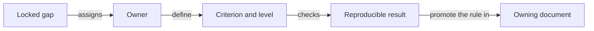

# Feedback Whist Lab

## Overview

This register groups the gaps, research limits and qualifications still required.
Stable contracts belong to thematic guidelines; each criterion remains open until the required level is verified.

## Active registers

[Active dossier](../../release/README.md) brings together the APK and evidence of the qualified version. Intermediate candidates remain in external staging; [qualification of delivery](../testing/ATF_ReleaseQualification.md) makes the replacement of the active dossier conditional.

| Area | Liability and criteria |
|---|---|
| [AI players](ATF_Ai.md) | Inference, estimates, cost and policy qualification on new data. |
| [Android](ATF_Android.md) | Full history, persistence, geometry, location and accessibility. |
| [Common interface](ATF_CardUi_Extraction.md) | The limits between reusable presentation and the Whist adapter: menu, profile, table, historical and animation. |
| [Browser](ATF_UiBrowser.md) | Reference geometry and parity with APKs for the common Edge and Chrome adapter. |
| [Reporting](ATF_Reporting.md) | Qualification of autonomy, comparisons and memory consumption in Extent. |
| [Governance](ATF_Governance.md) | Reusable API, explicit perimeter and code cohesion. |
| [Local infrastructure](ATF_TestInfrastructure.md) | The competition of the kit, the isolation of the configuration and the cost of validating API. |
| [Whist Achievements](ATF_Achievements.md) | Restoring the status of the Android screen and calibration with human players. |

## Prioritized ToDos

The 1–100 score expresses the recommended order of work, not the quality or percentage of completion. The assessment combines the impact on the user, the size of the verification gap, the risk for release and the clarity of the closure criterion. Each row shall indicate the normative register; the score shall be revised when the risk or proof changes and criteria shall remain open until they are closed there.

| ID | Priority | Score | ToDo remaining and short closing criterion |
|---|---:|---:|---|
| INF-01 | P1 | 96 | Recover an interrupted disposable-user creation from a persistent ownership record; reject foreign IDs and prove cleanup before retrying. [Register](ATF_TestInfrastructure.md#disposable-android-profile-readiness) |
| RPT-01 | P1 | 95 | Check each producer via detached HTML and negative controls for missing, external or misassigned content. [Register](ATF_Reporting.md#rpt-android-html-only---audit-delivery-without-auxiliary-copies) |
| RPT-02 | P1 | 94 | Probe on remaining producers to reject lost claims and the usefulness of original comparisons, including Fail, ERROR and SKIP. [Register](ATF_Reporting.md#rpt-android-component-html---captured-comparisons-not-just-junit-xml) |
| AND-01 | P1 | 93 | Demonstrates the recovery of checkpoint after corruption or interruption, keeping user data or reporting explicit error. [Register](ATF_Android.md) |
| AND-02 | P1 | 92 | Qualify on APK actor, stable geometry and visible hand in bidding, play and AutoGame for 3–6 places, RO/EN and increased text. [Register](ATF_Android.md) |
| AI-01 | P1 | 91 | Calibrate Hard inference for bidding with 2–8 cards and cards played on new lots; separate the accuracy of probabilities from the simulated score. [Register](ATF_Ai.md) |
| ACH-01 | P1 | 90 | Qualify on APK restoration of position and selection from Achievements, then resume notifications after recreation of activity. [Register](ATF_Achievements.md) |
| AND-03 | P1 | 89 | Qualify API 37, navigation of the system, resumption, enlarged fonts and memory on an identified device. [Register](ATF_Android.md) |
| RPT-03 | P1 | 88 | Publish large suites within the declared limit of the heap, without repeated copies of HTML and without losing JUnit or comparisons to failure. [Register](ATF_Reporting.md#rpt-bounded-report-heap---safe-completion-for-large-suites) |
| UI-01 | P1 | 86 | Qualify header, boxes and notifications on consumer APKs and check the name's entry of Unicode. [Register](ATF_CardUi_Extraction.md#priorities-and-closing-conditions) |
| RAG-11 | P2 | 84 | Separate immutable APK/runtime provenance from the validator revision, preserving strict rejection of changed game inputs. [Register](ATF_Governance.md#release-qualification-boundaries) |
| AI-02 | P2 | 82 | Measure the opportunities, the conversions to 500, effect on the ranking and latency on new lots, with natural game separate from the controlled prefix. [Register](ATF_Ai.md#playing-for-zero) |
| DOC-01 | P2 | 81 | Improve English release and governance terminology against live code, preserving Romanian meaning and approved document structure. [Register](ATF_Governance.md#improving-guidance-guides) |
| WEB-07 | P2 | 79 | Qualify settings, resume, Play again and history in APK and Chrome on the same Android in RO/EN and with increased text. [Register](ATF_UiBrowser.md#qualification-on-the-same-device) |
| WEB-11 | P2 | 78 | Qualify rank and glyphs in a 17-card hand, to the text enlarged on Chrome Android. [Register](ATF_UiBrowser.md#qualification-on-the-same-device) |
| AI-03 | P2 | 76 | Extract sample management and reuse from MonteCarloAi without changing the facade; fix random order, reply, cancellation and budget by components. [Register](ATF_Ai.md#engine-evolution) |

## Change ownership

Legend: Closure of criteria

A criterion shall be called the necessary behaviour, source and level of verification. The stable rule shall be documented with the responsible and the concrete results and investigative material shall remain external.

Core, Reporting, Console and Mock are consumed as binary pairs in JAR/POM. This project holds the verification of the contracts it uses, the provenance of the pair, local integration and documentation of any observed limitations; hash and coordinates are the source of identity.
[Guide editorial Whist](../governance/ATF_Documentation.md) has the rules of documentation and their verification in checkout.

## Closure and promotion

- Keep the proven defect distinct, missing qualification and research hypothesis.
- Check the nominal case, relevant refusal and identity of sources prior to closure.
- Promote the stable rule in his guide and remove only the criterion shown.
- Each open work has one responsible register; the READMEs explain the mechanism and send to that criterion.
- Keep the technical checks active until their explicit reconciliation.
- Update all references to consolidation; a change of directory does not prove to resolve behavior.

## Joint contract of autonomy

The reports must be opened and audited without runner, additional JAR or ancillary files. HTML keeps the context, comparisons and inline captures; the consumer verifies this contract in [reporting feedback](ATF_Reporting.md).

## Common test support

The kit is consumed by the set JAR/POM pair. Local tests check integration, lifecycle, competition and case propagation; the results of a library do not replace the qualification of the Android adapter or product suite.
