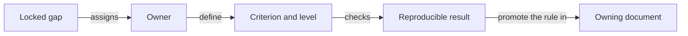

# Feedback Whist Lab

## Overview

This register groups the gaps, research limits and qualifications still required.
Stable contracts belong to thematic guidelines; each criterion remains open until the required level is verified.

## Active registers

[Active release dossier](../../release/README.md) holds the qualified APK and evidence. Intermediate candidates stay in external staging; [release qualification](../testing/ATF_ReleaseQualification.md) controls replacement of the active dossier.

| Area | Ownership and criteria |
|---|---|
| [AI players](ATF_Ai.md) | Inference, estimates, cost and policy qualification on new data. |
| [Android](ATF_Android.md) | Full history, persistence, geometry, location and accessibility. |
| [Shared interface](ATF_CardUi_Extraction.md) | Boundaries between reusable presentation and the Whist adapter: menu, profile, table, history and animation. |
| [Browser](ATF_UiBrowser.md) | Reference geometry and parity with APKs for the common Edge and Chrome adapter. |
| [Reporting](ATF_Reporting.md) | Qualification of autonomy, comparisons and memory consumption in Extent. |
| [Governance](ATF_Governance.md) | Reusable API, explicit perimeter and code cohesion. |
| [Local infrastructure](ATF_TestInfrastructure.md) | Kit concurrency, configuration isolation and API-validation cost. |
| [Whist Achievements](ATF_Achievements.md) | Restoring the status of the Android screen and calibration with human players. |

## Prioritized ToDos

The 1–100 score expresses work priority, not quality or completion percentage. It combines user impact, verification gaps, release risk and clarity of the closure criterion. Each row links to its owning register; revise the score as risk or evidence changes and close a criterion only at its required verification level.

| ID | Priority | Score | ToDo remaining and short closing criterion |
|---|---:|---:|---|
| RPT-01 | P1 | 95 | Check each producer via detached HTML and negative controls for missing, external or misassigned content. [Register](ATF_Reporting.md#rpt-android-html-only---audit-delivery-without-auxiliary-copies) |
| RPT-02 | P1 | 94 | Qualify remaining producers against missing assertions and unusable original comparisons, including FAIL, ERROR and SKIP. [Register](ATF_Reporting.md#rpt-android-component-html---captured-comparisons-not-just-junit-xml) |
| AND-01 | P1 | 93 | Prove checkpoint recovery after corruption or interruption, preserving user data or reporting an explicit error. [Register](ATF_Android.md) |
| AND-02 | P1 | 92 | Qualify the active actor, stable geometry and visible hand in bidding, play and AutoGame on the APK, for 3–6 players, RO/EN and enlarged text. [Register](ATF_Android.md) |
| AI-01 | P1 | 91 | Calibrate Hard inference for bidding with 2–8 cards and cards played on new lots; separate the accuracy of probabilities from the simulated score. [Register](ATF_Ai.md) |
| ACH-01 | P1 | 90 | Qualify restoration of Achievements scroll position and selection on the APK, and notification resumption after activity recreation. [Register](ATF_Achievements.md) |
| AND-03 | P1 | 89 | Qualify API 37, navigation of the system, resumption, enlarged fonts and memory on an identified device. [Register](ATF_Android.md) |
| RPT-03 | P1 | 88 | Publish large suites within the declared limit of the heap, without repeated copies of HTML and without losing JUnit or comparisons to failure. [Register](ATF_Reporting.md#rpt-bounded-report-heap---safe-completion-for-large-suites) |
| UI-01 | P1 | 86 | Qualify headers, player boxes and notifications on consumer APKs, including Unicode name entry. [Register](ATF_CardUi_Extraction.md#priorities-and-closing-conditions) |
| AI-02 | P2 | 82 | Measure opportunities, conversions to 500, ranking impact and latency on new batches; separate natural play from controlled prefixes. [Register](ATF_Ai.md#playing-for-zero) |
| WEB-07 | P2 | 79 | Qualify settings, resume, Play again and history in APK and Chrome on the same Android in RO/EN and with increased text. [Register](ATF_UiBrowser.md#qualification-on-the-same-device) |
| WEB-11 | P2 | 78 | Qualify ranks and suit glyphs in a 17-card hand with enlarged text in Android Chrome. [Register](ATF_UiBrowser.md#qualification-on-the-same-device) |
| WEB-15 | P2 | 77 | Complete adoption qualification in remaining consumers, preserving matching runtime/test JAR hashes and game-specific adapters. [Register](ATF_UiBrowser.md#shared-package-adoption) |
| AI-03 | P2 | 76 | Extract sample management and reuse from MonteCarloAi without changing its facade; fix random order, replay, cancellation and budget behavior through component tests. [Register](ATF_Ai.md#engine-evolution) |

## Change ownership

Legend: Closure of criteria

Each criterion states required behavior, its source and verification level. Stable rules belong in the owning document; concrete results and investigation material stay in the external audit.

Core, Reporting, Console and Mock are consumed as pinned JAR/POM pairs. This project verifies the contracts it uses, pair provenance, local integration and observed limits; coordinates and hashes define binary identity.
[Whist editorial guide](../governance/ATF_Documentation.md) defines documentation rules and local verification.

## Closure and promotion

- Distinguish demonstrated defects, missing qualification and research hypotheses.
- Check the nominal case, relevant rejection cases and source identity before closure.
- Move stable rules into their owning guide and remove only demonstrated closure criteria.
- Each open item has one owning register; READMEs explain the mechanism and link to that criterion.
- Keep the technical checks active until their explicit reconciliation.
- Update references after consolidation; moving a directory does not prove a behavior fix.

## Joint contract of autonomy

Reports must remain readable and auditable without a runner, additional JARs or auxiliary files. HTML retains context, comparisons and inline captures; consumers verify this contract through [reporting feedback](ATF_Reporting.md).

## Common test support

The Kit is consumed as a pinned JAR/POM pair. Local tests verify integration, lifecycle, concurrency and invocation propagation; library results do not replace Android-adapter or product-suite qualification.
