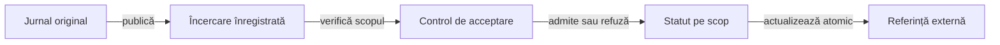

# Guvernanța predării rezultatelor Whist

## Pe scurt

Acest director descrie contractul dintre publicarea unei execuții și acceptarea ei pentru un scop declarat. Inventarul rulărilor și locațiile rapoartelor sunt date gestionate în depozitul extern.

## Stări și responsabilități

Legendă și limite

O încercare și o acceptanță sunt entități diferite. Admiterea ține cont de scop, identitatea aplicației, integritatea datelor de intrare și verificările cerute; data copierii nu schimbă ordinea execuțiilor.

## Invariante

- Identificatorul unei execuții este imuabil; un reimport identic este idempotent.
- Referințele ultimei încercări și ultimei acceptanțe sunt separate pentru fiecare scop.
- Refuzul sau absența unei verificări nu produce acceptanță implicită.
- Actualizarea referințelor folosește un singur blocaj exclusiv și înlocuire atomică.
- Publicarea nu reconstruiește interacțiuni sau intervale temporale care nu au fost capturate.

[Mecanismul de predare a rezultatelor](../../WHIST_UI_REPORT_HANDOFF.md) · [Arhitectura publicării](../../reporting/README.md) · [Responsabilități](../README.md)
