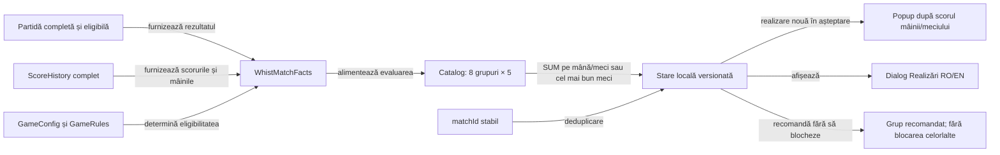

# Realizările Whist

## Scop și model

Realizările descriu rezultate observabile ale unei partide Whist și oferă o cale de progres ușor de urmărit. Catalogul are 40 de obiective stabile, în opt grupuri tematice de câte cinci. Fiecare grup conține două obiective Ușoare, două Medii și unul Greu. Nivelul realizării exprimă efortul obiectivului și nu selectează nivelul AI-ului.

Toate cele cinci obiective dintr-un grup sunt vizibile și acumulează progres din prima mână eligibilă. Recomandarea se mută la primul grup în care jucătorul nu a obținut încă niciun obiectiv. Aceasta este o orientare, nu o condiție de deblocare: obiectivele rămase din grupurile anterioare și cele din grupurile următoare pot fi obținute în orice ordine. Nicio realizare validă nu se pierde pentru că jucătorul a urmat alt traseu.

## Grupele și obiectivele

| Grup | Ușor | Mediu | Greu |
|---|---|---|---|
| 1. Primii pași | Încheie o partidă; obține un contract exact | Încheie cinci partide; obține 20 de contracte exacte | Câștigă trei partide |
| 2. Contracte pe mărimea mâinii | Contract exact la o carte; zero levate la o mână de cel puțin șase cărți | Cel puțin 50% exacte la mâinile de 2–3 cărți; cel puțin 50% exacte la mâinile de 4–5 cărți | Cel puțin 75% exacte la mâinile de 6–8 cărți |
| 3. Precizie în serie | Trei contracte exacte consecutive; cel puțin 50% exacte într-o partidă | Cel puțin 60% exacte; cel puțin 65% exacte într-o partidă | Cel puțin 75% exacte într-o partidă |
| 4. Serii pozitive | Încheie meci cu serii activate; obține primul bonus pozitiv | Obține trei bonusuri pozitive; câștigă cu bonus pozitiv | Obține bonusuri pozitive în cinci partide distincte |
| 5. Variante românești | Încheie 1–8–1; încheie 8–1–8 | Câștigă în 1–8–1; câștigă în 8–1–8 | Obține 500 de puncte prin regula Joc la 0 |
| 6. Mese și clasamente | Încheie o partidă la 3; încheie una la 6 jucători | Top doi la 5; top doi la 6 jucători | Câștigă trei partide la 6 jucători |
| 7. Închidere și versatilitate | Contract exact în ultima mână; exactitate la șapte mărimi de mână | Final cu trei contracte exacte; exactitate la toate mărimile 1–8 | Cinci contracte exacte în ultimele cinci mâini |
| 8. Clasament și reveniri | Păstrează/îmbunătățește locul de la jumătatea jocului; top trei la patru jucători | Top doi la patru jucători; urcă cel puțin un loc după jumătatea jocului | De pe ultimul loc la jumătate, termină în primii doi |

Catalogul executabil și textele în română și engleză sunt în [WhistAchievementCatalog](../../whist-lab-app/app/src/main/java/ro/whistlab/app/achievements/WhistAchievementCatalog.java). Interfața afișează progresul plafonat la țintă; modelul păstrează valoarea acumulată pentru ca obiectivele cu praguri diferite să poată folosi aceeași măsură.

## Sursa de adevăr

- Progresul de mână se acordă numai după ce levatele, licitațiile și scorul acelei mâini au fost înregistrate. Obiectivele care depind de întreaga partidă se acordă numai după `SCORE` și `finalHand`, pentru locul uman de la scaunul 0.
- O partidă este utilizabilă dacă registrul include întregul program de mâini, ofertele și levatele înregistrate pentru fiecare mână. Un checkpoint vechi cu istoric incomplet nu inventează evenimente și nu acordă realizări.
- Contractul exact este decis de perechea salvată `bid == tricks`, nu de o deducție din scorul final. Mărimea mâinii provine din `GameRules.handSizes` pentru varianta și masa configurate.
- Pragurile exprimate în procente folosesc numărul real de mâini din partida și categoria respectivă. Astfel, aceeași realizare nu devine mai ușoară doar pentru că varianta sau numărul jucătorilor distribuie mai multe mâini dintr-o anumită mărime.
- Clasamentul folosește `matchScore`, deci egalitatea pe primul loc este victorie comună, iar primii doi sunt determinați ținând cont de egalități. Bonusul de 500 pentru Joc la 0 este inclus în această valoare.
- Un bonus de serie este recunoscut numai dacă diferența dintre schimbarea înregistrată și punctajul de bază este pozitivă. Penalizarea de serie nu este o realizare și nu este recompensată.
- Realizările sunt locale instalării și nu sunt legate de numele editabil al jucătorului. Partidele de fixture sau replay rămân excluse prin eligibilitatea existentă a partidei. Auto-play-ul mâinii este inclus: rezultatul jocului este măsurat, iar proveniența manuală/automată nu este persistată de modelul actual.

## Acumulare și reluare

Obiectivele cumulative folosesc `SUM`, aplicat pe mână când evenimentul este local mâinii și pe partidă când cere o partidă încheiată. Obiectivele care spun „într-o partidă” sau „consecutive” folosesc `BEST_MATCH`; o serie exactă nu se poate lipi de mâini din partide diferite. Mâinile și partidele au ID-uri de eveniment persistente, derivate din `matchId`; repetarea salvării, reluarea după restart sau reconcilierea unui istoric deja persistat nu adaugă progres de două ori.

La trecerea unui obiectiv de prag, ID-ul său intră în lista locală a notificărilor neafișate. Ecranul de scor arată un singur popup grupat după mâna completată sau după finalul partidei, cu realizările noi și totalul de progres. Lista se șterge numai după închiderea popup-ului; dacă aplicația se oprește înainte, notificarea reapare la reluare.

Starea este JSON versionat, într-un spațiu separat de clasamente și de numele profilului. Schema anterioară se migrează păstrând progresul și ID-urile partidelor; nu inventează ID-uri de mâini sau notificări vechi. Dacă starea este coruptă sau de o versiune incompatibilă, aplicația semnalează eroarea de salvare; nu o resetează în tăcere.

## Verificare

[WhistAchievementComponentTest](../../whist-lab-app/app/src/test/java/ro/whistlab/app/achievements/WhistAchievementComponentTest.java) verifică forma catalogului, disponibilitatea obiectivelor între grupuri, pragurile `SUM`/`BEST_MATCH`, ambele variante românești, mesele de 3 și 6 locuri, faptele pe mână și pe partidă, notificările persistente și idempotenta după restart și redenumire. [GamePersistenceRankingComponentTest](../../whist-lab-app/app/src/test/java/ro/whistlab/app/persistence/GamePersistenceRankingComponentTest.java) verifică ordinea checkpoint–progres la mâna încheiată–clasament–replay și izolarea erorilor de stocare.

Corpusul offline activ este selectat pentru lecții AI, nu pentru a estima șansa unui jucător uman de a obține o realizare. El poate depista obiective fără exemple observate sau praguri cu probleme, dar procentele din acel corpus nu sunt prezentate ca probabilități de utilizator.

[Contractele variantelor](README.md) · [Componente JVM ale aplicației](../../whist-lab-app/app/src/test/README.md) · [Strategia de testare](../testing/README.md)
