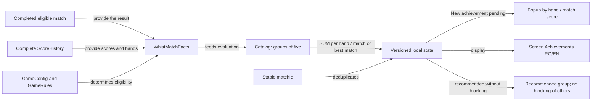

# Whist Achievements

## Overview

The catalogue comprises 55 stable targets, in 11 thematic groups of five, based on observable game results. Each group contains two Light, Two Medium and One Hard objectives; the difficulty of achieving is distinct from the level of the AIU.

All five objectives are visible and gain progress from the first eligible hand. The recommended group is the first where the player has not yet achieved a goal. The Recommendation is indicative; objectives across all groups remain available in any order.

Legend: facts, status and notifications

Hands and games provide distinct facts. The assessment shall update the local status with Iempotenti identifiers and the notification shall be pending until the user has confirmed it.

## Groups and objectives

| Group | Easy | Medium | Hard |
|---|---|---|---|
| 1. First steps | Close a game; get an exact contract | He concludes five games; he gets 20 accurate contracts | Win three games |
| 2. Contract in hand size | Accurate contract to one card; zero levelled to a hand of at least six cards | At least 50% exact to the hands of 2–3 cards; at least 50% exact to the hands of 4–5 cards | At least 75% exact to the hands of 6–8 cards |
| 3. Serial precision | Three consecutive exact contracts; at least 50% exact in a match | At least 60% accurate; at least 65% accurate in a match | At least 75% accurate in a match |
| 4. Streaks positive | End match with activated series; get first positive bonus | Get three positive bonuses; win with positive bonus | Get positive bonuses in five distinct games |
| 5. Romanian Variants | End 1–8–1; end 8–1–8 | Win in 1–8–1; win in 8–1–8 | Get 500 points by playing rule at 0 |
| 6. Tables and rankings | Ends a game at 3; ends one at 6 players | Top two at 5; top two at 6 players | Win three games at 6 players |
| 7. Closure and versatility | Contract exact in the last hand; accurate at seven hand sizes | Final with three exact contracts; accurate at all sizes 1–8 | Five exact contracts in the last five hands |
| 8. Rankings and returns | Keep / improve the place half game; top three to four players | Top two to four players; climb at least one place after half the game | From last place to half, finish in the top two |
| 9. Zero contracts | First zero at 2–8 cards; three zeros at 2–3 cards | Three zeroes at 4–5 cards; three zeroes at eight cards | Zero exactly in each of the three intervals in a match |
| 10. Contracts positive | Exactly one trick; at least two tricks on an exact contract | Three exact contracts of at least three tricks; five positive contracts of 6–8 cards | At least 65% accurate between eligible positive bids of a game |
| 11. Return to precision | Come back after one fail; come back after at least two consecutive misses | Pick up five returns of two exact contracts; return twice after each type of failure in a match | Four separate returns of three exact contracts in a match |

- YAML Catalogue declares the groups, order, texts RO/ENGradle, the metrics and thresholds. Before generation, validates the shape of objects, fields, IDs, trade groups and metrics-aggregation combinations compared to runtime lists; refusal identifies invalid registration prior to Java compilation. [Catalog executable](../../whist-lab-app/app/src/main/achievement-rules/whist-achievements.yaml) · [Contract validation](../../whist-lab-app/app/achievement-catalog.gradle)
- `:app:verifyWhistAchievementCatalogValidation` checks the vectors valid and negative; the tasku is part of `:app:testDebugAchievementsComponents` and `check`. Runtime tests shall verify separately the order and the identity generated, thresholds, resumption and the impotence of progress.
- Established identifiers link the saved progress to the displayed target. The interface caps progress to the target and the model retains the accumulated value for thresholds using the same measure.

## Source of truth

- Hand progress is granted only after the tricks, bids and score of that hand have been recorded. The objectives that depend on the entire game shall be granted only after `SCORE` and `finalHand` for the human seat of 0.
- A game is usable if the register includes the entire hand program, the bids and tricks recorded for each hand. An old checkpoint with incomplete history does not invent events and does not grant achievements.
- The exact contract is decided by the saved pair `bid == tricks`, not by a deduction from the final score. The size of the hand comes from `GameRules.handSizes` for the configured variant and table.
- The percentage thresholds shall use the actual number of hands in the game and in the category concerned. Full progress is the whole part of the report, so a result below the threshold is not rounded up when unlocking. Report the difficulty separately on configurations, as the number of opportunities and the distribution of results differ.
- Rankings use `matchScore`. A tie for first is a shared win, and the top two places account for ties. The 500-point award for playing for zero is included in that value.
- A series bonus is only recognised if the difference between the change recorded and the baseline score is positive. Serial penalty is not an achievement and is not rewarded.
- The achievements are local to the installation and are not related to the editable name of the player. The fixture or replay games remain excluded by the existing eligibility of the match. AutoPlay hand is included: the result of the game is measured and the manual / automatic provenance is not persisted by the current model.

## Measurement of contracts and returns

- Zero requires both a zero and zero trick bid won. The objectives by hand size are 2–3, 4–5 and 6–8 cards. A handful of a card remains in the group dedicated to that size.
- The accuracy of positive bids uses only 2–8 hands, which the player has bid more than zero. The game shall contain at least eight such tenders and the proportion shall be calculated from all such contracts, including those missed.
- A comeback starts at the first contract right after a failure. For return in both directions, the last failure before the contract exactly sets the direction. The sequences continue until the next failure and contribute once to each applicable threshold.
- The recommended order goes from individual contracts to repetition, coverage and precision in a game. The difficulty shall take into account the frequency of the eligible opportunities, the cumulative effort and the requirement to confirm them in the same game.

## Accumulation and restoration

- `SUM` gathers the eligible events, and `BEST_MATCH` keeps the best outcome of the match; the series do not unite between games. Persistent IDs derived from `matchId` make saving, resuming and reconciling idempotents.
- At the threshold, the output IDA enters the local tail. The score screen groups notifications by hand or by match; the items remain in line until closure and reappear after premature shutdown.
- The Whist projection prepares text and order for the common list and panel. The coordinator shall keep the unique window and durable confirmation. [Projection](../../whist-lab-app/app/src/main/java/ro/whistlab/app/achievements/presentation/WhistAchievementPresentation.java) · [Coordinator](../../whist-lab-app/app/src/main/java/ro/whistlab/app/achievements/notice/WhistAchievementNoticeCoordinator.java) · [Common interface](../../whist-lab-app/atf-card-table-ui/README.md#achievements)
- The state of the JSON is separated from the leaderboards and profile. The extension of the catalogue shall retain existing IDs, thresholds and unlocks. The added objectives receive credit for new events and a resumption of game keeps the history of the deduction.

## Verification

- [WhistAchievementComponentTest](../../whist-lab-app/app/src/test/java/ro/whistlab/app/achievements/WhistAchievementComponentTest.java) checks the rules, thresholds, variants, game facts, migration and idempotence.
- [WhistContractAchievementsComponentTest](../../whist-lab-app/app/src/test/java/ro/whistlab/app/achievements/WhistContractAchievementsComponentTest.java) checks the eligible sizes, denominator of the accuracy, direction of return and simultaneous progress of the extended catalogue.
- [WhistAchievementPresentationComponentTest](../../whist-lab-app/app/src/test/java/ro/whistlab/app/achievements/WhistAchievementPresentationComponentTest.java) compares all rows RO/EN and checks the order and progress displayed.
- [WhistAchievementNoticeCoordinatorComponentTest](../../whist-lab-app/app/src/test/java/ro/whistlab/app/achievements/WhistAchievementNoticeCoordinatorComponentTest.java) checks the unique dialogue, confirmation, closure, storage errors and return after restart.
- [GamePersistenceRankingComponentTest](../../whist-lab-app/app/src/test/java/ro/whistlab/app/persistence/GamePersistenceRankingComponentTest.java) checks the checkpoint-achievement-ranking-replay order and isolation of storage errors.
- [WhistAchievementOfflineCalibrationTest](../../whist-lab-app/app/src/test/java/ro/whistlab/app/achievements/WhistAchievementOfflineCalibrationTest.java) plays full games Normal/Hard on the same seedings, measures targets `SUM` and `BEST_MATCH` separately, checks the resumption without double credit and writes an Extent compact report plus CSVs outside the warehouse. The load eighty-in `:app:testDebugAchievementCalibration` supports a calibration phase or holdout; the seed intervals must be disjuncted.

- Begins with 1–8–1 to four places; then extends to the Romanian tables of 3–6 places and to 8–1–8.
- Run Normal and Hard on the same distribution and keep progress separate on level.
- Compare eligibility, opportunities with progress, success per game and cumulative unlocking.
- Compare streak bonuses and penalties of 5 and 10 on paired deals; report Play to Zero separately.
- It uses disjoint seed intervals between calibration and holdout, keeping the simulation of the configurations in each phase. The distribution print includes the order of all hands, the divisionaries, the cards and the trump.
- For new thresholds, the CSV per game keeps the gross measure. The value of `NA` marks a match without the minimum number of eligible opportunities.
- Low frequency in self-game does not prove human impossibility; any changed threshold must be confirmed and keep the progress saved.

Calibration simulation is an experiment separate from the active AI learning corpus. It can detect objectives without occasion, redundant advances and thresholds that do not fit the simulated policies; its results describe self-game Normal/Hard and are not presented as probabilities for people. The calibration and holdout selection, seedants, configuration and source hashes shall be kept together in external artifacts.

[Variant contracts](README.md) · [JVM application components](../../whist-lab-app/app/src/test/README.md) · [Test strategy](../testing/README.md)
