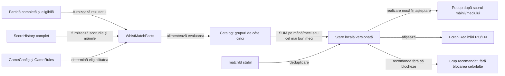

# Realizările Whist

## Scop și model

Catalogul cuprinde 55 de obiective stabile, în 11 grupuri tematice de câte cinci, bazate pe rezultate observabile ale jocului. Fiecare grup conține două obiective Ușoare, două Medii și unul Greu; dificultatea realizării este distinctă de nivelul AI-ului.

Toate cele cinci obiective sunt vizibile și acumulează progres de la prima mână eligibilă. Grupul recomandat este primul în care jucătorul nu a obținut încă un obiectiv. Recomandarea este orientativă; obiectivele din toate grupurile rămân disponibile în orice ordine.

Legendă: fapte, stare și notificări

Mâinile și partidele furnizează fapte distincte. Evaluarea actualizează starea locală cu identificatori idempotenti, iar notificarea rămâne în așteptare până la confirmarea utilizatorului.

## Grupele și obiectivele

| Grup | Ușor | Mediu | Greu |
|---|---|---|---|
| 1. Primii pași | Încheie o partidă; obține un contract exact | Încheie cinci partide; obține 20 de contracte exacte | Câștigă trei partide |
| 2. Contracte pe mărimea mâinii | Contract exact la o carte; zero levate la o mână de cel puțin șase cărți | Cel puțin 50% exacte la mâinile de 2–3 cărți; cel puțin 50% exacte la mâinile de 4–5 cărți | Cel puțin 75% exacte la mâinile de 6–8 cărți |
| 3. Precizie în serie | Trei contracte exacte consecutive; cel puțin 50% exacte într-o partidă | Cel puțin 60% exacte; cel puțin 65% exacte într-o partidă | Cel puțin 75% exacte într-o partidă |
| 4. Serii pozitive | Încheie meci cu serii activate; obține primul bonus pozitiv | Obține trei bonusuri pozitive; câștigă cu bonus pozitiv | Obține bonusuri pozitive în cinci partide distincte |
| 5. Variante românești | Încheie 1–8–1; încheie 8–1–8 | Câștigă în 1–8–1; câștigă în 8–1–8 | Obține 500 de puncte prin regula Joc la 0 |
| 6. Mese și clasamente | Încheie o partidă la 3; încheie una la 6 jucători | Top doi la 5; top doi la 6 jucători | Câștigă trei partide la 6 jucători |
| 7. Închidere și versatilitate | Contract exact în ultima mână; exactitate la șapte mărimi de mână | Final cu trei contracte exacte; exactitate la toate mărimile 1–8 | Cinci contracte exacte în ultimele cinci mâini |
| 8. Clasament și reveniri | Păstrează/îmbunătățește locul de la jumătatea jocului; top trei la patru jucători | Top doi la patru jucători; urcă cel puțin un loc după jumătatea jocului | De pe ultimul loc la jumătate, termină în primii doi |
| 9. Contracte de zero | Primul zero la 2–8 cărți; trei zerouri la 2–3 cărți | Trei zerouri la 4–5 cărți; trei zerouri la opt cărți | Zero exact în fiecare dintre cele trei intervale, într-o partidă |
| 10. Contracte pozitive | Exact o levată; cel puțin două levate la un contract exact | Trei contracte exacte de cel puțin trei levate; cinci contracte pozitive exacte la 6–8 cărți | Cel puțin 65% exacte între licitațiile pozitive eligibile ale unei partide |
| 11. Revenirea la precizie | Revino după o ratare; revino după cel puțin două ratări consecutive | Adună cinci reveniri de câte două contracte exacte; revino de două ori după fiecare tip de ratare într-o partidă | Patru reveniri distincte de câte trei contracte exacte într-o partidă |

- Catalogul YAML declară grupurile, ordinea, textele RO/EN, metricile și pragurile. Înainte de generare, Gradle validează forma obiectelor, câmpurile, ID-urile, grupurile negoale și combinațiile metrică–agregare față de enum-urile runtime; refuzul identifică înregistrarea invalidă înaintea compilării Java. [Catalogul executabil](../../whist-lab-app/app/src/main/achievement-rules/whist-achievements.yaml) · [Validarea de contract](../../whist-lab-app/app/achievement-catalog.gradle)
- `:app:verifyWhistAchievementCatalogValidation` verifică vectorii valizi și negativi; taskul face parte din `:app:testDebugAchievementsComponents` și `check`. Testele runtime verifică separat ordinea și identitățile generate, pragurile, reluarea și acordarea idempotentă a progresului.
- Identificatorii stabili leagă progresul salvat de obiectivul afișat. Interfața plafonează progresul la țintă, iar modelul păstrează valoarea acumulată pentru pragurile care folosesc aceeași măsură.

## Sursa de adevăr

- Progresul de mână se acordă numai după ce levatele, licitațiile și scorul acelei mâini au fost înregistrate. Obiectivele care depind de întreaga partidă se acordă numai după `SCORE` și `finalHand`, pentru locul uman de la scaunul 0.
- O partidă este utilizabilă dacă registrul include întregul program de mâini, ofertele și levatele înregistrate pentru fiecare mână. Un checkpoint vechi cu istoric incomplet nu inventează evenimente și nu acordă realizări.
- Contractul exact este decis de perechea salvată `bid == tricks`, nu de o deducție din scorul final. Mărimea mâinii provine din `GameRules.handSizes` pentru varianta și masa configurate.
- Pragurile procentuale folosesc numărul real de mâini din partidă și din categoria respectivă. Progresul întreg este partea întreagă a raportului, deci un rezultat sub prag nu este rotunjit în sus la deblocare. Raportează dificultatea separat pe configurații, fiindcă numărul de ocazii și distribuția rezultatelor diferă.
- Clasamentul folosește `matchScore`, deci egalitatea pe primul loc este victorie comună, iar primii doi sunt determinați ținând cont de egalități. Bonusul de 500 pentru Joc la 0 este inclus în această valoare.
- Un bonus de serie este recunoscut numai dacă diferența dintre schimbarea înregistrată și punctajul de bază este pozitivă. Penalizarea de serie nu este o realizare și nu este recompensată.
- Realizările sunt locale instalării și nu sunt legate de numele editabil al jucătorului. Partidele de fixture sau replay rămân excluse prin eligibilitatea existentă a partidei. Auto-play-ul mâinii este inclus: rezultatul jocului este măsurat, iar proveniența manuală/automată nu este persistată de modelul actual.

## Măsurarea contractelor și revenirilor

- Zero cere atât o licitație de zero, cât și zero levate câștigate. Obiectivele după mărimea mâinii folosesc 2–3, 4–5 și 6–8 cărți. O mână de o carte rămâne în grupa dedicată acelei mărimi.
- Precizia licitațiilor pozitive folosește doar mâini de 2–8 cărți la care jucătorul a licitat mai mult de zero. Partida trebuie să conțină cel puțin opt astfel de licitații, iar proporția se calculează din toate aceste contracte, inclusiv cele ratate.
- O revenire începe la primul contract exact imediat după o ratare. Pentru revenirea în ambele direcții, ultima ratare dinaintea contractului exact stabilește direcția. Secvențele continuă până la următoarea ratare și contribuie o singură dată la fiecare prag aplicabil.
- Ordinea recomandată trece de la contracte individuale la repetare, acoperire și precizie într-o partidă. Dificultatea ține cont de frecvența ocaziilor eligibile, de efortul cumulativ și de cerința de a le confirma în aceeași partidă.

## Acumulare și reluare

- `SUM` adună evenimentele eligibile, iar `BEST_MATCH` păstrează cel mai bun rezultat dintr-o partidă; seriile nu se unesc între partide. ID-urile persistente, derivate din `matchId`, fac salvarea, reluarea și reconcilierea idempotente.
- La atingerea pragului, ID-ul realizării intră în coada locală. Ecranul de scor grupează notificările după mână sau partidă; elementele rămân în coadă până la închidere și reapar după o oprire prematură.
- Proiecția Whist pregătește textul și ordinea pentru lista și panoul comune. Coordonatorul păstrează fereastra unică și confirmarea durabilă. [Proiecția](../../whist-lab-app/app/src/main/java/ro/whistlab/app/achievements/presentation/WhistAchievementPresentation.java) · [Coordonatorul](../../whist-lab-app/app/src/main/java/ro/whistlab/app/achievements/notice/WhistAchievementNoticeCoordinator.java) · [Interfața comună](../../whist-lab-app/atf-card-table-ui/README.md#realizări)
- Starea JSON versionată este separată de clasamente și profil. Extinderea catalogului păstrează ID-urile, pragurile și deblocările existente. Obiectivele adăugate primesc credit la evenimente noi, iar o partidă reluată păstrează istoricul de deduplicare.

## Verificare

- [WhistAchievementComponentTest](../../whist-lab-app/app/src/test/java/ro/whistlab/app/achievements/WhistAchievementComponentTest.java) verifică regulile, pragurile, variantele, faptele de joc, migrarea și idempotenta.
- [WhistContractAchievementsComponentTest](../../whist-lab-app/app/src/test/java/ro/whistlab/app/achievements/WhistContractAchievementsComponentTest.java) verifică mărimile eligibile, numitorul preciziei, direcția revenirii și progresul simultan al catalogului extins.
- [WhistAchievementPresentationComponentTest](../../whist-lab-app/app/src/test/java/ro/whistlab/app/achievements/WhistAchievementPresentationComponentTest.java) compară toate rândurile RO/EN și verifică ordinea și progresul afișat.
- [WhistAchievementNoticeCoordinatorComponentTest](../../whist-lab-app/app/src/test/java/ro/whistlab/app/achievements/WhistAchievementNoticeCoordinatorComponentTest.java) verifică dialogul unic, confirmarea, închiderea, erorile de stocare și revenirea după restart.
- [GamePersistenceRankingComponentTest](../../whist-lab-app/app/src/test/java/ro/whistlab/app/persistence/GamePersistenceRankingComponentTest.java) verifică ordinea checkpoint–realizări–clasament–replay și izolarea erorilor de stocare.
- [WhistAchievementOfflineCalibrationTest](../../whist-lab-app/app/src/test/java/ro/whistlab/app/achievements/WhistAchievementOfflineCalibrationTest.java) joacă partide complete Normal/Greu pe aceleași seed-uri, măsoară separat țintele `SUM` și `BEST_MATCH`, verifică reluarea fără credit dublu și scrie un raport Extent compact plus CSV-uri în afara depozitului. Sarcina opt-in `:app:testDebugAchievementCalibration` acceptă o fază de calibrare sau holdout; intervalele de seed trebuie să fie disjuncte.

- Începe cu 1–8–1 la patru locuri; extinde apoi la mesele românești de 3–6 locuri și la 8–1–8.
- Rulează Normal și Greu pe aceeași distribuire și păstrează progresul separat pe nivel.
- Compară eligibilitatea, ocaziile cu progres, reușitele pe partidă și deblocarea cumulativă.
- Compară valorile 5 și 10 ale bonusului/penalizării pe aceleași seed-uri; raportează Joc la 0 separat.
- Folosește intervale de seed disjuncte între calibrare și holdout, păstrând împerecherea configurațiilor în fiecare fază. Amprenta distribuției include ordinea tuturor mâinilor, împărțitorii, cărțile și atuul.
- Pentru pragurile noi, CSV-ul pe partidă păstrează măsura brută. Valoarea `NA` marchează o partidă fără numărul minim de ocazii eligibile.
- Frecvența mică în auto-joc nu dovedește imposibilitatea umană; orice prag schimbat trebuie confirmat și să păstreze progresul salvat.

Simularea de calibrare este un experiment separat de corpusul activ de învățare AI. Ea poate depista obiective fără ocazii, progresii redundante și praguri care nu se potrivesc politicilor simulate; rezultatele sale descriu auto-jocul Normal/Greu și nu sunt prezentate ca probabilități pentru oameni. Selecția de calibrare și holdout, seed-urile, configurația și hash-urile surselor trebuie păstrate împreună, în artefacte externe.

[Contractele variantelor](README.md) · [Componente JVM ale aplicației](../../whist-lab-app/app/src/test/README.md) · [Strategia de testare](../testing/README.md)
