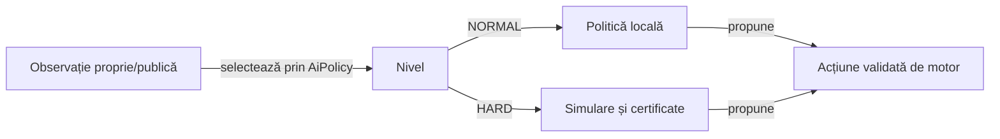

# Normal și Hard

[AiDifficulty](../../whist-lab-app/game-core/src/main/java/ro/whistlab/core/config/AiDifficulty.java) definește nivelurile de joc, iar [AiPolicy](../../whist-lab-app/game-core/src/main/java/ro/whistlab/core/ai/policy/AiPolicy.java) selectează implementarea. Dificultatea schimbă decizia AI în același contract de reguli.

## Responsabilități

Legendă: dificultatea nu modifică legalitatea

Ambele politici folosesc aceeași variantă și observație permisă. Motorul verifică acțiunea înainte de a schimba starea; nicio dificultate nu primește mâinile reale ale adversarilor.

## Obiective

| Politică | Comportament |
|---|---|
| Normal la licitare | Estimează puterea mâinii proprii și alege o licitație permisă. |
| Normal înaintea contractului | Caută levatele încă necesare și păstrează șanse viitoare când levata curentă nu poate fi luată. |
| Normal după contract | Evită levatele suplimentare și descarcă riscul viitor în limitele legale. |
| Hard cu contract recuperabil | Prioritizează șansa estimată a exactului, punctele proprii și scorul rivalului principal. |
| Hard cu imposibilitate publică | Protejează mai întâi punctele proprii estimate, apoi urmărește ratările adverse estimate. |
| Normal și Hard cu „Joc la 0” | Trec la ținta de zero exact când limitele publice exclud primele două locuri prin scor convențional, iar zero rămâne posibil în programul rămas. |

[Modelul deciziei](../ai/ATF_DecisionModel.md#prioritatea-obiectivelor) deține ordinea criteriilor, domeniile și certificatele runtime. [Manifestul obiectivelor](../../config/whist-play-objectives.yaml) leagă intenția de implementare și componente; parametrii și condițiile exacte se citesc din cod.

## Informație și adaptare

- Necesarul fiecărui loc se recalculează după levatele încheiate.
- Cărțile proprii, cele jucate, masa și cartea întoarsă sunt excluse din pool-ul ipotetic necorespunzător.
- Lipsurile de culoare demonstrate restrâng mâinile fezabile.
- Licitațiile cunoscute sunt ținte de contract în continuările simulate.
- La 2–8 cărți, ponderarea generală după comportamentul advers rămâne cercetare; licitarea de o carte are deja modelul condiționat specializat și fallback-ul descrise în [modelul deciziei](../ai/ATF_DecisionModel.md#estimarea-alternativelor).
- O estimare Monte Carlo și un certificat finit au niveluri diferite de certitudine.

## Compatibilitate

Parserul de dificultate convertește numele vechi EXPERT în HARD fără o a treia opțiune de meniu. Numele necunoscute și checkpoint-urile invalide sunt tratate prin validările explicite ale persistenței.

[Testele de contract](../../whist-lab-app/game-core/src/test/java/ro/whistlab/core/ai/policy/DifficultyContractTest.java) verifică enum-ul, dispatch-ul și migrarea. [Colecțiile](../testing/ATF_Collections.md) disting regresiile de domeniu de compararea politicilor și integrarea Android.

[Modelul deciziei](../ai/ATF_DecisionModel.md) formalizează observația, estimarea și ordinea obiectivelor.
