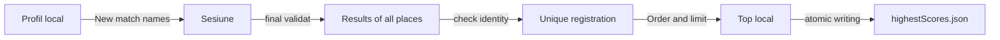

# Player profile and local leaderboards

## Overview

The names displayed, the results of a game and the ranking have distinct responsibilities. The change in name keeps the rules and the score; a result already recorded keeps the name at the end.

## Registration flow

Legend: identity, result and rescue

Only the last hand score phase can power the top. The unique identity of the match, kept in checkpoint, prevents re-registration at restart; a writing failure leaves the operation available for retest.

## Table name and identity

| Mechanism | Contract |
|---|---|
| Name of man | Available from the original menu and the match menu; 1–10 code points after removal of marginal spaces and normalisation of NFC, according to [PlayerNames](../../whist-lab-app/game-core/src/main/java/ro/whistlab/core/player/PlayerNames.java). |
| Edit Unicode | Typing and sticking measure the entire name proposed after the same normalisation. An over-the-limit edit shall retain the previous text, including the replaced selection. Delete remains available. |
| Salvarea | The profile validates the name from the active sites. Update the session and request the save of the match after confirmation of the profile writing. |
| Anularea | Closing the dialogue ends the editing. A closed editing callback does not write the profile or change the game. |
| Resetarea | Redo the default localized label; scores, cards and current history remain preserved. |
| Adversari AI | Short, distinct and randomly chosen names in the new game; the replay retains the saved names. |
| Random separation | The generation of names has its own flow; it does not consume the random distribution or policies of AI. |
| Historical records | The subsequent change of profile does not retroactively rename the ranking results. |

## Ranking and local file

- **Initialization: ** each base variant receives ten random results, explicitly marked as examples. A new profile receives the same initialization on first use.
- **Partitioning: ** variant, number of players, difficulty and series rules identify a top; scores obtained under different rules remain separate.
- **Selection: ** at completion are considered all places, including AI, in descending order of points. Maintain up to twenty entries; the equals have stable criteria, with real result before an equal example.
- **Display: ** Top 10 and Top 20 are presentation limits. The choice of Top 10 does not delete the additional retained entries.
- **Persistence:** `highestScores.json` is in the private directory `files` application; [adaptorul Android](../../whist-lab-app/app/src/main/java/ro/whistlab/app/highscores/AndroidHighScoreStorage.java) Use `AtomicFile`.
- **Integrity: ** incompatible scheme or invalid data are refused; the existing file is not replaced by automatic reinitialization.

## Series and compatibility

The menu of new games provides5 or ±10 points after five consecutive eligible results, or deactivation of the series. Hands of a card keep the eligibility and interruption rules described in the table below. [game rules](ATF_RulesRo.md).

[GameSessionStore](../../whist-lab-app/app/src/main/java/ro/whistlab/app/persistence/GameSessionStore.java) is a separate salvation of reward and penalty. Previous rescue without explicit penalty keeps − 5, including when the reward was + 10; the resumption does not recalculate the balances already granted and does not change the rules of that game.

- `GameConfig.newMatch` is the entry of the menu for symmetrical rules; the historic single-value builder retains the penalty of 5 for existing protocols.
- Experiments that adopt the new rule explicitly declare both values and qualify separately; the change of menu does not rewrite the corpusses or reference sources.

## Verification

Components check the complete program, the seat association, migration, top order, refusal of corruption, retesting and idempotence of registration. Geometry observed, Android navigation and effective recovery of the file adapter have [acceptance of separate E2E](../testing/ATF_Android.md#profile-history-leaderboards-and-series).

[Length history](ATF_ScoreHistory.md) · [Interface Atlas](../../whist-lab-app/app/src/main/java/ro/whistlab/app/README.md)
