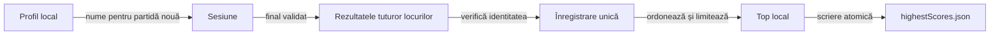

# Profilul jucătorului și clasamentele locale

Numele afișat, rezultatele unei partide și clasamentul au responsabilități distincte. Modificarea numelui păstrează regulile și scorul; un rezultat deja înregistrat păstrează numele de la încheiere.

## Fluxul înregistrării

Legendă: identitate, rezultat și salvare

Numai faza de scor a ultimei mâini poate alimenta topul. Identitatea unică a partidei, păstrată în checkpoint, previne reînregistrarea la reluare; un eșec de scriere lasă operația disponibilă pentru reîncercare.

## Nume și identitatea mesei

| Mecanism | Contract |
|---|---|
| Numele omului | Disponibil din meniul inițial și meniul partidei; 1–10 caractere vizibile acceptate de [PlayerNames](../../whist-lab-app/game-core/src/main/java/ro/whistlab/core/player/PlayerNames.java). |
| Resetarea | Reface eticheta implicită localizată; scorurile, cărțile și istoricul curent rămân păstrate. |
| Adversari AI | Nume scurte, distincte și alese aleatoriu la partidă nouă; reluarea păstrează numele salvate. |
| Separarea aleatorului | Generarea numelor are flux propriu; nu consumă aleatorul distribuirii sau al politicilor AI. |
| Înregistrări istorice | Schimbarea ulterioară a profilului nu redenumește retroactiv rezultatele din clasament. |

## Clasamentul și fișierul local

- **Inițializare:** fiecare variantă de bază primește zece rezultate aleatorii, marcate explicit ca exemple. Un profil nou primește aceeași inițializare la prima utilizare.
- **Partiționare:** varianta, numărul jucătorilor, dificultatea și regulile seriilor identifică un top; scorurile obținute sub reguli diferite rămân separate.
- **Selecție:** la încheiere sunt considerate toate locurile, inclusiv AI, în ordinea descrescătoare a punctelor. Se păstrează până la douăzeci de intrări; egalitățile au criterii stabile, cu rezultat real înaintea unui exemplu egal.
- **Afișare:** Top 10 și Top 20 sunt limite de prezentare. Alegerea Top 10 nu șterge intrările suplimentare păstrate.
- **Persistență:** `highestScores.json` este în directorul privat `files` al aplicației; [adaptorul Android](../../whist-lab-app/app/src/main/java/ro/whistlab/app/highscores/AndroidHighScoreStorage.java) folosește `AtomicFile`.
- **Integritate:** schema incompatibilă ori datele invalide sunt refuzate; fișierul existent nu este înlocuit prin reinițializare automată.

## Serii și compatibilitate

Meniul partidelor noi oferă ±5 sau ±10 puncte după cinci rezultate eligibile consecutive, ori dezactivarea seriilor. Mâinile de o carte păstrează regulile de eligibilitate și întrerupere descrise în [regulile jocului](ATF_RulesRo.md).

[GameSessionStore](../../whist-lab-app/app/src/main/java/ro/whistlab/app/persistence/GameSessionStore.java) salvează distinct recompensa și penalizarea. Salvările anterioare fără penalizare explicită păstrează −5, inclusiv când recompensa era +10; reluarea nu recalculează soldurile deja acordate și nu schimbă regulile acelei partide.

- `GameConfig.newMatch` este intrarea meniului pentru regulile simetrice; constructorul istoric cu o singură valoare păstrează penalizarea de 5 pentru protocoalele existente.
- Experimentele care adoptă regula nouă declară explicit ambele valori și se califică separat; schimbarea meniului nu rescrie corpusurile sau sursele de referință.

## Verificare

Componentele verifică programul complet, asocierea locurilor, migrarea, ordonarea topului, refuzul coruperii, reîncercarea și idempotenta înregistrării. Geometria observată, navigarea Android și recuperarea efectivă a adaptorului de fișier au [acceptanță E2E separată](../testing/ATF_Android.md#profil-istoric-clasamente-și-serii).

[Istoricul scorului](ATF_ScoreHistory.md) · [Atlasul interfeței](../../whist-lab-app/app/src/main/java/ro/whistlab/app/README.md)
