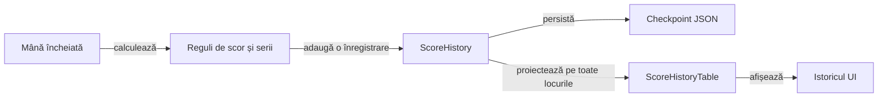

# Modelul istoricului de scor

Istoricul păstrează licitația, punctele mâinii și totalul fiecărui loc după o mână încheiată. Prezentarea și persistența consumă același registru, iar datele necunoscute dintr-o salvare veche rămân marcate ca necunoscute.

Registrul stochează licitațiile, levatele câștigate și soldurile; punctele sunt diferențe de sold. Rezultatul contractului compară licitatul cu levatele, independent de semnul punctelor. O licitație ratată este tăiată oblic, păstrând cifra lizibilă și descrierea accesibilă explicită.

- Fiecare jucător are exact două coloane vizibile: licitat și punctajul total după mâna respectivă; coloana `P` folosește soldul înregistrat pentru acel rând.
- Totalul este încadrat într-un dreptunghi numai pe mâna în care se acordă bonusul sau penalizarea de serie, exclusiv în celula `P` a jucătorului respectiv; semnul pozitiv ori negativ, singur, nu justifică marcajul.
- Diferența de puncte a mâinii rămâne în registru și în descrierea accesibilă, alături de total, fără coloană vizibilă suplimentară.

## Fluxul datelor

Legendă: scor și prezentare

Scorul este calculat o singură dată la închiderea mâinii. Registrul păstrează totalurile și contractele în ordinea locurilor; tabelul UI urmează ordinea cronologică a programului, fără schimbarea proprietății valorilor.

## Invariante

| Contract | Regulă |
|---|---|
| Punctele mâinii | Diferența dintre totalul nou și soldul anterior, incluzând seria. |
| Punctajul afișat | Totalul după mâna rândului, pentru fiecare loc; prima și ultima înregistrare păstrează propriul sold. |
| Licitația | Asociată explicit locului, chiar dacă acțiunile au fost capturate în altă ordine. |
| Levate | Valorile sunt întregi, încadrate în mână, iar suma pe locuri este numărul cărților mâinii. Ultima mână încheiată concordă cu starea jucătorilor. |
| Rezultatul contractului | Realizat, ratat sau necunoscut; punctele pozitive nu implică realizarea contractului. Zero este o licitație distinctă de valoarea necunoscută. |
| Înregistrare | O singură avansare pentru fiecare mână încheiată. |
| Limite | Un loc invalid nu este informație necunoscută; indexarea și depășirea intervalului mâinilor sunt refuzate explicit. O înregistrare nouă include levatele, fără ștergerea sufixului cunoscut. |
| Reîncărcare | Ultimul sold trebuie să corespundă stării jucătorilor și fazei sesiunii. |
| Date vechi | Soldul cunoscut se păstrează; cărțile, licitațiile și mâinile neînregistrate nu sunt reconstruite prin presupunere. |
| Partidă nouă | Registru propriu și sold inițial validat. |

## Compatibilitate și UI

[GameSessionStore](../../whist-lab-app/app/src/main/java/ro/whistlab/app/persistence/GameSessionStore.java) definește migrarea fiecărei scheme și validarea checkpoint-ului. [ScoreHistory](../../whist-lab-app/game-core/src/main/java/ro/whistlab/core/session/ScoreHistory.java) definește integritatea registrului.

- Toți jucătorii au coloane proprii; antetele rămân deasupra rândurilor derulabile vertical și se deplasează împreună cu acestea la derularea orizontală.
- Prima coloană afișează numai numărul cărților mâinii. Identitatea cronologică rămâne în model și în descrierile accesibile, inclusiv când mai multe mâini au același număr de cărți.
- Separatoarele verticale delimitează grupurile jucătorilor, fără a separa licitația de punctele aceluiași loc. Cele două subcoloane se rotunjesc o singură dată în pixeli; suma lor dimensionează și antetul, iar padding-ul intră în lățimea derulabilă. Măsurarea folosește totalurile afișate, inclusiv zero și semnul negativ; diferențele pe mâini nu dimensionează coloana `P`.
- Programul complet include mâinile încheiate, mâna curentă și mâinile viitoare; punctele neacordate se afișează ca necunoscute, fără totaluri inventate.
- Contractul zero se afișează ca valoare, iar contractul necunoscut are marcaj și text accesibil distinct.
- Istoricul rămâne disponibil după terminarea partidei.
- Proiecția furnizează aceeași ordine și aceleași valori afișării și citirii asistate.
- Antetele scurte sunt explicate prin legendă, iar separatoarele delimitează fiecare jucător. Lățimile preferate compacte se extind după textul măsurat; cifrele și numele complete au prioritate față de compresie.
- Legenda are lățimea utilă a dialogului și rămâne în afara derulării orizontale a coloanelor. Textul RO/EN se împarte natural pe rânduri; înălțimea lui și a antetelor este rezervată înaintea bugetului pentru rândurile derulabile.
- [HistoryViewport](../../whist-lab-app/app/src/main/java/ro/whistlab/app/score/layout/HistoryViewport.java) primește dimensiuni măsurate în pixeli. Fiecare măsurare reface bugetul din spațiul actual, astfel încât revenirea de la o fereastră compactă sau un font mărit să poată extinde din nou tabelul.
- Schema curentă păstrează un sufix de levate cunoscute, separat de sufixul licitațiilor cunoscute. Migrarea unei mâini încheiate poate recupera ultima valoare din starea jucătorilor; mâinile mai vechi și cele în curs nu primesc valori inventate.
- Salvarea și reîncărcarea păstrează prefixul necunoscut. O mână nouă adaugă informația completă fără a reinterpreta datele vechi; un contract necunoscut nu primește tăietură.
- Marcajul de serie compară punctele înregistrate cu scorul obișnuit al contractului cunoscut, în profilul românesc cu serii activate. Numai ajustarea egală cu bonusul sau penalizarea configurată primește dreptunghi; o mână de o carte, rezultatele necunoscute și mâinile neîncheiate nu primesc marcaj. Descrierea accesibilă numește separat ajustarea, inclusiv pentru profilurile vechi asimetrice.
- Geometria dreptunghiului rezervă numărul complet, înălțimea fontului și distanța față de contur. Măsurarea poate extinde coloana `P` și înălțimea rândului; desenarea rămâne în acea celulă, fără contur în jurul licitației sau al întregului grup al jucătorului.
- Conturul normal marchează bonusul după cinci realizări eligibile consecutive; conturul roșu marchează penalizarea după cinci ratări eligibile consecutive. Culoarea conturului urmează ajustarea de serie, inclusiv când totalul cumulat are semnul opus; lățimea și înălțimea dreptunghiului se măsoară separat.

## Verificarea mecanismului

Componentele verifică închiderea mâinii, migrarea, coruperea checkpoint-ului și proiecția tuturor locurilor. Replay-ul unui trace extern este opt-in și verifică asocierea contract–puncte–total după reîncărcare, cu identitatea și hash-ul intrării controlate.

[Componentele totalurilor afișate](../../whist-lab-app/app/src/rasterTest/java/ro/whistlab/app/score/ScoreHistoryCumulativeComponentTest.java) confruntă fiecare sold istoric și limita prefixului cunoscut la 3–6 locuri, în RO/EN. [Măsurarea coloanelor](../../whist-lab-app/app/src/test/java/ro/whistlab/app/score/ScoreHistoryMeasureComponentTest.java) folosește aceeași valoare vizibilă, inclusiv pentru ultimul rând și ultimul jucător.

- [Componentele seriilor](../../whist-lab-app/app/src/test/java/ro/whistlab/app/score/ScoreHistorySeriesComponentTest.java) joacă partide legale cu contracte controlate și calculează separat soldurile și contoarele, fără apelarea formulei motorului în oracol; reîncărcarea JSON acoperă licitarea, jocul și închiderea mâinii.
- [Geometria marcajului](../../whist-lab-app/app/src/test/java/ro/whistlab/app/score/award/SeriesPointsFrameComponentTest.java) confruntă dreptunghiul și întregul contur cu limitele celulei la densități fracționare, numere lungi și font mărit; pixelii și fontul Android păstrează calificare nativă distinctă.
- [Proba raster de componentă](../../whist-lab-app/app/src/rasterTest/java/ro/whistlab/app/score/ScoreHistoryCumulativeComponentTest.java) proiectează stări legale prin geometria de producție într-o imagine JVM cu fonturi controlate. Diferența dintre imaginile cu și fără marcaje trebuie să aparțină numai celulelor `P` premiate și să conțină cele patru laturi; roșul se verifică și după o penalizare care lasă totalul pozitiv.

[Motorul](../../whist-lab-app/game-core/README.md) · [Persistența și interfața](../../whist-lab-app/app/src/main/java/ro/whistlab/app/README.md)
