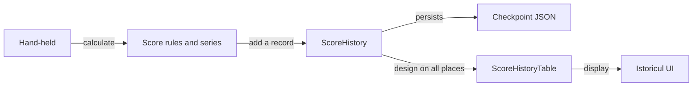

# Score history model

## Overview

The historian shall retain the bid, the points of the hand and the total of each place after a hand has been completed. The presentation and persistence consume the same register, and the unknown data from an old rescue remains marked as unknown.

The register stores the bids, the won tricks and the balances; the points are balance differences. The result of the contract compares the bid with tricks, independently of the point sign. A failed bid shall be cut obliquely in red, keeping the readable figure and the explicitly accessible description.

- Each player has exactly two visible columns: auctioned and total score after the respective hand; column `P` uses the balance recorded for that line.
- The total is placed in a rectangle only on the hand in which the bonus or series penalty is granted, exclusively in the `P` cell of the player concerned; the positive or negative sign alone does not justify the marking.
- The difference in points of the hand remains in the register and in the accessible description, together with the total, without additional visible column.

## Data flow

Legend: score and presentation

The score is calculated once upon closing the hand. The register shall keep the totals and contracts in order of seats; the UI table shall follow the chronological order of the programme without changing the ownership of values.

## Invariants

| Contract | All right |
|---|---|
| Hand points | Difference between the new total and the previous balance, including the series. |
| Display | The total by hand of the row for each place; the first and last record shall keep its own balance. |
| Playing for zero | At the end of the eligible match, the result and ranking convert the total exactly 0 into 500. The last hand cell keeps the balance, and the legend indicates the players who received the transformation. |
| Bidding | Elaborated, even if the actions were captured in another order. |
| Tricks | The values are whole, placed in the hand, and the amount per seat is the number of cards per hand. The last hand ended is consistent with the status of the players. |
| The contract result | Accomplished, missed or unknown; positive points do not imply the performance of the contract. Zero is a tender distinct from the unknown value. |
| Registration | One advance for each hand completed. |
| Limits | An invalid site is not unknown information; indexation and overrun of the hand interval are explicitly refused. A new record includes tricks without deleting the known suffix. |
| Reload | The final balance shall correspond to the status of the players and the session phase. |
| Date vechi | The known balance shall be maintained; cards, bids and unregistered hands shall not be reconstructed by assumption. |
| New game | Own register and initial validated balance. |

## Compatibility and UI

[GameSessionStore](../../whist-lab-app/app/src/main/java/ro/whistlab/app/persistence/GameSessionStore.java) defines the migration of each scheme and the validation of the checkpoint. [ScoreHistory](../../whist-lab-app/game-core/src/main/java/ro/whistlab/core/session/ScoreHistory.java) defines the integrity of the register.

- All players have their own columns; the headers remain above the rows removable vertically and move along with them at the horizontal run. If the fixed elements no longer leave a complete row, the full content shall be conducted vertically, keeping access to the table and legend.
- The first column only shows the number of cards of the hand. The chronological identity remains in the model and in accessible descriptions, including when several hands have the same number of cards.
- Vertical separators delimit the players' groups without separating the bid from the same place. The two subcolumns are rounded once in pixels; their sum also measures the header, and the paddingle enters the removable width. The measurement shall use the totals displayed, including zero and negative sign; the differences in the hands shall not size up column `P`.
- The full program includes the completed hands, the current hand and the future hands; the unawarded points are displayed as unknown, without invented totals.
- The zero contract shall be displayed as value and the unknown contract shall have a distinct marking and accessible text.
- History remains available after the game is over.
- The projection shall provide the same order and values of the assisted display and reading.
- Short Headings are explained by legend, and separators delimit each player. The compact preferred widths extend after the measured text; the figures and full names have priority over compression.
- The legend has the useful width of dialogue and remains outside the horizontal development of columns. Text RO/EN is divided naturally by row; its height and lettages are reserved before the budget for refundable rows.
- [HistoryViewport](../../whist-lab-app/app/src/main/java/ro/whistlab/app/score/layout/HistoryViewport.java) receives measured pixels. Each measurement restores the budget from the current space so that the return from a compact window or an enlarged font can expand the table again.
- The current scheme keeps a known trick suffix separate from the suffix of the known bids. Migrating a hand can recover the last value from the player's condition; older and ongoing hands do not receive invented values.
- Salvation and reloading keep the unfamiliar prefix. A new hand adds complete information without reinterpreting old data; an unknown contract does not receive a cut.
- The serial marking compares the points recorded with the usual score of the known contract, in the Romanian profile with activated series. Only the adjustment equal to the bonus or the set-up penalty receives rectangle; a hand of a card, unknown results and uncompleted hands do not receive marking. Accessible description calls separately adjustment, including for old asymmetrical profiles.
- The geometry of the rectangle reserves the complete number, font height and distance from the contour. The measurement may extend column `P` and the row height; drawing shall remain in that cell without contour around the bid or the entire player group.
- Normal contour marks the bonus after five consecutive eligible achievements; red contours mark penalty after five consecutive eligible misstatements. The colour of the contour follows the series adjustment, including when the aggregate total is opposite; the width and height of the rectangle shall be measured separately.

## Verification of mechanism

### Adaptation to the window

| Responsibility | Mechanism |
|---|---|
| The dialogue window | [HistoryDialogWindow](../../whist-lab-app/app/src/main/java/ro/whistlab/app/score/layout/HistoryDialogWindow.java) follows the useful window protected from the system bars. The edges shall be proportionate and capped; the observer shall be removed at closure. |
| Table width | [Grila](../../whist-lab-app/app/src/main/java/ro/whistlab/app/score/ScoreHistoryGridMetrics.java) extends proportionately the columns to the width available, with the same header borders and rows. Rounding debris does not leave an empty band. |
| Minimum content | Full text measurement sets the compression limit. When the limit exceeds the window, the horizontal running shall retain the numbers and names without reducing the accessibility scale. |
| Height | Headings and measured legend first receive space; removable rows occupy the rest without fixed ceiling. When a complete row is not in place, [containerul](../../whist-lab-app/app/src/main/java/ro/whistlab/app/score/layout/HistoryContentScroll.java) allows the full content to run; a new measurement may return to fixed headers. |
| Text and Markings | [Tipografia](../../whist-lab-app/app/src/main/java/ro/whistlab/app/score/layout/HistoryTypography.java) keeps dimensions in spp. [Diagonala](../../whist-lab-app/app/src/main/java/ro/whistlab/app/score/layout/BidStrikeGeometry.java) draw in red over the missed bid and retain thickness when changing the text or outline of the series. |

### Graphical components and samples

The components check the closure of the hand, migration, corruption of the checkpoint and projection of all places. The external tracer replayer is eighty-in and checks the contract- point-total combination after reloading, with the identity and hash of the controlled entry.

[Components of the totals displayed](../../whist-lab-app/app/src/rasterTest/java/ro/whistlab/app/score/raster/ScoreHistoryCumulativeComponentTest.java) face each historical balance and limit of the prefix known to 3–6 places, in RO/EN. [Measurement of columns](../../whist-lab-app/app/src/test/java/ro/whistlab/app/score/ScoreHistoryMeasureComponentTest.java) uses the same visible value, including for the last row and last player.

- [Componentele seriilor](../../whist-lab-app/app/src/test/java/ro/whistlab/app/score/ScoreHistorySeriesComponentTest.java) plays legal games with controlled contracts and calculates separately the balances and meters without calling the engine formula into the oracle; the JSON recharge covers the bidding, playing and closing of the hand.
- [Geometry of marking](../../whist-lab-app/app/src/test/java/ro/whistlab/app/score/award/SeriesPointsFrameComponentTest.java) confronts the rectangle and the entire contour with cell boundaries at fractional density, long numbers and enlarged font; the pixels and Android font retain distinct native qualification.
- [Test component raster](../../whist-lab-app/app/src/rasterTest/java/ro/whistlab/app/score/raster/ScoreHistoryCumulativeComponentTest.java) designs legal states through production geometry in a JVM image with controlled fonts. The difference between images with and without markings shall be only of the awarded `P` cells and contain the four sides; the red shall be checked after a penalty leaving the total positive.
- [Recovery of history in images](../../whist-lab-app/app/src/rasterTest/java/ro/whistlab/app/score/raster/ScoreHistoryRecoveryRasterComponentTest.java) writes the JSON checkpoint in a file, reads it through the application code and compares PNG pixels before and after restoration, to 3–6 places, in RO/EN and with increased text. Check the historical markings in the bid, game and after closing another hand; do not deduct them from the current meter of the series.
- [Adaptive grid](../../whist-lab-app/app/src/test/java/ro/whistlab/app/score/ScoreHistoryGridMetricsComponentTest.java) verifies the use of width, measured minima, resizing and rounding. [Probele grafice](../../whist-lab-app/app/src/rasterTest/java/ro/whistlab/app/score/raster/ScoreHistoryResponsiveRasterComponentTest.java) composes policies in a controlled view and compares images separately with and without diagonal: only the failed bid cells can change, with red pixels and oblique direction.
- The last hand and last eligible payment are distinct points: a final hand of a card does not receive a new mark but retains the previous payment in history; a program ending with an eligible hand may pay the series even in the last row. The raster window is limited to the existing program without accessing a row after the last hand.

[Motorul](../../whist-lab-app/game-core/README.md) · [Persistence and interface](../../whist-lab-app/app/src/main/java/ro/whistlab/app/README.md)
