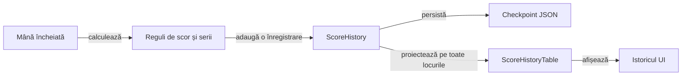

# Modelul istoricului de scor

Istoricul păstrează licitația, punctele mâinii și totalul fiecărui loc după o mână încheiată. Prezentarea și persistența consumă același registru, iar datele necunoscute dintr-o salvare veche rămân marcate ca necunoscute.

Registrul stochează licitațiile, levatele câștigate și soldurile; punctele sunt diferențe de sold. Rezultatul contractului compară licitatul cu levatele, independent de semnul punctelor. O licitație ratată este tăiată oblic, păstrând cifra lizibilă și descrierea accesibilă explicită.

## Fluxul datelor

Legendă: scor și prezentare

Scorul este calculat o singură dată la închiderea mâinii. Registrul păstrează totalurile și contractele în ordinea locurilor; tabelul UI urmează ordinea cronologică a programului, fără schimbarea proprietății valorilor.

## Invariante

| Contract | Regulă |
|---|---|
| Punctele mâinii | Diferența dintre totalul nou și soldul anterior, incluzând seria. |
| Licitația | Asociată explicit locului, chiar dacă acțiunile au fost capturate în altă ordine. |
| Levate | Valorile sunt întregi, încadrate în mână, iar suma pe locuri este numărul cărților mâinii. Ultima mână încheiată concordă cu starea jucătorilor. |
| Rezultatul contractului | Realizat, ratat sau necunoscut; punctele pozitive nu implică realizarea contractului. Zero este o licitație distinctă de valoarea necunoscută. |
| Înregistrare | O singură avansare pentru fiecare mână încheiată. |
| Reîncărcare | Ultimul sold trebuie să corespundă stării jucătorilor și fazei sesiunii. |
| Date vechi | Soldul cunoscut se păstrează; cărțile, licitațiile și mâinile neînregistrate nu sunt reconstruite prin presupunere. |
| Partidă nouă | Registru propriu și sold inițial validat. |

## Compatibilitate și UI

[GameSessionStore](../../whist-lab-app/app/src/main/java/ro/whistlab/app/persistence/GameSessionStore.java) definește migrarea fiecărei scheme și validarea checkpoint-ului. [ScoreHistory](../../whist-lab-app/game-core/src/main/java/ro/whistlab/core/session/ScoreHistory.java) definește integritatea registrului.

- Toți jucătorii au coloane proprii; antetele rămân deasupra rândurilor derulabile vertical și se deplasează împreună cu acestea la derularea orizontală.
- Prima coloană afișează numai numărul cărților mâinii. Identitatea cronologică rămâne în model și în descrierile accesibile, inclusiv când mai multe mâini au același număr de cărți.
- Separatoarele verticale delimitează grupurile jucătorilor, fără a separa licitația de punctele și totalul aceluiași loc. Subcoloanele se rotunjesc o singură dată în pixeli; suma lor dimensionează și antetul, iar padding-ul intră în lățimea derulabilă.
- Programul complet include mâinile încheiate, mâna curentă și mâinile viitoare; punctele neacordate se afișează ca necunoscute, fără totaluri inventate.
- Contractul zero se afișează ca valoare, iar contractul necunoscut are marcaj și text accesibil distinct.
- Istoricul rămâne disponibil după terminarea partidei.
- Proiecția furnizează aceeași ordine și aceleași valori afișării și citirii asistate.
- Antetele scurte sunt explicate prin legendă, iar separatoarele delimitează fiecare jucător. Lățimile preferate compacte se extind după textul măsurat; cifrele și numele complete au prioritate față de compresie.
- Schema curentă păstrează un sufix de levate cunoscute, separat de sufixul licitațiilor cunoscute. Migrarea unei mâini încheiate poate recupera ultima valoare din starea jucătorilor; mâinile mai vechi și cele în curs nu primesc valori inventate.
- Salvarea și reîncărcarea păstrează prefixul necunoscut. O mână nouă adaugă informația completă fără a reinterpreta datele vechi; un contract necunoscut nu primește tăietură.

## Verificarea mecanismului

Componentele verifică închiderea mâinii, migrarea, coruperea checkpoint-ului și proiecția tuturor locurilor. Replay-ul unui trace extern este opt-in și verifică asocierea contract–puncte–total după reîncărcare, cu identitatea și hash-ul intrării controlate.

[Motorul](../../whist-lab-app/game-core/README.md) · [Persistența și interfața](../../whist-lab-app/app/src/main/java/ro/whistlab/app/README.md)
