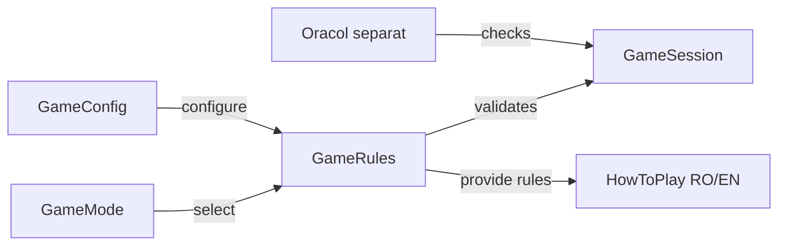

# The contracts of the Whist variants

## Overview

Each variant has its own contract for package, program, trump, bidding and score. The similarity of the game name does not allow the implicit transfer of a rule between profiles.

## Complementary guides

| Question | Ghid |
|---|---|
| How to play Romanian Whist? | [Rules in Romanian](https://github.com/crististefanita/whist/blob/main_RO/docs/game/ATF_RulesRo.md) and [English](ATF_RulesEn.md). |
| What changes with player difficulty? | [Normal and Hard](ATF_Levels.md). |
| What data is recorded for each completed hand? | [Score history](ATF_ScoreHistory.md). |
| How do players set their name and retain rankings? | [Player profile and local leaderboards](ATF_PlayerRecords.md). |
| How are progression objectives organized and awarded? | [Whist achievements](ATF_Achievements.md). |

## Liabilities

Legend: same variant in the game and verification

The configuration shall determine the rules applicable prior to distribution. The aid and tests use the identity of the variant, and the oracle checks the rules and scores by independent implementation.

## Romanian Profile Contract

| Aspect | All right |
|---|---|
| Pachet | Low-level package by number of players, with high ranks defined by GameRules. |
| Program | Sequence determined by variant and number of seats; extreme blocks follow profile program. |
| Licitare | Contract in the legal range; the last offer cannot equalize the amount with the size of the hand. |
| Culoare | The colour follow-up is mandatory when it exists in the hand. |
| Trump | In the absence of colour, cutting is mandatory if there is an asset; overcoating is not mandatory. |
| trick | Win the highest asset or rank of the required color; the winner leads. |
| Score and series | The points for the contract, misconduct and series are defined in the table below. |
| Playing for zero | Default check option in both Romanian variants. After the last hand, each total exactly 0 is displayed and ranked as 500. The history of hands retains the calculated total. |

## Score and series

| All right | 1–8–1 | 8–1–8 |
|---|---:|---:|
| Points added to the tricks of an exact contract | 5 | 5 |
| Distress trick points | -1 | -1 |
| Hand eligible for payment of series | 5 | 5 |
| Bonus and penalty under option 5 | 5, -5 | 5, -5 |
| Bonus and penalty under option 10 | 10, -10 | 10, -10 |
| Serial penalty in asymmetrical historical profile | -5 | -5 |

On a card, a result of the same type keeps the series. The opposite result interrupts the series. The payment of a series resets the meter.

[Testul factual](../../whist-lab-app/game-core/src/test/java/ro/whistlab/core/rules/documentation/DocumentedScoringComponentTest.java) confronts the table with the engine formulae and checks the refusal of the wrong statements.

## Principles of implementation

- [GameMode](../../whist-lab-app/game-core/src/main/java/ro/whistlab/core/rules/GameMode.java) identifies the profile.
- [GameConfig](../../whist-lab-app/game-core/src/main/java/ro/whistlab/core/config/GameConfig.java) validates the configuration and migration of compatible values.
- [GameRules](../../whist-lab-app/game-core/src/main/java/ro/whistlab/core/rules/GameRules.java) holds the package, program, legal actions and winner.
- [RomanianScoring](../../whist-lab-app/game-core/src/main/java/ro/whistlab/core/rules/RomanianScoring.java) holds the score and series.
- [HowToPlay](../../whist-lab-app/game-core/src/main/java/ro/whistlab/core/rules/HowToPlay.java) produces aid in Romanian and English.

## Governance of changes in rules

1. Identify the exact variant and condition prior to the change.
2. Formula her rule and borders through independent components.
3. Check the transitions, score and restoration of the session.
4. Update aid RO/EN and affected manifestations.
5. Check Android integration separately through explicitly activated scenarios.

[Rule engine](../../whist-lab-app/game-core/README.md) · [RO rules](https://github.com/crististefanita/whist/blob/main_RO/docs/game/ATF_RulesRo.md) · [Rules EN](ATF_RulesEn.md) · [Collections](../testing/ATF_Collections.md)
