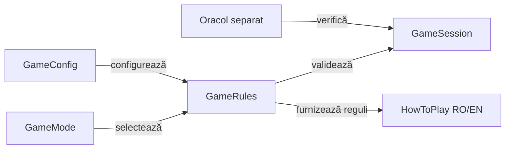

# Contractele variantelor Whist

## Pe scurt

Fiecare variantă are propriul contract pentru pachet, program, atu, licitare și scor. Similaritatea numelui jocului nu autorizează transferul implicit al unei reguli între profiluri.

## Ghiduri complementare

| Întrebare | Ghid |
|---|---|
| Cum se joacă Whist românesc? | [Reguli în română](ATF_RulesRo.md) și [engleză](ATF_RulesEn.md). |
| Ce schimbă nivelul jucătorului? | [Normal și Hard](ATF_Levels.md). |
| Ce date păstrează fiecare mână încheiată? | [Istoricul scorului](ATF_ScoreHistory.md). |
| Cum se configurează numele și se păstrează topurile? | [Profilul jucătorului și clasamentele locale](ATF_PlayerRecords.md). |
| Cum se organizează și se acordă obiectivele progresului? | [Realizările Whist](ATF_Achievements.md). |

## Responsabilități

Legendă: aceeași variantă în joc și verificare

Configurația stabilește regulile aplicabile înainte de distribuire. Ajutorul și testele folosesc identitatea variantei, iar oracolul verifică regulile și scorul prin implementare independentă.

## Contractul profilului românesc

| Aspect | Regulă |
|---|---|
| Pachet | Pachet redus după numărul de jucători, cu rangurile mari definite de GameRules. |
| Program | Secvență determinată de variantă și numărul de locuri; blocurile extreme urmează programul profilului. |
| Licitare | Contract în intervalul legal; ultima ofertă nu poate egaliza suma cu mărimea mâinii. |
| Culoare | Urmarea culorii este obligatorie când există în mână. |
| Atu | În lipsa culorii, tăierea este obligatorie dacă există atu; supratăierea nu este obligatorie. |
| Levata | Câștigă cel mai mare atu sau cel mai mare rang din culoarea cerută; câștigătorul conduce. |
| Scor și serii | Punctele pentru contract, abatere și serii sunt definite în tabelul de mai jos. |
| Joc la 0 | Opțiune bifată implicit în ambele variante românești. După ultima mână, fiecare total exact 0 se afișează și se clasează ca 500. Istoricul mâinilor păstrează totalul calculat. |

## Scor și serii

| Regulă | 1–8–1 | 8–1–8 |
|---|---:|---:|
| Puncte adăugate la levatele unui contract exact | 5 | 5 |
| Puncte pe levată de abatere | -1 | -1 |
| Mâini eligibile pentru plata seriei | 5 | 5 |
| Bonus și penalizare la opțiunea 5 | 5, -5 | 5, -5 |
| Bonus și penalizare la opțiunea 10 | 10, -10 | 10, -10 |
| Penalizare de serie în profilul istoric asimetric | -5 | -5 |

La o carte, un rezultat de același tip păstrează seria. Rezultatul opus întrerupe seria. Plata unei serii resetează contorul.

[Testul factual](../../whist-lab-app/game-core/src/test/java/ro/whistlab/core/rules/documentation/DocumentedScoringComponentTest.java) confruntă tabelul cu formulele motorului și verifică refuzul declarațiilor greșite.

## Principii de implementare

- [GameMode](../../whist-lab-app/game-core/src/main/java/ro/whistlab/core/rules/GameMode.java) identifică profilul.
- [GameConfig](../../whist-lab-app/game-core/src/main/java/ro/whistlab/core/config/GameConfig.java) validează configurația și migrarea valorilor compatibile.
- [GameRules](../../whist-lab-app/game-core/src/main/java/ro/whistlab/core/rules/GameRules.java) deține pachetul, programul, acțiunile legale și câștigătorul.
- [RomanianScoring](../../whist-lab-app/game-core/src/main/java/ro/whistlab/core/rules/RomanianScoring.java) deține scorul și seriile.
- [HowToPlay](../../whist-lab-app/game-core/src/main/java/ro/whistlab/core/rules/HowToPlay.java) produce ajutorul în română și engleză.

## Guvernanța schimbărilor de reguli

1. Identificați varianta și condiția exactă înaintea modificării.
2. Formulați regula și frontierele ei prin componente independente.
3. Verificați tranzițiile, scorul și restaurarea sesiunii.
4. Actualizați ajutorul RO/EN și manifestele afectate.
5. Verificați separat integrarea Android prin scenarii activate explicit.

[Motorul de reguli](../../whist-lab-app/game-core/README.md) · [Reguli RO](ATF_RulesRo.md) · [Rules EN](ATF_RulesEn.md) · [Colecții](../testing/ATF_Collections.md)
