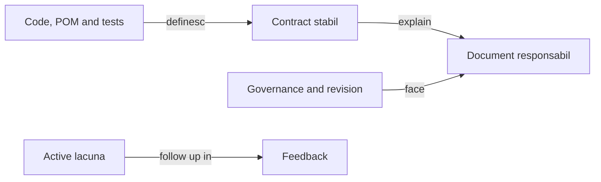

# Good documentation practices

## Overview

The documentation shall explain a contract, its owner and the use or verification. The code, configuration and live tests determine the behaviour; proposals and limits still unqualified are explicitly marked.

## Responsibilities



<details>
<summary>Legend: source, contract and loophole</summary>

A stable rule has only one document in charge. The feedback keeps the remaining difference and the closing criterion; the result of a run is archived separately and does not automatically become a contract.

</details>

## Organisation of guidelines

- The docs root keeps the area index, and each area has only one guidance Readme.
- The group follows the reader's questions and responsibilities: game, decision, learning, testing, publication, platform, governance and feedback.
- The complementary guides of the same area stay together; a new sub-director requires a distinct responsibility and several documents justifying it.
- An indicative range of three to seven documents per area helps scan. The volume, cohesion and reading route shall decide when an area is consolidated or separated.
- A new file appears when it holds a contract or a process of its own; a title or an additional example may remain a section.
- A guide that unites two mechanisms indicates their limits and sends to the owner of each contract.
- Priority index `docs/feedback/README.md` keep unique IDs, decreasing scores in the range 1–100 and local links to the owner's register; [governance test](../../atf-tests/src/test/java/atf/tests/governance/documentation/feedback/FeedbackIndexGovernanceTest.java) validate negative cases as well.

The orientation name is `README.md`. Descriptive guides use `ATF_<PascalCase>.md`, with short names in the context of the area; language or profile is indicated only when they distinguish real contracts.

## Single contract and explicit stage

Each mechanism has only one guide responsible for definitions and full procedure. An index or a neighbor guide may retain the necessary synthesis, with a link to the contract; formulae, inventories and steps shall be maintained with the owner.

| Stadiu | Allowed claim |
|---|---|
| Implementat | Name the consumer, domain and limit in the current code. |
| Propus | Specifies the required mechanism, the owner and the qualification criterion; it remains distinct from the existing capability. |
| Calificat | Identifies the actual level checked; the result and identity of the copy shall be kept externally. |

To a contradiction, confront the code and configuration, narrow the claim to the proven field and keep the gap in feedback. A process requirement, a past structural test or a declaration field does not prove the implementation of the mechanism on its own.

## First screen

| Question | Visible content |
|---|---|
| What is it and what is it for? | Title and brief orientation. |
| Who owns the behavior? | Responsible, inputs and limits. |
| How does it work? | The main relationship, by schematic, list or compact table. |
| How do I check it? | Test, command or observable criterion with its level. |
| Unde aprofundez? | Links to responsible documents and relevant sources. |

The purpose, responsibility and the main limit remain visible. The secondary details, the long exceptions and justifications may be in folding blocks.

## Main README

The main READMETER directs the reader to the product, sources and verification:

- Presents the game and provides the Android edition page and direct download, according to [contract of delivery](../testing/ATF_ReleaseQualification.md#public-readme-contract).
- Just below the download, show the route between the building, checks and delivery. The engine map explains the platforms and the condition owners separately. The table complements the responsibilities and leads to the documents of the modules.
- According to the map, it provides a short local check and sends out strategy, governance and qualification. The rules of the game, the publication steps and the results have their own guides and folders.

Face the roles in the map with [reactorul Maven](../../pom.xml), [modulele Gradle](../../whist-lab-app/settings.gradle) And the configuration of the module that consumes addiction. For a test addiction, the source of truth is her statement in the build. [Map governance](../../atf-tests/src/test/java/atf/tests/governance/documentation/factual/DocumentedModuleMapGovernanceTest.java) face modules, direct dependencies and application edges and check omissions, mispursues and reverse direction.

## Language, style and prose

- The documentation on `main` uses English. `main_RO` preserves the Romanian edition at the same paths. Rule-guide filenames retain the locale they originally identify.
- The titles, tables, diagrams and foldable summaries shall use the language of the document.
- API identifiers, the original quoted orders and labels shall be kept in accurate form.
- Use one main title, a `Pe scurt` section for guidance, progressive sections and lists with the `-` marker.
- A visible paragraph has not more than three sentences; responsibilities and comparisons shall be expressed in the form that makes them easy to go.
- Fonts and colors belong to the application that displays Markdown; documents use semantic structure without local CSS.
- Each block of code has its declared language, and each block of folding has its explicit summary and balanced delimitation.

## Diagrams and tables

- A diagram answers a question and uses short concepts with verbs on the edges.
- New flows and dependencies prefer left-right reading; states and time order use the appropriate form of relationship.
- A single foldable legend immediately follows the diagram and explains the meaning and limit of relationships.
- Classes, long lists and addiction details remain in the legend or the responsible guide.
- Tables compare parallel information; two main tables have an explanation or a section of another role.
- A map of addictions faces the POMS, diverging the execution, testing and optional propagation.

## Stable content and variable data

The values defined by the rules, the limits of the API and general teaching examples are part of the contract. Current results are kept externally; the evidence selected for a delivery enters into [dosarul versiunii](../platform/ATF_AndroidDelivery.md#folder-of-a-version), separate from generic guides.

- Active technical controls have their identity and reconciliation cycle; the closure of the feedback keeps control until his criterion is demonstrated.
- The identifier of a YAML control recognised by the scheme shall be technical and kept intact.
- The verification of project identifiers protects prose and other fields; an incomplete block or without control scheme does not receive this classification.
- Address `releases/latest` and the declared delivery destinations are only technical data in Markdown links: the tag page, APK and checksum come from the same [Typed identity](../../atf-tests/src/main/java/atf/tests/distribution/ApkDownloadTarget.java), selected by [project policy](../../config/atf-governance-policy.json). Visible label, other versions or repositorys and query, fragment or suffix addresses remain verified. Classification does not declare downloading, publication of remotor or integrity of APK.

## Review and synchronization

The notes in the Release page are a user presentation: download and changes in the bullets, followed by a link to evidence. [Delivery contract](../platform/ATF_AndroidDelivery.md#presentation-of-a-version) defines the confirmed differences from the previous version and the summary **On the short ** used when the comparison is not established.

[Governance of presentation](../../atf-tests/src/test/java/atf/tests/governance/documentation/release/ReleasePresentationGovernanceTest.java) validates this perimeter separately from the technical guides. The test details and the limits of the devices shall be kept in the record of the version.

1. Read source, configuration, test and responsible guide in their current state.
2. Browse information as a stable rule, proposal, loophole or execution result.
3. Make out her claim and her limit, with the link to the source that owns her.
4. Check the destinations and fragments of the links, including after moves or consolidation.
5. Compare files again before writing and keep the changes competing.
6. Perform relevant checks and identify the validated root, inventory and sources.

The traceability of an allegation is `afirmație → sursă live → document responsabil → test sau criteriu → nivel executat`. A valid path does not prove the meaning of the statement, and a structural test does not certify the interaction of Android.

## Documentation governance CLI

[Lansatorul](../../scripts/run-documentation-governance.ps1) accepts the explicit root of the project and one or more documents. Omission of option `-File` check the inventory completely. API Java and suite use the same [Implementing rules](../../atf-tests/src/main/java/atf/tests/documentation/DocumentationGovernance.java).

```powershell
.\scripts\run-documentation-governance.ps1 -ProjectRoot $ProjectRoot -File @(
    'README.md', 'docs/governance/ATF_Documentation.md'
) -Json
```

- The paths are relative to the project. The inventory includes READMES, library guides from `lib` and Markdown files from `docs`. External, non-anonymous and generated directories shall be refused explicit selection.
- The launcher requires JDK 21 and Jackson and SnakeYAML dependencies available in the Maven cachet. `-MavenCache` indicates local warehouse, and `-ScratchRoot` indicates an existing external directory for compilation. The launch uses the cachet for reading and compiles only the necessary sources of the CLIC.
- Option `-Json` maintains the code, file, line, finding, rule and remedy. The verdict is the same on the file regardless of the selection. Local links shall be validated in the context of the entire project.
- Output code `0` indicates success, `2` indicate documentary deviations; and `1` indicate an invalid entry or an execution error. [Probele cu fixture-uri](../../atf-tests/src/test/java/atf/tests/governance/documentation/cli/DocumentationGovernanceCliComponentTest.java) covers parity and refusals.

Documentary verification includes structure, links, fragments, prose, style, diagrams, local editorial content and feedback rules. [Governance Suite](README.md#isolated-rolling) also verifies allegations that depend on sources, inventory of modules and delivery.

## Editorial verification and evaluation

[Local Suite](README.md) checks the structure, prose, style, diagrams, links and source perimeter. Local links should be resolved in checkout, including after a symbolic path is resolved. References to other projects shall use stable URLs.

For verifiable statements, use a table in the responsible guide and confront the values with direct implementation. Keep a case accurate and controlled mutations for values, missing or duplicated rows. [Documentation collection](../testing/ATF_Collections.md) confronts [Whist score table](../game/README.md#score-and-series) with the engine.

- Compare the published English rules with English in-app help. The Romanian app help is verified against the Romanian test fixture and documented on `main_RO`.
- Confront the engine rules with data and expectations independent of text.
- Enter a controlled change of meaning and request the diagnosis at the level of the statement.

| Criteriu editorial | Punctaj maxim |
|---|---:|
| Fitness to code and limits | 20 |
| Single responsibility and contract | 20 |
| Navigation and sustainability of links | 20 |
| Useful clarity and density | 20 |
| Verificabilitate | 20 |

The same grid applies to the whole revised set. The note and justification shall be kept in the external audit; the automatic verification shall not automatically produce the maximum grade or the closure of a product criterion.

[Documentation index](../README.md) · [Change of tests](ATF_TestChanges.md) · [Liabilities and gaps](../feedback/README.md)
