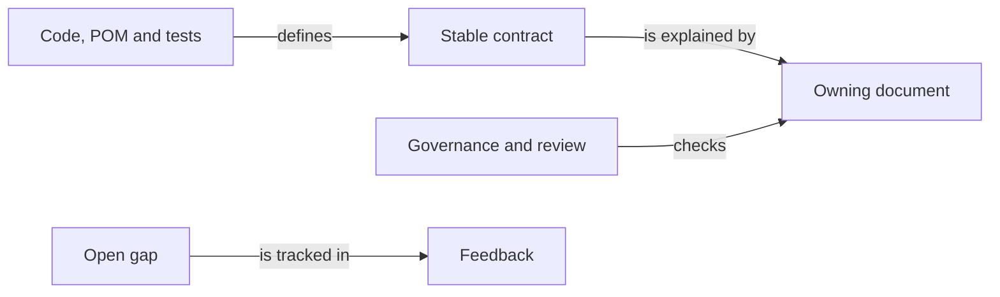

# Good documentation practices

## Overview

Documentation explains a contract, its owner, and how to use or verify it. Current code, configuration, and tests define behaviour; proposals and unverified limits must be explicit.

## Responsibilities



<details>
<summary>Legend: source, contract and gap</summary>

Each stable rule has one owning document. Feedback records the remaining gap and its closure criterion; execution results are archived separately and do not automatically become contracts.

</details>

## Organisation of guidelines

- The docs root keeps the area index, and each area has only one guidance Readme.
- The group follows the reader's questions and responsibilities: game, decision, learning, testing, publication, platform, governance and feedback.
- The complementary guides of the same area stay together; a new subdirectory requires a distinct responsibility and several documents justifying it.
- An indicative range of three to seven documents per area helps navigation. Volume, cohesion, and the reading path determine when an area is consolidated or separated.
- A new file appears when it holds a contract or a process of its own; a title or an additional example may remain a section.
- A guide covering two mechanisms states their boundaries and links to each owning contract.
- The priority index `docs/feedback/README.md` keeps unique IDs, scores from 1–100 in descending order, and local links to the owning register; the [governance test](../../atf-tests/src/test/java/atf/tests/governance/documentation/feedback/FeedbackIndexGovernanceTest.java) validates negative cases as well.

The orientation name is `README.md`. Descriptive guides use `ATF_<PascalCase>.md`, with short names in the context of the area; language or profile is indicated only when they distinguish real contracts.

## Single contract and explicit stage

Each mechanism has only one guide responsible for definitions and full procedure. An index or neighbouring guide may provide a brief overview linked to the contract; formulas, inventories, and procedures stay with their owner.

| Status | Allowed claim |
|---|---|
| Implemented | Name the consumer, domain and limit in the current code. |
| Proposed | Specify the required mechanism, the owner and the qualification criterion; it remains distinct from the existing capability. |
| Qualified | Identify the actual level checked; the result and identity of the copy shall be kept externally. |

When statements conflict, check code and configuration, narrow the claim to the verified scope, and track the gap in feedback. A process requirement, a past structural test or a declaration field does not prove the implementation of the mechanism on its own.

## First screen

| Question | Visible content |
|---|---|
| What is it and what is it for? | Title and brief orientation. |
| Who owns the behaviour? | Owner, inputs, and limits. |
| How does it work? | The main relationship, by schematic, list or compact table. |
| How do I check it? | Test, command or observable criterion with its level. |
| Where can I read more? | Links to responsible documents and relevant sources. |

The purpose, responsibility and the main limit remain visible. The secondary details, the long exceptions and justifications may be in folding blocks.

<a id="main-readme"></a>

## Main README

The main README guides the reader to the product, source code and verification.

- Presents the game and provides the Android edition page and direct download, according to [contract of delivery](../testing/ATF_ReleaseQualification.md#public-readme-contract).
- Just below the download, show the path through build, verification, and delivery. The engine map explains the platforms and state ownership separately. The table complements the responsibilities and leads to the documents of the modules.
- After the map, provide a short local check and links to strategy, governance, and qualification. The rules of the game, the publication steps and the results have their own guides and folders.

Verify the map against the [Maven reactor](../../pom.xml), [Gradle modules](../../whist-lab-app/settings.gradle) and the configuration of each consuming module. Build declarations define the scope of test dependencies. [Map governance](../../atf-tests/src/test/java/atf/tests/governance/documentation/factual/DocumentedModuleMapGovernanceTest.java) checks modules, direct dependencies and application edges for omissions, incorrect scopes and reversed relationships.

## Language, style and prose

- All Markdown documents use English on `main` and Romanian with diacritics on `main_RO`, at matching paths. Stable filenames and API identifiers retain their spelling. Keep heading levels, table shapes, diagram topology, link destinations and commands synchronized.
- The titles, tables, diagrams and foldable summaries shall use the language of the document.
- API identifiers, the quoted commands and labels shall be kept in accurate form.
- Use one main title, an `Overview` section in English or `Pe scurt` in Romanian, progressive headings and lists marked with `-`.
- A visible paragraph has at most three sentences; use a structure that makes responsibilities and comparisons easy to scan.
- Fonts and colors belong to the application that displays Markdown; documents use semantic structure without local CSS.
- Each block of code has its declared language, and each collapsible section has an explicit summary and balanced delimiters.

### Operational terminology

Describe the operation defined by the code: a directory contains files, a source snapshot pins inputs, an asset is a published download, and a receipt records an observation. A checksum establishes byte identity; it does not prove application behavior or public access.

The terminology rule rejects reviewed translation artifacts in visible English, including table cells and link labels. Technical literals, URLs and fenced examples keep their spelling. The same rule runs through the CLI and suite; editorial review still verifies meaning against code and Romanian documentation.

### Release presentation and original evidence

Release guides use the branch language at their canonical paths. Translating presentation does not change the APK, test results, source identity or canonical audit reports.

| Responsibility | Verification |
|---|---|
| Original publication text | `documentation-provenance.json` pins original document paths, byte lengths and SHA-256 to a Git commit |
| Translated presentation | Language governance checks every Markdown document, including table cells, link labels and diagram captions |
| Payload inventory | Re-observe hashes after presentation changes; preserve all qualification and binary facts |
| Romanian edition | Keep the same document structure and technical examples; verify the pinned EN/RO review |

## Diagrams and tables

- A diagram answers a question and uses short concepts with verbs on the edges.
- New flows and dependencies prefer left-right reading; states and time order use the appropriate form of relationship.
- A single foldable legend immediately follows the diagram and explains the meaning and limit of relationships.
- Classes, long lists and dependency details remain in the legend or the responsible guide.
- Tables compare parallel information; two main tables have an explanation or a section of another role.
- A dependency map matches the POM files and distinguishes runtime, test, and optional dependencies.

## Stable content and variable data

The values defined by the rules, the limits of the API and general teaching examples are part of the contract. Current results are kept externally; the evidence selected for a delivery enters into [release dossier](../platform/ATF_AndroidDelivery.md#folder-of-a-version), separate from generic guides.

- Active technical controls have their identity and reconciliation cycle; the closure of the feedback retains the control until its criterion is demonstrated.
- The identifier of a YAML control recognised by the scheme shall be technical and kept intact.
- The verification of project identifiers protects prose and other fields; an incomplete block or one that lacks the control schema does not receive this classification.
- Address `releases/latest` and the declared delivery destinations are only technical data in Markdown links: the tag page, APK and checksum come from the same [Typed identity](../../atf-tests/src/main/java/atf/tests/distribution/ApkDownloadTarget.java), selected by [project policy](../../config/atf-governance-policy.json). Visible label, other versions or repositories and query, fragment or suffix addresses remain verified. This classification does not prove download availability, remote publication, or APK integrity.

## Review and synchronization

The notes in the Release page are a user presentation: download and changes in the bullets, followed by a link to evidence. [Delivery contract](../platform/ATF_AndroidDelivery.md#presentation-of-a-version) defines the confirmed differences from the previous version and the summary **Overview** used when the comparison is not established.

[Governance of presentation](../../atf-tests/src/test/java/atf/tests/governance/documentation/release/ReleasePresentationGovernanceTest.java) validates this perimeter separately from the technical guides. The test details and the limits of the devices shall be kept in the record of the version.

1. Read source, configuration, test and responsible guide in their current state.
2. Classify information as a stable rule, proposal, gap, or execution result.
3. State the claim and its limit, linking to the source that defines it.
4. Check the destinations and fragments of the links, including after moves or consolidation.
5. Compare files again before writing and preserve concurrent changes.
6. Perform relevant checks and identify the validated root, inventory and sources.

Claim traceability follows `claim → live source → owning document → test or criterion → executed layer`. A valid path does not prove the meaning of the statement, and a structural test does not certify the interaction of Android.

## Documentation governance CLI

[Launcher](../../scripts/run-documentation-governance.ps1) accepts the explicit root of the project and one or more documents. Omitting `-File` checks the complete inventory. API Java and suite use the same [rules](../../atf-tests/src/main/java/atf/tests/documentation/DocumentationGovernance.java).

```powershell
.\scripts\run-documentation-governance.ps1 -ProjectRoot $ProjectRoot -File @(
    'README.md', 'docs/governance/ATF_Documentation.md'
) -Json
```

- The paths are relative to the project. The inventory includes every Markdown file outside generated directories. Explicit selection rejects external paths, indirect paths, and generated files.
- The launcher requires JDK 21 and Jackson and SnakeYAML dependencies available in the Maven cache. `-MavenCache` selects the local repository, and `-ScratchRoot` indicates an existing external directory for compilation. The launch uses the cache for reading and compiles only the necessary CLI sources.
- Option `-Json` maintains the code, file, line, finding, rule and remedy. The verdict is the same on the file regardless of the selection. Local links shall be validated in the context of the entire project.
- Exit code `0` means success, `2` means documentation violations, and `1` means invalid input or an execution error. [Fixture checks](../../atf-tests/src/test/java/atf/tests/governance/documentation/cli/DocumentationGovernanceCliComponentTest.java) cover diagnostic parity and rejected inputs.

Documentary verification includes structure, links, fragments, prose, style, diagrams, local editorial content and feedback rules. [Governance Suite](README.md#isolated-execution) also verifies claims that depend on sources, inventory of modules and delivery.

## Editorial verification and evaluation

[Local Suite](README.md) checks the structure, prose, style, diagrams, links and source perimeter. Local links should be resolved in checkout, including after a symbolic path is resolved. References to other projects shall use stable URLs.

For verifiable statements, use a table in the responsible guide and compare its values against the implementation. Keep one valid case and controlled mutations for incorrect values and missing or duplicated rows. [Documentation collection](../testing/ATF_Collections.md) compares the [Whist score table](../game/README.md#score-and-series) with the engine.

- Compare the published English rules with English in-app help. The Romanian app help is verified against the Romanian test fixture and documented on `main_RO`.
- Check engine rules against independent data and expectations.
- Inject a controlled change of meaning and require a diagnostic identifying the affected statement.

| Editorial criterion | Maximum score |
|---|---:|
| Fitness to code and limits | 20 |
| Single responsibility and contract | 20 |
| Navigation and sustainability of links | 20 |
| Useful clarity and density | 20 |
| Verifiability | 20 |

The same grid applies to the whole revised set. Keep the score and its justification in the external audit; passing automated checks does not imply a perfect score or close a product acceptance criterion.

[Documentation index](../README.md) · [Change of tests](ATF_TestChanges.md) · [Responsibilities and gaps](../feedback/README.md)
