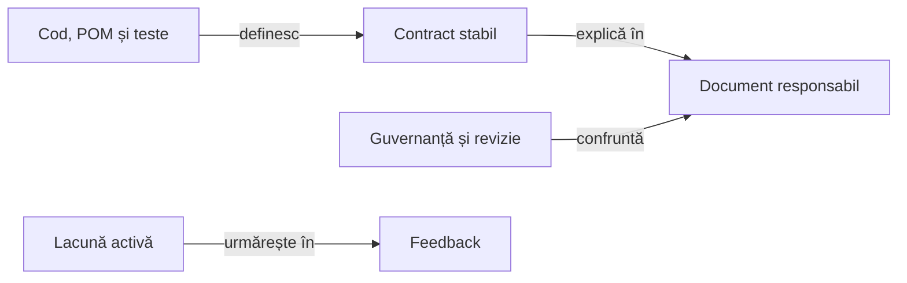

# Bune practici pentru documentație

Documentația explică un contract, proprietarul lui și modul de folosire sau verificare. Codul, configurația și testele live stabilesc comportamentul; propunerile și limitele încă necalificate sunt marcate explicit.

## Responsabilități

Legendă: sursă, contract și lacună

O regulă stabilă are un singur document responsabil. Feedback-ul păstrează diferența rămasă și criteriul de închidere; rezultatul unei rulări se arhivează separat și nu devine automat contract.

## Organizarea ghidurilor

- Rădăcina docs păstrează indexul ariilor, iar fiecare arie are un singur README de orientare.
- Gruparea urmărește întrebările și responsabilitățile cititorului: joc, decizie, învățare, testare, publicare, platformă, guvernanță și feedback.
- Ghidurile complementare ale aceleiași arii stau împreună; un subdirector nou cere o responsabilitate distinctă și mai multe documente care o justifică.
- Un interval orientativ de trei până la șapte documente pe arie ajută scanarea. Volumul, coeziunea și traseul de lectură decid când se consolidează sau se separă o arie.
- Un fișier nou apare când deține un contract sau un proces propriu; un titlu ori un exemplu suplimentar poate rămâne secțiune.
- Un ghid care unește două mecanisme indică limitele lor și trimite la proprietarul fiecărui contract.

Numele de orientare este `README.md`. Ghidurile descriptive folosesc `ATF_<PascalCase>.md`, cu nume scurt în contextul ariei; limba ori profilul se indică numai când disting contracte reale.

## Contract unic și stadiu explicit

Fiecare mecanism are un singur ghid responsabil pentru definiții și procedura completă. Un index sau un ghid vecin poate păstra sinteza necesară orientării, cu link către contract; formulele, inventarele și pașii se întrețin la proprietar.

| Stadiu | Afirmație admisă |
|---|---|
| Implementat | Numește consumatorul, domeniul și limita din codul curent. |
| Propus | Precizează mecanismul cerut, proprietarul și criteriul de calificare; rămâne distinct de capabilitatea existentă. |
| Calificat | Identifică nivelul efectiv verificat; rezultatul și identitatea copiei se păstrează extern. |

La o contradicție, confruntați codul și configurația, restrângeți afirmația la domeniul demonstrat și păstrați lacuna în feedback. O cerință de proces, un test structural trecut sau un câmp declarativ nu dovedesc singure implementarea mecanismului.

## Primul ecran

| Întrebare | Conținut vizibil |
|---|---|
| Ce este și la ce folosește? | Titlu și orientare scurtă. |
| Cine deține comportamentul? | Responsabil, intrări și limite. |
| Cum funcționează? | Relația principală, prin schemă, listă sau tabel compact. |
| Cum îl verific? | Test, comandă sau criteriu observabil, cu nivelul său. |
| Unde aprofundez? | Legături către documentele responsabile și sursele relevante. |

Scopul, responsabilitatea și limita principală rămân vizibile. Detaliile secundare, excepțiile și justificările lungi pot sta în blocuri pliabile.

## Limbă, stil și proză

- Toate README-urile sunt în română cu diacritice; ghidurile bilingve de reguli au limba declarată în nume.
- Titlurile, tabelele, diagramele și rezumatele pliabile folosesc limba documentului.
- Identificatorii API, comenzile și etichetele originale citate își păstrează forma exactă.
- Folosiți un singur titlu principal, secțiuni progresive și liste cu marcatorul `-`.
- Un paragraf vizibil are cel mult trei propoziții; responsabilitățile și comparațiile se exprimă prin forma care le face ușor de parcurs.
- Fonturile și culorile aparțin aplicației care afișează Markdown; documentele folosesc structură semantică, fără CSS local.
- Fiecare bloc de cod are limbajul declarat, iar fiecare bloc pliabil are rezumat explicit și delimitare echilibrată.

## Diagrame și tabele

- O diagramă răspunde unei întrebări și folosește concepte scurte, cu verbe pe muchii.
- Fluxurile și dependențele noi preferă lectura stânga–dreapta; stările și ordinea temporală folosesc forma potrivită relației.
- O singură legendă pliabilă urmează imediat diagrama și explică sensul și limita relațiilor.
- Clasele, listele lungi și detaliile de dependență rămân în legendă sau în ghidul responsabil.
- Tabelele compară informații paralele; două tabele principale au între ele o explicație sau o secțiune cu alt rol.
- O hartă de dependențe se confruntă cu POM-urile, distingând execuția, testarea și propagarea opțională.

## Conținut stabil și date variabile

Valorile definite de reguli, limitele API și exemplele didactice generale sunt parte a contractului. Rezultatele curente se păstrează extern; dovezile selectate pentru o livrare intră în [dosarul versiunii](../platform/ATF_AndroidDelivery.md#dosarul-unei-versiuni), separat de ghidurile generice.

- Controalele tehnice active au identitate și ciclu propriu de reconciliere; închiderea feedback-ului păstrează controlul până când criteriul lui este demonstrat.
- Identificatorul unui control YAML recunoscut după schemă este dată tehnică și se păstrează intact.
- Verificarea identificatorilor de proiect protejează proza și celelalte câmpuri; un bloc incomplet sau fără schema controlului nu primește această încadrare.
- Adresa `releases/latest` și destinațiile livrării declarate sunt date tehnice numai în linkuri Markdown: pagina tag-ului, APK-ul și checksum-ul provin din aceeași [identitate tipizată](../../atf-tests/src/main/java/atf/tests/distribution/ApkDownloadTarget.java), selectată prin [politica proiectului](../../config/atf-governance-policy.json). Eticheta vizibilă, alte versiuni ori repository-uri și adresele cu query, fragment sau sufix rămân verificate. Clasificarea nu declară descărcarea, publicarea remote sau integritatea APK-ului.

## Revizie și sincronizare live

Notele din pagina Release sunt o prezentare pentru utilizator: descărcare și schimbări în bullets, urmate de o legătură către dovezi. [Contractul livrării](../platform/ATF_AndroidDelivery.md#prezentarea-unei-versiuni) definește diferențele confirmate față de versiunea precedentă și rezumatul **Pe scurt** folosit când comparația nu este stabilită.

[Guvernanța prezentării](../../atf-tests/src/test/java/atf/tests/governance/documentation/release/ReleasePresentationGovernanceTest.java) validează acest perimetru separat de ghidurile tehnice. Detaliile testelor și limitele dispozitivelor se păstrează în dosarul de dovezi al versiunii.

1. Citiți sursa, configurația, testul și ghidul responsabil în starea lor curentă.
2. Clasificați informația ca regulă stabilă, propunere, lacună sau rezultat de execuție.
3. Formulați afirmația și limita ei, cu legătura către sursa care o deține.
4. Verificați destinațiile și fragmentele linkurilor, inclusiv după mutări sau consolidări.
5. Comparați din nou fișierele înainte de scriere și păstrați modificările concurente.
6. Executați verificările relevante și identificați rădăcina, inventarul și sursele validate.

Trasabilitatea unei afirmații este `afirmație → sursă live → document responsabil → test sau criteriu → nivel executat`. O cale validă nu dovedește sensul afirmației, iar un test structural nu certifică interacțiunea Android.

## Verificare și evaluare editorială

[Suita locală](README.md) verifică structura, proza, stilul, diagramele, linkurile și perimetrul surselor. Linkurile locale trebuie să se rezolve în checkout, inclusiv după rezolvarea unei căi simbolice. Referințele către alte proiecte folosesc URL-uri stabile.

Pentru afirmații verificabile, folosiți un tabel în ghidul responsabil și confruntați valorile cu implementarea directă. Păstrați un caz corect și mutații controlate pentru valori, rânduri lipsă sau duplicate. [Tabelul de scor Whist](../game/README.md#scor-și-serii) este verificat în [colecția de documentație](../testing/ATF_Collections.md).

| Criteriu editorial | Punctaj maxim |
|---|---:|
| Fidelitate față de cod și limite | 20 |
| Responsabilitate unică și contract | 20 |
| Navigare și durabilitatea linkurilor | 20 |
| Claritate și densitate utilă | 20 |
| Verificabilitate | 20 |

Aceeași grilă se aplică întregului set revizuit. Nota și justificarea se păstrează în auditul extern; trecerea verificărilor automate nu produce automat nota maximă sau închiderea unui criteriu de produs.

[Indexul documentației](../README.md) · [Schimbarea testelor](ATF_TestChanges.md) · [Responsabilități și lacune](../feedback/README.md)
