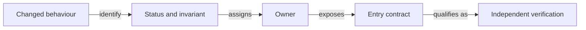

# Package responsibilities

## Overview

A package groups types that change for the same contract. [Project policy](../../config/atf-governance-policy.json) applies the limit of eight Java files separately on the module and set of sources; an extraction is justified by the mechanism's state and invariance.

[Header typography](../../whist-lab-app/app/src/main/java/ro/whistlab/app/theme/GameHeaderTypography.java) belongs to the common style of `theme`; geometry and composition of the table remain in `table`. The selection of display components shall include both responsibilities.

## Choosing an owner

Legend: the separation follows the contract

The input class shall retain the API consumed and delegate the mechanisms with its own status or rules. The number of lines indicates where it is worth investigating; moving to a new file does not demonstrate cohesion or fairness on its own.

| Question | Responsible and limit |
|---|---|
| What action is legal and what score does it result in? | [Engine](../../whist-lab-app/game-core/README.md): model, configuration, rules and session, without Android or test infrastructure. |
| What information can policy use? | [Decision model](../ai/ATF_DecisionModel.md): projection of his own hand and public facts precedes the simulation. |
| How do we compare independent implementation? | [Lab](../../whist-lab-app/ai-lab/README.md): separate model and algorithm; the engine consumes only when tested. |
| How do you measure and play the screen? | [Atlas Android](../../whist-lab-app/app/src/main/java/ro/whistlab/app/README.md): window, geometry, texts, persistence and life cycle. |
| Who commands and interprets the observation? | [Android adapter](../../atf-test-android/README.md): unlimited transport, capture and parsing; pure components do not control the device. |
| Who selects and publishes the results? | [Reporting consumer](../../atf-tests/README.md): local data and audit; generic rendering belongs to the binary library. |

## Entry and delegation classes

The API can remain a short delegation. The common rule has only one implementation within its perimeter and independent algorithms and reference policies retain their identity.

| Entry point | Bounded mechanism | Input to be kept |
|---|---|---|
| [MainActivity](../../whist-lab-app/app/src/main/java/ro/whistlab/app/MainActivity.java) | `AppNavigation`, family `screens`, `GameCommandFlow` and `GamePersistence` | The destination and the dialogues have their own identity; the screens receive observations and actions. The refusal concerns only command, and the checkpoint precedes the ranking and export. |
| [PresentationRefresh](../../whist-lab-app/app/src/main/java/ro/whistlab/app/presentation/PresentationRefresh.java) | Tail of remaking presentation with ports for suspension, availability and rendering | A burst has only one active demand; invalidation rejects the old callback without consuming the new demand. Geometry is read at rendering, and navigation and dialogues remain responsible for availability. |
| [GameTablePanel](../../whist-lab-app/app/src/main/java/ro/whistlab/app/table/GameTablePanel.java) | `animation` family: application, model, `TrickCollectionRun` and Android adapter | Demand is faced with the trick with the history; the coordinator has resources and events, and the adapter measures and increases. The suspension preserves visible time without mutations in the game. |
| [GameSession](../../whist-lab-app/game-core/src/main/java/ro/whistlab/core/session/GameSession.java) | Current hand, score and restoration have owners in [Rules engine](../../whist-lab-app/game-core/README.md#contracts-in-code). | The facade keeps order of orders and checkpoint format. JVM test checks the advance after restoration and refusal without mutation. |
| [MonteCarloAi](../../whist-lab-app/game-core/src/main/java/ro/whistlab/core/ai/engine/MonteCarloAi.java) | `PossibleDeals`, `RolloutPolicy`, `DecisionEvaluation` and `DecisionOrdering` | The generation of worlds, the assessment of the sequels and the order of results remain distinct; order, tolerances and random flow are reproducible. |
| [AiCostQualificationTest](../../whist-lab-app/game-core/src/test/java/ro/whistlab/core/ai/cost/AiCostQualificationTest.java) | `CostProfile`, `CostPlayer` and `CostChecks` | The profile shall be validated once, the measures shall be typed and the rules and limits checked separately from publication; failure shall retain the original cause. |
| [IndependentPlayer](../../whist-lab-app/ai-lab/src/main/java/ro/whistlab/coach/IndependentPlayer.java) | `IndependentDeals` and `IndependentContinuations` | The distribution and advancement of hypothetical worlds remain independent of the engine; the order of decisions, score and random flow do not expose actual adverse cards. |
| [AdbClient](../../atf-test-android/src/main/java/atf/android/AdbClient.java) | `CommandProcess` | The start, drainage and termination use the same term; the cleaning keeps the original cause. |
| [AndroidUiDriver](../../atf-test-android/src/test/java/atf/android/e2e/driver/AndroidUiDriver.java) | `UiDeviceCapture`, `waiting.UiStateAwaiter`, `UiHierarchy`, [family `hierarchy`](../../atf-test-android/src/test/java/atf/android/e2e/driver/hierarchy/) and `ScreenshotAnalysis` | The catch holds the transfer, and the wait holds the term and the last hierarchy. `HierarchyDocument` decodes the nodes, `CardLabelText` keeps the notation, and `CardHierarchy` interprets the cards; generic selectors and measurement do not emit ADB. |
| [ThirteenCardDisplayScenario](../../atf-test-android/src/test/java/atf/android/e2e/gameplay/presentation/ThirteenCardDisplayScenario.java) | `ThirteenCardBiddingCheck` and `SingleCardCenteringCheck` | The coordinator shall maintain the profiles and restoration; phase checks shall be given the same trace and the same evidence without additional JUnit invokes. |
| [SixPlayerTableScenario](../../atf-test-android/src/test/java/atf/android/e2e/gameplay/presentation/SixPlayerTableScenario.java) | `SixPlayerSetupPhase`, `SixPlayerBiddingCheck` and `SixPlayerNavigationCheck` | The configuration, table and navigation use the same trace; the initial summary and the immutable field of the bids are explicitly passed between phases. The coordinator shall retain the failure and shutdown of `finally`. |
| [ThirteenCardPlayScenario](../../atf-test-android/src/test/java/atf/android/e2e/gameplay/presentation/ThirteenCardPlayScenario.java) | [Family `fan`](../../atf-test-android/src/test/java/atf/android/e2e/gameplay/presentation/fan/): `ThirteenCardFanFlow`, `FanSetupPhase` and `FanPlayPhase` | The family entrance connects internal phases; the hierarchy and the initial place are explicitly transmitted. The trail, evidence and comparisons remain common, and the coordinator holds the verdict and the stop. |
| [SavedGameRecoveryScenario](../../atf-test-android/src/test/java/atf/android/e2e/gameplay/persistence/SavedGameRecoveryScenario.java) | `SavedGamePreparationPhase` and `SavedGameResumePhase` | The initial catch of the shift shall be explicitly restarted; the pixel comparison, the score, the track and order of evidence shall be retained. The coordinator holds the failure and return home. |
| [AndroidUiFlowReportPublisher](../../atf-test-android/src/test/java/atf/android/e2e/support/AndroidUiFlowReportPublisher.java) | `AndroidUiFlowReportAudit` | Publication uses the library API; the audit confronts the result with the data captured, without altering the rendering or the execution verdict. |

## Tests, scenarios and data

JUnit method keeps the case identity and the scenario explicitly receives the flow owner. The Oracle calculates the expectation independently; the journal and publication consume the comparison already assessed.

- **Components: ** small situations near the rule times the API checked; the common support keeps the witnesses legal and the actor's projection.
- **Parties and research: ** `core.match`, `core.learning`, `core.research` and independent research families have explicit selections distinct from the implicit regression.
- **References: ** frozen policies remain separate sources; moving a package does not allow their rewriting.
- **Android screenplays: ** navigation, configuration, persistence and levatates have their own responsibilities; the helper receives status and does not invent a new invocation.
- **Display notes:** [shared decoder](../../atf-test-android/src/test/java/atf/android/e2e/display/support/TableViewportObservation.java) consummate the same hierarchy in components and E2E; native capture and acceptance have other limits.
- **Publication:** reading the replica and native results does not depend on the coordinator of the presentation; [reporting contracts](../reporting/README.md) be associated with and accepted.
- **Data: ** games, selections and concrete results remain in the external archive; the scheme and validators belong to the code.

## Procedure for a reorganisation

1. Identify status, invariance, consumers and test that can see a wrong change.
2. Keep the necessary API and move the mechanism, updating the package declaration, imports and access; public visibility is granted only to justified integrations.
3. Face the population of JUnit, order of actions, comparative values and backup behaviour; changing an expected has its own revision.
4. Reconcile live sources and [Full identity of candidate](../testing/ATF_Collections.md#full-identity-of-candidate-base). A move changes the hash even when the algorithm is the same; the frozen base is not repaired by replacing the hashs.
5. Run minimal behavioural check and [governance](README.md). The change in a derogation requires reason and revision; the inventory shall not be regenerated to hide the excess of the limit.

[Test architecture](../testing/ATF_Architecture.md) · [Change of tests](ATF_TestChanges.md) · [Documentation rules](ATF_Documentation.md)
