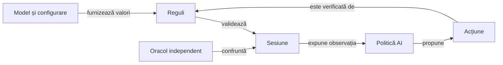

# Responsabilitățile pachetelor

## Pe scurt

Un pachet grupează tipuri care se schimbă pentru același contract. Limita de opt fișiere Java se aplică separat pe modul și set de surse; organizarea urmărește responsabilitatea, iar limita semnalează acumularea ei.

## Motorul și politica de joc

Legendă: comandă, observație și verificare

Motorul păstrează starea și validează orice acțiune. Politica este apelată prin proiecția mâinii proprii și a informației publice; oracolul și datele complete pentru audit rămân în suportul testelor.

| Zonă | Responsabilitate |
|---|---|
| `core.model` | Cărți, culori, atu și copii imutabile ale listelor, inclusiv marcajele de absență permise de stare. |
| `core.config` | Configurația și nivelul selectat înaintea jocului. |
| `core.rules` | Variante, acțiuni legale, scor și catalogul regulilor. |
| `core.session` | Tranziții, faze, restaurare și istoricul scorului. |
| `core.ai.policy` | Fațada deciziei și politica Normal. |
| `core.ai.engine` | Estimarea Hard, continuări, finaluri și certificate asupra observației permise. |
| `core.ai.forecast` | Estimarea contractelor și a seriilor viitoare. |
| `core.ai.profile` | Alternative explicite de obiectiv pentru comparații controlate. |

Prefixul complet al motorului este `ro.whistlab`. Implementarea aplicației consumă aceste contracte fără dependență de codul testelor sau al jucătorului independent.

## Teste și învățare

| Zonă | Contract |
|---|---|
| Teste lângă regulă, sesiune sau politică | Proprietăți mici și așteptări independente, grupate după comportamentul verificat. |
| `core.testing` | Martori legali, comparații capturate și oracole comune. |
| `core.testing.match` | Execuția reutilizabilă a partidei și proiecția observației jucătorului independent. |
| `core.learning` | Colectare, analiză a pierderilor, referințe și evaluări explicite; selecții distincte de regresia implicită. |
| `core.match` | Contracte ale partidelor offline, perspectivelor și strategiilor. |
| `core.baseline` și `coach.baseline` | Politici de referință separate pe identitate de versiune, cu paritate verificată. |
| `coach.research` și `coach.strategy` | Ipoteze experimentale și alternative de strategie, separate de jucătorul activ. |

O mutare schimbă identitatea sursei chiar când algoritmul și coeficienții rămân aceiași. O sursă înghețată se păstrează integral în arhiva sa; reutilizarea unui candidat pe altă structură cere o migrare explicită și o nouă calificare, fără simpla înlocuire a hash-urilor.

## Android și infrastructura ATF

| Zonă | Responsabilitate |
|---|---|
| `app.table`, `app.hand`, `app.cards`, `app.bidding` | Geometrie și elemente de prezentare, fără modificarea regulilor jocului. |
| `app.score`, `app.localization`, `app.theme` | Istoric afișat, texte și stiluri comune. |
| `app.persistence`, `app.lifecycle`, `app.fixtures` | Salvare, temporizarea levatei și date de test protejate prin activarea de depanare. |
| `app.MainActivity` | Compoziția aplicației și punctul de lansare Android. |
| `atf.android.e2e.driver` și `activation` | Interacțiuni delimitate și activarea explicită a dispozitivului. |
| `atf.android.e2e.oracle`, `player`, `evidence` | Așteptări independente, proiecția actorului și capturarea datelor. |
| `atf.android.e2e.display` și `gameplay` | Contracte vizuale și parcursuri de joc distincte. |
| `atf.tests.contracts`, `learning`, `publishing`, `reporting.text` | Contracte de adaptor, selecție, compoziția publicării și compararea textului. |

## Evoluție și verificare

- Declarația de pachet corespunde căii, iar importurile arată contractele folosite între responsabilități.
- Vizibilitatea publică se acordă punctelor de integrare necesare; starea privată rămâne privată.
- Numele aplicației Android, schema salvării și regulile nu se schimbă pentru a simplifica o mutare.
- Colecțiile identifică testele după declarația curentă, fără presupunerea că toate trăiesc în pachetul rădăcină.
- Inventarul curent nu folosește derogări de coeziune; o schimbare a acestei politici cere revizie explicită.
- Regresiile compară populația de cazuri și comportamentul, iar guvernanța verifică structura și limitele dependențelor.

[Arhitectura testării](../testing/ATF_Architecture.md) · [Guvernanță](README.md) · [Regulile documentației](ATF_Documentation.md)
