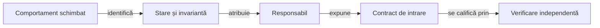

# Responsabilitățile pachetelor

## Pe scurt

Un pachet grupează tipuri care se schimbă pentru același contract. [Politica proiectului](../../config/atf-governance-policy.json) aplică limita de opt fișiere Java separat pe modul și set de surse; o extracție se justifică prin starea și invarianta mecanismului.

## Alegerea responsabilului

Legendă: separarea urmează contractul

Clasa de intrare păstrează API-ul consumat și deleagă mecanismele cu stare ori reguli proprii. Numărul de linii indică unde merită investigat; mutarea într-un fișier nou nu demonstrează singură coeziunea sau corectitudinea.

| Întrebare | Responsabil și limită |
|---|---|
| Ce acțiune este legală și ce scor rezultă? | [Motorul](../../whist-lab-app/game-core/README.md): model, configurare, reguli și sesiune, fără Android sau infrastructura testelor. |
| Ce informație poate folosi politica? | [Modelul deciziei](../ai/ATF_DecisionModel.md): proiecția mâinii proprii și a faptelor publice precede simularea. |
| Cum comparăm o implementare independentă? | [Laboratorul](../../whist-lab-app/ai-lab/README.md): model și algoritm separate; motorul îl consumă numai la testare. |
| Cum se măsoară și redă ecranul? | [Atlasul Android](../../whist-lab-app/app/src/main/java/ro/whistlab/app/README.md): fereastră, geometrie, texte, persistență și ciclu de viață. |
| Cine comandă și cine interpretează observația? | [Adaptorul Android](../../atf-test-android/README.md): transport delimitat, captură și parsare; componentele pure nu comandă dispozitivul. |
| Cine selectează și publică rezultatele? | [Consumatorul raportării](../../atf-tests/README.md): date și audit local; randarea generică aparține bibliotecii binare. |

## Clase de intrare și delegare

API-ul poate rămâne o delegare scurtă. Regula comună are o singură implementare în perimetrul său, iar algoritmii independenți și politicile de referință își păstrează identitatea.

| Intrare | Mecanism delimitat | Invariantă de păstrat |
|---|---|---|
| [GameSession](../../whist-lab-app/game-core/src/main/java/ro/whistlab/core/session/GameSession.java) | `CheckpointValidation` și `CheckpointScores` | Structura, cărțile și scorul sunt validate înaintea restaurării; datele lipsă nu sunt inventate. |
| [MonteCarloAi](../../whist-lab-app/game-core/src/main/java/ro/whistlab/core/ai/engine/MonteCarloAi.java) | `PossibleDeals`, `RolloutPolicy`, `DecisionEvaluation` și `DecisionOrdering` | Generarea lumilor, evaluarea continuărilor și ordonarea rezultatelor rămân distincte; ordinea, toleranțele și fluxul aleator sunt reproductibile. |
| [AiCostQualificationTest](../../whist-lab-app/game-core/src/test/java/ro/whistlab/core/ai/cost/AiCostQualificationTest.java) | `CostProfile`, `CostPlayer` și `CostChecks` | Profilul se validează o dată, măsurile sunt tipizate, iar regulile și limitele se verifică separat de publicare; eșecul păstrează cauza inițială. |
| [IndependentPlayer](../../whist-lab-app/ai-lab/src/main/java/ro/whistlab/coach/IndependentPlayer.java) | `IndependentDeals` și `IndependentContinuations` | Distribuțiile și avansarea lumilor ipotetice rămân independente de motor; ordinea deciziilor, scorul și fluxul aleator nu expun cărțile reale adverse. |
| [AdbClient](../../atf-test-android/src/main/java/atf/android/AdbClient.java) | `CommandProcess` | Pornirea, drenarea și terminarea folosesc același termen; curățarea păstrează cauza inițială. |
| [AndroidUiDriver](../../atf-test-android/src/test/java/atf/android/e2e/driver/AndroidUiDriver.java) | `UiDeviceCapture`, `waiting.UiStateAwaiter`, `UiHierarchy` și `ScreenshotAnalysis` | Captura deține transferul; așteptarea pasivă păstrează termenul, pauza și ultima ierarhie. Parsarea și măsurarea nu emit ADB; navigarea rămâne distinctă de observare. |
| [ThirteenCardDisplayScenario](../../atf-test-android/src/test/java/atf/android/e2e/gameplay/presentation/ThirteenCardDisplayScenario.java) | `ThirteenCardBiddingCheck` și `SingleCardCenteringCheck` | Coordonatorul păstrează profilurile și restaurarea; verificările fazelor primesc aceeași urmă și aceleași dovezi, fără invocări JUnit suplimentare. |
| [SixPlayerTableScenario](../../atf-test-android/src/test/java/atf/android/e2e/gameplay/presentation/SixPlayerTableScenario.java) | `SixPlayerSetupPhase`, `SixPlayerBiddingCheck` și `SixPlayerNavigationCheck` | Configurarea, masa și navigarea folosesc aceeași urmă; rezumatul inițial și domeniul imuabil al licitațiilor trec explicit între faze. Coordonatorul păstrează eșecul și oprirea din `finally`. |
| [ThirteenCardPlayScenario](../../atf-test-android/src/test/java/atf/android/e2e/gameplay/presentation/ThirteenCardPlayScenario.java) | [Familia `fan`](../../atf-test-android/src/test/java/atf/android/e2e/gameplay/presentation/fan/): `ThirteenCardFanFlow`, `FanSetupPhase` și `FanPlayPhase` | Intrarea familiei conectează fazele interne; ierarhia și locul inițial sunt transmise explicit. Urma, dovezile și comparațiile rămân comune, iar coordonatorul deține verdictul și oprirea. |
| [SavedGameRecoveryScenario](../../atf-test-android/src/test/java/atf/android/e2e/gameplay/persistence/SavedGameRecoveryScenario.java) | `SavedGamePreparationPhase` și `SavedGameResumePhase` | Captura turei inițiale trece explicit către reluare; comparația pixelilor, scorul, urma și ordinea dovezilor se păstrează. Coordonatorul deține eșecul și revenirea acasă. |
| [AndroidUiFlowReportPublisher](../../atf-test-android/src/test/java/atf/android/e2e/support/AndroidUiFlowReportPublisher.java) | `AndroidUiFlowReportAudit` | Publicarea folosește API-ul bibliotecii; auditul confruntă rezultatul cu datele capturate, fără a modifica randarea sau verdictul execuției. |

## Teste, scenarii și date

Metoda JUnit păstrează identitatea cazului, iar scenariul primește explicit proprietarul fluxului. Oracolul calculează așteptarea independent; jurnalul și publicarea consumă comparația deja evaluată.

- **Componente:** situații mici lângă regula ori API-ul verificat; suportul comun păstrează martorii legali și proiecția actorului.
- **Partide și cercetare:** `core.match`, `core.learning`, `core.research` și familiile independente de cercetare au selecții explicite, distincte de regresia implicită.
- **Referințe:** politicile înghețate rămân surse separate; mutarea unui pachet nu autorizează rescrierea lor.
- **Scenarii Android:** navigarea, configurarea, persistența și levatele au responsabili proprii; helperul primește starea și nu inventează o nouă invocare.
- **Observații display:** [decodorul comun](../../atf-test-android/src/test/java/atf/android/e2e/display/support/TableViewportObservation.java) consumă aceeași ierarhie în componente și E2E; captura și acceptanța nativă au alte limite.
- **Publicare:** citirea replay-ului și a rezultatelor native nu depinde de coordonatorul prezentării; [contractele raportării](../reporting/README.md) dețin asocierea și acceptanța.
- **Date:** partidele, selecțiile și rezultatele concrete rămân în arhiva externă; schema și validatoarele aparțin codului.

## Procedura unei reorganizări

1. Identificați starea, invarianta, consumatorii și testul care poate observa o schimbare greșită.
2. Păstrați API-ul necesar și mutați mecanismul, actualizând declarația de pachet, importurile și accesul; vizibilitatea publică se acordă numai integrărilor justificate.
3. Confruntați populația JUnit, ordinea acțiunilor, valorile comparate și comportamentul de rezervă; schimbarea unui expected are revizie proprie.
4. Reconciliați sursele live și [identitatea completă a candidatului](../testing/ATF_Collections.md#identitatea-completă-a-bazei-candidatului). O mutare schimbă hash-ul chiar când algoritmul este același; baza înghețată nu se repară prin înlocuirea hash-urilor.
5. Rulați verificarea comportamentală minimă și [guvernanța](README.md). Modificarea unei derogări cere motiv și revizie; inventarul nu se regenerează pentru a ascunde depășirea limitei.

[Arhitectura testării](../testing/ATF_Architecture.md) · [Schimbarea testelor](ATF_TestChanges.md) · [Regulile documentației](ATF_Documentation.md)
