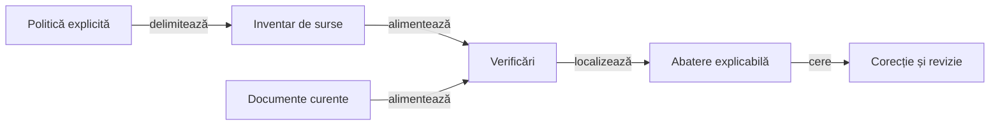

# Guvernanța calității ATF

## Pe scurt

Guvernanța transformă principiile de structură în verificări executabile locale. Suita inspectează sursele, documentele și contractele bibliotecilor consumate, fără dispozitiv, turneu sau acces la servicii externe.

## Ghiduri complementare

- [Bune practici documentare](ATF_Documentation.md): organizare, redactare, legende, navigare și revizie live.
- [Schimbarea testelor](ATF_TestChanges.md): așteptări independente, control negativ și transferul responsabilității.
- [Responsabilitățile pachetelor](ATF_Packages.md): structura motorului, aplicației și testelor, coeziune și limite de dependență.

## Perimetru și responsabilități



<details>
<summary>Legendă: un rezultat are un perimetru</summary>

Inventarul include rădăcinile Maven declarate și rădăcinile JVM suplimentare din politică. Validatoarele documentare inspectează toate README-urile și fișierele Markdown din docs, excluzând directoarele generate.

</details>

[Suita locală](../../atf-tests/src/test/java/atf/tests/governance/AtfQualityGovernanceSuite.java) și [politica](../../config/atf-governance-policy.json) definesc contractul executabil. Adaptarea păstrează regulile reutilizabile ale verificatoarelor comune; ipotezele despre modulele altor aplicații nu sunt importate.

## Reguli executabile

| Zonă | Contract | Limită |
|---|---|---|
| Reactor | Modulele sursă coincid cu politica; bibliotecile comune rămân binare | Nu copiem implementarea sau infrastructura de regresie a producătorului. |
| Pachete | Declarația corespunde căii; coeziunea se verifică separat pe modul și set de surse | Numărul de fișiere nu măsoară singur calitatea semantică. |
| Coeziune | Maximum opt fișiere Java pe pachet; inventarul curent nu folosește derogări | O acumulare de responsabilități cere separare, fără mărirea pragului. |
| Importuri | Fără importuri duplicate; comentariile și șirurile nu devin cod | Verificarea lexicală folosește parserul comun. |
| Dependențe | Motorul nu cunoaște Android, ATF sau JUnit; infrastructura respectă direcțiile declarate | Test Kit deține integrarea JUnit locală; implementarea consolei și probele sale native sunt consumate prin livrarea binară. |
| Niveluri | O clasă executabilă Maven are un singur nivel; tabelul ghidului corespunde codului | Clasele ajutătoare și modulele Gradle au politici explicite. |
| Documentație | Structură, proză, stil, diagrame, legende, linkuri, fragmente și căi relocabile | Formularea în română și corectitudinea conceptuală cer și revizie editorială. |

Politica nu permite mărirea automată a pragului sau generarea derogărilor pentru a obține succes. Probele negative verifică și mecanismul generic al excepțiilor: identitate exactă a fișierelor, motiv și acțiune de separare; o excepție devenită inutilă este respinsă. Aceste probe sintetice nu introduc derogări în proiect.

## Rulare izolată

Din rădăcina proiectului:

```powershell
.\scripts\run-atf-governance.ps1
```

Lansatorul compilează într-o copie temporară proprie și verifică explicit proiectul sursă. Inventarul cu hash-uri este comparat înainte și după verificare; schimbările concurente invalidează certificarea acelei copii.

Depozitul Maven al rulării este propriu copiei temporare. Cache-ul existent poate inițializa dependențele prin `-MavenCache`; instalarea bibliotecilor din `lib` nu înlocuiește fișierele folosite de alte procese.

Pentru o copie de lucru deja pregătită, cu bibliotecile și modulele necesare:

```powershell
mvn -B '-Dmaven.repo.local=<depozit-Maven-propriu>' -pl atf-tests -am '-Dtest=AtfQualityGovernanceSuite' '-Dsurefire.failIfNoSpecifiedTests=false' test
```

`atf.governance.root` poate selecta explicit rădăcina verificată. O rădăcină invalidă produce eroare, fără revenire tacită la alt proiect.

## Dovezi și limite

- Rezultatul nativ păstrează clasa, regula și abaterea localizată.
- Probele negative verifică detectarea unui defect injectat și acceptarea documentului sănătos vecin.
- Inventarul surselor nu ignoră un pachet valid numit `target` din interiorul unei rădăcini compilate.
- Verificarea documentară nu certifică algoritmul jocului, randarea Android sau compatibilitatea tuturor bibliotecilor.
- Calificarea binarelor rămâne contractul distinct al [integrării bibliotecilor](../platform/ATF_Integration.md).
- Deficiențele semantice și datoria de separare rămân vizibile în [feedback](../feedback/ATF_Governance.md).

[Arhitectura testării](../testing/ATF_Architecture.md) · [Documentație](ATF_Documentation.md) · [Schimbarea testelor](ATF_TestChanges.md)
