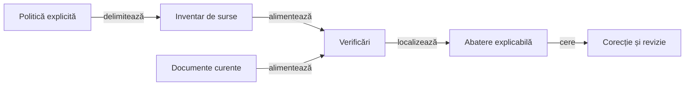

# Guvernanța calității ATF

## Pe scurt

Guvernanța transformă principiile de structură în verificări executabile locale. Suita inspectează sursele, documentele și contractele bibliotecilor consumate, fără dispozitiv, turneu sau acces la servicii externe.

## Ghiduri complementare

- [Bune practici documentare](ATF_Documentation.md): organizare, redactare, legende, navigare și revizie live.
- [Schimbarea testelor](ATF_TestChanges.md): așteptări independente, control negativ și transferul responsabilității.
- [Responsabilitățile pachetelor](ATF_Packages.md): structura motorului, aplicației și testelor, coeziune și limite de dependență.

## Perimetru și responsabilități



<details>
<summary>Legendă: un rezultat are un perimetru</summary>

Inventarul include rădăcinile Maven declarate și rădăcinile JVM suplimentare din politică. Validatoarele documentare inspectează toate README-urile și fișierele Markdown din docs, excluzând directoarele generate.

</details>

[Suita locală](../../atf-tests/src/test/java/atf/tests/governance/AtfQualityGovernanceSuite.java) și [politica](../../config/atf-governance-policy.json) definesc contractul executabil. Adaptarea păstrează regulile reutilizabile ale verificatoarelor comune; ipotezele despre modulele altor aplicații nu sunt importate.

| Inventar | Invariantă |
|---|---|
| Maven | Rădăcina declarată și POM-ul responsabil sunt păstrate împreună, inclusiv pentru module imbricate; metadatele nu sunt reconstruite din primele segmente ale căii. |
| Rădăcini suplimentare | Modulul și calea sunt explicite, iar `test` este boolean; rădăcina rămâne în modulul său. |
| Proprietate | Un fișier are un singur responsabil și un singur set de surse; suprapunerile sunt refuzate, fără deduplicare care ar ascunde ambiguitatea. |

[Contractele inventarului](../../atf-tests/src/test/java/atf/tests/governance/support/SourceInventoryContractTest.java) verifică atât sursa validă, cât și configurațiile care ar pierde identitatea sau ar schimba proprietarul.

## Reguli executabile

| Zonă | Contract | Limită |
|---|---|---|
| Reactor | Modulele sursă coincid cu politica; bibliotecile comune rămân binare | Nu copiem implementarea sau infrastructura de regresie a producătorului. |
| Pachete | Declarația corespunde căii; coeziunea se verifică separat pe modul și set de surse | Numărul de fișiere nu măsoară singur calitatea semantică. |
| Coeziune | Maximum opt fișiere Java pe pachet; inventarul curent nu folosește derogări | O acumulare de responsabilități cere separare, fără mărirea pragului. |
| Importuri | Fără importuri duplicate; comentariile și șirurile nu devin cod | Verificarea lexicală folosește parserul comun. |
| Dependențe | Motorul nu cunoaște Android, ATF sau JUnit; infrastructura respectă direcțiile declarate | Test Kit deține integrarea JUnit locală; implementarea consolei și probele sale native sunt consumate prin livrarea binară. |
| Niveluri | O clasă executabilă Maven are un singur nivel; tabelul ghidului corespunde codului | Clasele ajutătoare și modulele Gradle au politici explicite. |
| Documentație | Structură, proză, stil, diagrame, legende, linkuri, fragmente și căi relocabile | Formularea în română și corectitudinea conceptuală cer și revizie editorială. |

Politica nu permite mărirea automată a pragului sau generarea derogărilor pentru a obține succes. Probele negative verifică și mecanismul generic al excepțiilor: identitate exactă a fișierelor, motiv și acțiune de separare; o excepție devenită inutilă este respinsă. Aceste probe sintetice nu introduc derogări în proiect.

## Declarațiile testelor

[Parserul sintactic](../../atf-tests/src/test/java/atf/tests/governance/source/JavaTestDeclarations.java) folosește JDK-ul activ, în memorie, fără generare de clase sau procesarea adnotărilor. [Regulile nivelurilor](../../atf-tests/src/test/java/atf/tests/governance/source/TestLayerRules.java) consumă această structură și păstrează separat rezolvarea adnotărilor compuse.

O inspecție deține și închide propriul manager de fișiere JDK, reutilizat între sursele aceleiași inspecții. Fiecare sursă are o sarcină și diagnostice noi; o eroare de sintaxă nu contaminează următoarea sursă, iar contextul închis nu mai poate fi folosit.

| Frontieră | Contract |
|---|---|
| Declarație | Poziția adnotării față de modificatori, forma calificată și spațierea nu schimbă proprietarul. |
| Execuție declarată | Metodele tipului și containerele `@Nested` identifică execuția; o clasă interioară folosită ca fixture nu etichetează automat exteriorul. |
| Graf de adnotări | Importuri explicite sau cu wildcard, declarații reale și cicluri delimitate; ambiguitățile sunt refuzate. |
| Surse invalide | O eroare de sintaxă produce diagnostic cu linie și coloană, fără inventar gol acceptat. |
| Limită | Inspecția nu încarcă tipurile aplicației, nu execută JUnit și nu substituie compilarea sau rezolvarea completă a moștenirii. |

[Componentele sintaxei](../../atf-tests/src/test/java/atf/tests/governance/source/TestLayerSyntaxTest.java) verifică refuzurile și vecinii valizi, inclusiv exemple Java în șiruri care nu trebuie tratate ca declarații.

## Rulare izolată

Pentru verificarea dovezilor publicate, folosiți un checkout Git cu obiectele commiturilor indicate în notele de release. Suita citește acele obiecte local, iar un obiect lipsă produce eroare.

Din rădăcina proiectului:

```powershell
.\scripts\run-atf-governance.ps1
```

Lansatorul compilează într-o copie temporară proprie și verifică explicit proiectul sursă. Inventarul cu hash-uri este comparat înainte și după verificare; schimbările concurente invalidează certificarea acelei copii.

Depozitul Maven al rulării este propriu copiei temporare. Cache-ul existent poate inițializa dependențele prin `-MavenCache`; instalarea bibliotecilor din `lib` nu înlocuiește fișierele folosite de alte procese.

Pentru o copie de lucru deja pregătită, cu bibliotecile și modulele necesare:

```powershell
mvn -B '-Dmaven.repo.local=<depozit-Maven-propriu>' -pl atf-tests -am '-Dtest=AtfQualityGovernanceSuite' '-Dsurefire.failIfNoSpecifiedTests=false' test
```

`atf.governance.root` poate selecta explicit rădăcina verificată. O rădăcină invalidă produce eroare, fără revenire tacită la alt proiect.

## Dovezi și limite

- Rezultatul nativ păstrează clasa, regula și abaterea localizată.
- Probele negative verifică detectarea unui defect injectat și acceptarea documentului sănătos vecin.
- Inventarul surselor nu ignoră un pachet valid numit `target` din interiorul unei rădăcini compilate.
- [Igiena rădăcinii](../../atf-tests/src/test/java/atf/tests/governance/source/workspace/WorkspaceHygieneGovernanceTest.java) refuză directoare nerecunoscute, căi temporare locale aplatizate și fișiere compilate rătăcite. Verificarea este numai cititoare; curățarea cere inventar și ținte rezolvate în perimetrul numit.
- [Strategia unică](../../atf-tests/src/test/java/atf/tests/governance/documentation/strategy/TestingStrategyGovernanceTest.java) păstrează un proprietar normativ, ghiduri generice fără rezultate și un catalog explicativ pentru fiecare rădăcină de teste declarată.
- Verificarea documentară nu certifică algoritmul jocului, randarea Android sau compatibilitatea tuturor bibliotecilor.
- Calificarea binarelor rămâne contractul distinct al [integrării bibliotecilor](../platform/ATF_Integration.md).
- Deficiențele semantice și datoria de separare rămân vizibile în [feedback](../feedback/ATF_Governance.md).
- [Retenția dovezilor release-ului](../../atf-tests/src/test/java/atf/tests/governance/documentation/release/ReleaseEvidenceRetentionGovernanceTest.java) refuză PNG-uri identice deja încorporate. Prezența octeților nu certifică viewerul, autonomia corpurilor Android sau integritatea APK-ului; acestea au controale distincte.
- [Integritatea livrării](../../atf-tests/src/test/java/atf/tests/governance/documentation/release/ReleaseIntegrityGovernanceTest.java) confruntă APK-ul, checksum-ul, CRC-ul, inventarul hash-urilor și cazurile JUnit reale. Probele negative alterează și fișiere ale căror hash-uri au fost recalculate, pentru a califica separat oracolul semantic. [Contractul și limitele](../platform/ATF_AndroidDelivery.md#integritatea-fișierelor-și-rezultatelor) disting observarea octeților de execuție, semnătură și proveniență.

[Arhitectura testării](../testing/ATF_Architecture.md) · [Documentație](ATF_Documentation.md) · [Schimbarea testelor](ATF_TestChanges.md)

## Revizia semantică

Verificările structurale trebuie completate prin controale ale afirmațiilor factuale care au proprietar executabil. Revizia semantică rămâne obligatorie pentru reguli, compatibilitate și limitele descrise în mai multe rezumate.

- [Responsabilitățile pachetelor](ATF_Packages.md) cer starea, dependențele și invarianta fiecărui mecanism; mutarea unui fișier nu demonstrează singură coeziunea.
- [Bunele practici documentare](ATF_Documentation.md) dețin grila editorială și separarea rezultatului extern de contract.
- [Feedback-ul de guvernanță](../feedback/ATF_Governance.md#calificarea-afirmațiilor-și-lansatoarelor) păstrează controlul factual încă necesar și nivelul cerut înaintea închiderii.
