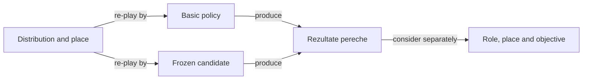

# Comparison of strategies at the same table

## Overview

The arena compares politics on complete Romanian games. The protocol declares distributions, order, roles, basic strategies, seat rotation and pre-evaluation score rules.

## Comparison principles



<details>
<summary>Legend: same distribution, independent decisions</summary>

Each policy receives only the observation allowed to the actor. Distribution and place are kept between pairs, and public states may diverge after the first different choice.

</details>

| Principiu | Interpretare |
|---|---|
| Same original world | The candidate and the basis shall start from the same distributions and orders. |
| Same observation limit | Each decision uses the hand and prefix of that game; prefixes may diverge after the first different choice. |
| Rotation of seats | The assessment from different places measures sensitivity to position and reduces confusion of the advantage of the place with the effect of policy. |
| Full match | The final score includes the consequences of all the bids, cards and the declared score rules. |
| Lot rezervat | The promotion assessment shall use distributions not used in the candidate's choice. |

## Interpretation limits

After the first divergence, the match compares complete routes and does not isolate the effect of a single move, as actions change the subsequent public status.

Report the role, place, adverse family, size of the hand, points, exact contracts and components of the score, including the serial bonuses.

A winning game or an aggregate rate does not alone prove the superiority of a rule; the evaluation uses the criteria set before the reserved lot.

## From observation to verifiable rule

[Protocolul offline](README.md#the-improvement-cycle) has the stages of diagnosis and promotion. The arena provides the comparable pair and the first divergence; [componenta AI](../testing/ATF_AiComponents.md) justifies local ownership through permitted observation and independent oracle.

The effect of a single decision shall be investigated separately from the effect of the whole policy. After the first different bid or card, the comparison of the match also measures the subsequent reactions of the other actors.

## Information and artifacts

The running keeps the sources and configuration identified, roles, distributions and results in the external repository. [The contract of the body](ATF_Corpus.md) has the observation projection and the separation of complete data from policy input.

| Performing input | Purpose |
|---|---|
| [run-offline-strategy-profiles.ps1](../../scripts/run-offline-strategy-profiles.ps1) | Compare the declared profiles on the same distribution at each place for the development diagnosis. |
| Collection `arena` | Use protocol [strategy-arena](../../config/strategy-arena.json), validation of the Gradle's own and the Gradle load declared in the catalogue. |
| Collection `learning` | Qualify a candidate identified under the promotion protocol and the declared phase. |

From the root of the project, for an explicitly selected development seed:

```powershell
$seed = [long](Read-Host 'Seed-ul declarat pentru diagnosticul de dezvoltare')
.\scripts\run-offline-strategy-profiles.ps1 -Seed $seed
```

The choice of a seed from the clock does not prove that the distribution is unused. The development comparison and the reserved assessment have separate registers and criteria.

[Orders and preconditions](../testing/ATF_Collections.md) · [Protocolul offline](README.md)
