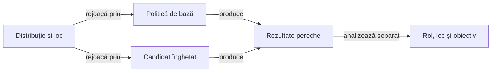

# Compararea strategiilor la aceeași masă

Arena compară politici pe partide românești complete. Protocolul declară distribuțiile, ordinea, rolurile, strategiile de bază, rotația locurilor și regulile de scor înainte de evaluare.

## Principii de comparare



<details>
<summary>Legendă: aceeași distribuție, decizii independente</summary>

Fiecare politică primește numai observația permisă actorului. Distribuția și locul se păstrează între perechi, iar stările publice pot diverge după prima alegere diferită.

</details>

| Principiu | Interpretare |
|---|---|
| Aceeași lume inițială | Candidatul și baza pornesc de la aceleași distribuții și aceeași ordine. |
| Aceeași limită de observație | Fiecare decizie folosește mâna proprie și prefixul acelei partide; prefixele pot diverge după prima alegere diferită. |
| Rotația locurilor | Evaluarea din locuri diferite măsoară sensibilitatea la poziție și reduce confundarea avantajului locului cu efectul politicii. |
| Partidă completă | Scorul final include consecințele tuturor licitațiilor, cărților și regulilor de scor declarate. |
| Lot rezervat | Evaluarea de promovare folosește distribuții care nu au fost folosite la alegerea candidatului. |

## Limitele interpretării

După prima divergență, partida compară trasee complete și nu izolează efectul unei singure mutări, deoarece acțiunile schimbă starea publică ulterioară.

Raportați separat rolul, locul, familia adversă, mărimea mâinii, punctele, contractele exacte și componentele scorului, inclusiv bonusurile de serie.

O partidă câștigată sau o rată agregată nu dovedește singură superioritatea unei reguli; evaluarea folosește criteriile stabilite înaintea lotului rezervat.

## Din observație într-o regulă verificabilă

[Protocolul offline](README.md#ciclul-de-îmbunătățire) deține etapele diagnosticării și promovării. Arena furnizează perechea comparabilă și prima divergență; [componenta AI](../testing/ATF_AiComponents.md) justifică proprietatea locală prin observație permisă și oracol independent.

Efectul unei singure decizii se investighează separat de efectul întregii politici. După prima licitație sau carte diferită, comparația partidei măsoară și reacțiile ulterioare ale celorlalți actori.

## Informație și artefacte

Rularea păstrează sursele și configurația identificate, rolurile, distribuțiile și rezultatele în depozitul extern. [Contractul corpusului](ATF_Corpus.md) deține proiecția observației și separarea datelor complete de intrarea politicii.

| Intrare de execuție | Scop |
|---|---|
| [run-offline-strategy-profiles.ps1](../../scripts/run-offline-strategy-profiles.ps1) | Compară profilurile declarate pe aceeași distribuție, la fiecare loc, pentru diagnosticul de dezvoltare. |
| Colecția `arena` | Folosește protocolul [strategy-arena](../../config/strategy-arena.json), validarea proprie și sarcina Gradle declarată în catalog. |
| Colecția `learning` | Califică un candidat identificat conform protocolului de promovare și fazei declarate. |

Din rădăcina proiectului, pentru un seed de dezvoltare ales explicit:

```powershell
$seed = [long](Read-Host 'Seed-ul declarat pentru diagnosticul de dezvoltare')
.\scripts\run-offline-strategy-profiles.ps1 -Seed $seed
```

Alegerea unui seed din ceas nu dovedește că distribuția este nefolosită. Comparația de dezvoltare și evaluarea rezervată au registre și criterii distincte.

[Comenzi și precondiții](../testing/ATF_Collections.md) · [Protocolul offline](README.md)
