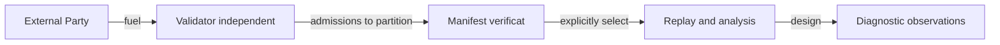

# Game corpus contract

## Overview

The corpus is an external entry for the replicay, selection and offline analysis. The project has the schematics and validators; party files, concrete manifests and lot registers remain in the external warehouse configured.

## Data model

| Entitate | Contract |
|---|---|
| Party | Identity, partition, rule profile, policies and order of hands. |
| Hand | Dealer, distribution, trump card, orderly bids, tricks and closing score. |
| Observation | The actor's hand and the public prefix available at the decision. |
| Manifest | Selected files, hashes, parent identity and purpose of selection. |
| Lot Register | Separate evaluation development and record of already consumed ranges. |



<details>
<summary>Legend: access to data</summary>

The validator can check the property of all cards after the game is finished. The policy receives the projection allowed to the decision, and the analysis does not turn actual adverse hands into inputs of that policy.

</details>

## PARTIES AND INFIDENCE

- Development allows analysis and adjustment; active selection reads only the declared manifest.
- Heldout is reserved for the assessment of the frozen candidate and is registered as exposed to the opening.
- Reference keeps compatibility inputs; they do not justify a statement about the current power of a policy.
- Repeats of the same distribution or trace shall not be counted as independent observations.
- In the match scheme, the seedum is exactly decimal; the parser does not convert it by a JavaScript number that would lose the accuracy of the type Java long.
- The identity, partition, paths and SHA-256 shall be checked prior to use.

## Usage

[Body configuration](../../config/learning-corpus.json) indicates the archive and active pointer.[Validatorul](../../whist-lab-app/ai-lab/tools/corpus/whist-corpus.mjs) checks the rules and the score, and [selectorul activ](../../whist-lab-app/ai-lab/tools/corpus/whist-active-corpus.mjs) controls the selection.

```powershell
$gamePath = Read-Host 'Fișierul JSON extern pentru replay'
$expectedSha256 = Read-Host 'SHA-256 declarat în manifestul sursei'
node whist-lab-app/ai-lab/tools/corpus/whist-corpus-cli.mjs replay $gamePath $expectedSha256
node whist-lab-app/ai-lab/tools/corpus/whist-active-corpus.mjs verify-current
```

[Replay-ul](../../whist-lab-app/ai-lab/tools/corpus/whist-archive-replay.mjs) requires the hash expected prior to reading, compares bytes and then checks the rules; a missing, changed or illegal entry is denied. The hash identifies the file without demonstrating the provenance or correctness of the game. The Gradle `:ai-lab:replayArchive` task accepts the same entries by `-Pwhist.archive.file` and `-Pwhist.archive.sha256` and is not part of `check`.

Default components use [legal data built](../../whist-lab-app/ai-lab/tools/testing/legal-game-fixture.mjs), with rules of training independent of validator. External archive is required only for selected operations on kept data.

[Selection criteria](ATF_Selection.md) and [evaluation protocol](README.md) explain the use of the body to improve policies.
