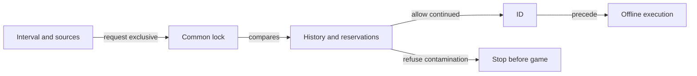

# Common record of batch exposure

## Overview

[Registry executable](../../whist-lab-app/ai-lab/tools/qualification/whist-evaluation-registry.mjs) keeps the distribution exposure before the game. [Installation policy](../../config/whist-evaluation-policy.json) identifies the common location; the corpus, the result directory and the batch name do not choose.

A registry shall coordinate processes using the same installation. His move requires the preservation of the entire state and coordinated updating of consumers; an empty copy is not a migration. Direct executions outside launchers shall be imported as exposure before qualification.

## Flow of an application



<details>
<summary>Legend: reservation and exposure</summary>

The reservation shall be preceded by the execution and shall be maintained even after failure or interruption. The receipt shall identify the admission of the consignment; the result of the tests and the strategic progress shall be checked separately.

</details>

## Identity and re-use

[Variant component](../../whist-lab-app/ai-lab/tools/qualification/half-open-interval.mjs) checks the intersection of the entire semi-open intervals, independent of play and storage. The registry adapts `firstSeed` and `seeds` at the ends of the range and retains the validation of the domain itself; the adjacent is not overlapping.

| Element | Contract |
|---|---|
| Distribution | Common space `romanian4-seeded-deals` and the semi-open range of seeds identify the conservative exposure. The role, opponent, location and version of the protocol do not create independent distributions. |
| Candidate | The identity, phase, range, hashness of protocol and source inventory identify the reservation. The reserved assessment requires additional ice cream hash. |
| Development | The same distributions can be replayed with other policies. Receipt `DEVELOPMENT_REUSE` shall maintain overlaps and prohibit their subsequent submission as untouched data. |
| Reserved assessment | any overlap with the history or other reservation shall be refused, including one seed or the inclusion of one interval in another. |
| Continuation | The same full identity shall be given the same identifier and the mark `CONTINUATION`. Continuation is not a new independent batch and does not delete previous results. |

The identity is calculated from the canonical JSON with sorted keys and the SHA-256. Corpus and result paths keep the origin of the first application, without being able to reset the exposure.

- [Inventory executable](../../whist-lab-app/ai-lab/tools/qualification/WhistEvaluationInputs.psm1) includes the sources and resources of the engine and laboratory, the construction of JVM and the admission mechanism.
- The presentation of Android and independent documentation does not change the identity of policy; a change in the executable source changes it.
- The inventory shall also include the generic component imported by the register.
- Changing this dependency changes the identity of the reservation; separating it into a new file does not remove it from the sources to be frozen.

## Initialization and history

Initialization requires a revised manifest: `reviewedBy` and list `exposures`. Each historical range declares `firstSeed`, `seeds` and `evidenceSha256`; the import sources and inventory remain in the external archive. An empty list is only allowed for a revised environment as new.

```powershell
node .\whist-lab-app\ai-lab\tools\qualification\whist-evaluation-registry.mjs initialize '<shared-registry>' '<reviewed-history.json>' '<new-receipt.json>'
```

Repeated initialization is denied. Old manifests, reservations under the corpus and games already seen are imported conservatively; the lack of a file does not demonstrate that the data has not been exposed. The import of history does not change the qualification of experiments retrospectively.

## Concurrency and recovery

| Mechanism | Input |
|---|---|
| Atomic lock | The creation of the Director `.lock` serializes reading, checking and writing. Expiration of expectation refuses application; blocking is not automatically taken over. |
| Persistence | The status includes a control amount; writing uses new file, synchronization and renaming inside the lock. |
| Discontinuation | A `.pending.json` file stops admission. Recovery shall inspect the owner process, the previous state and the partial writing prior to intervention. |
| Integrity | JSON truncated, changed amount and redirected pathways through links are denied. Control shall not replace the permission and safety copy of the deposit. |

## Integration and verification

[Collections Launcher](../../scripts/run-whist-collection.ps1) reserves the development, evaluation and arena after identification of the executable copy. The protocol and the freezing are kept from the same bytes interpreted; reservation precedes the starting of Gradle.

[Diagnostic recording](../../scripts/Register-WhistDevelopmentExposure.ps1) is also used by the game launchers, perspectives and profiles. Local files `holdout-use` remain only compatibility projections for readers of historical tournaments; authority is the common register.

| Level | Checked properties |
|---|---|
| Node component | Borders, overlaps, identity, body copying, history, integrity, interruption and demands from competing processes. |
| Integration component | Real launcher with built sources and Gradle controlled: booking precedes execution, refusal does not start the game, and local receipt keeps canonical identity. |
| Field evaluation | The protocol faces the rules, score and progress on the accepted lot separately; the registry does not issue a verdict of force playing. |

[Protocol offline](README.md) · [Collections](../testing/ATF_Collections.md) · [Register components](../../whist-lab-app/ai-lab/tools/qualification/whist-evaluation-registry.test.mjs)
