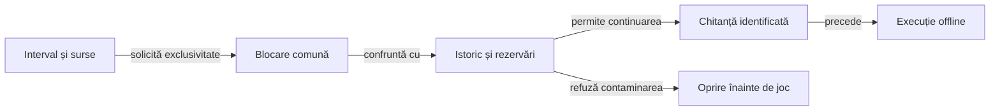

# Registrul comun al expunerii loturilor

## Scop și proprietar

[Registrul executabil](../../whist-lab-app/ai-lab/tools/qualification/whist-evaluation-registry.mjs) păstrează expunerea distribuțiilor înaintea jocului. [Politica instalației](../../config/whist-evaluation-policy.json) identifică locația comună; corpusul, directorul rezultatului și numele lotului nu o aleg.

Un registru coordonează procesele care folosesc aceeași instalație. Mutarea lui cere păstrarea întregii stări și actualizarea coordonată a consumatorilor; o copie goală nu reprezintă o migrare. Execuțiile directe în afara lansatoarelor trebuie importate ca expunere înaintea calificării.

## Fluxul unei cereri



<details>
<summary>Legendă: rezervare și expunere</summary>

Rezervarea precede execuția și rămâne păstrată inclusiv după eșec sau întrerupere. Chitanța identifică admiterea lotului; rezultatul testelor și progresul strategic se verifică separat.

</details>

## Identitatea și reutilizarea

[Componenta de intervale](../../whist-lab-app/ai-lab/tools/qualification/half-open-interval.mjs) verifică intersecția intervalelor întregi semi-deschise, independent de joc și stocare. Registrul adaptează `firstSeed` și `seeds` la capetele intervalului și păstrează validarea domeniului propriu; adiacența nu este suprapunere.

| Element | Contract |
|---|---|
| Distribuție | Spațiul comun `romanian4-seeded-deals` și intervalul semi-deschis de semințe identifică expunerea conservator. Rolul, adversarul, locul și versiunea protocolului nu creează distribuții independente. |
| Candidat | Identitatea, faza, intervalul, hash-ul protocolului și inventarul surselor identifică rezervarea. Evaluarea rezervată cere suplimentar hash-ul înghețării. |
| Dezvoltare | Aceleași distribuții pot fi rejucate cu alte politici. Chitanța `DEVELOPMENT_REUSE` păstrează suprapunerile și interzice prezentarea lor ulterioară ca date neatinse. |
| Evaluare rezervată | Orice suprapunere cu istoricul sau altă rezervare este refuzată, inclusiv la o singură semință ori la includerea unui interval în altul. |
| Continuare | Aceeași identitate completă primește același identificator și marcajul `CONTINUATION`. Continuarea nu este un nou lot independent și nu șterge rezultatele anterioare. |

Identitatea este calculată din JSON canonic cu chei sortate și SHA-256. Căile corpusului și rezultatului păstrează proveniența primei cereri, fără să poată reseta expunerea.

- [Inventarul executabil](../../whist-lab-app/ai-lab/tools/qualification/WhistEvaluationInputs.psm1) include sursele și resursele motorului și laboratorului, construirea JVM și mecanismul admiterii.
- Prezentarea Android și documentația independentă nu schimbă identitatea politicii; o modificare a sursei executabile o schimbă.
- Inventarul include și componenta generică importată de registru.
- Schimbarea acestei dependențe schimbă identitatea rezervării; separarea într-un fișier nou nu o scoate din sursele care trebuie înghețate.

## Inițializare și istoric

Inițializarea cere un manifest revizuit: `reviewedBy` și lista `exposures`. Fiecare interval istoric declară `firstSeed`, `seeds` și `evidenceSha256`; sursele și inventarul importului rămân în arhiva externă. O listă goală este admisă numai pentru un mediu revizuit ca nou.

```powershell
node .\whist-lab-app\ai-lab\tools\qualification\whist-evaluation-registry.mjs initialize '<registru-comun>' '<istoric-revizuit.json>' '<chitanță-nouă.json>'
```

Inițializarea repetată este refuzată. Manifestele vechi, rezervările de sub corpus și partidele deja văzute se importă conservator; lipsa unui fișier nu demonstrează că datele nu au fost expuse. Importul istoricului nu schimbă retrospectiv calificarea experimentelor.

## Concurență și recuperare

| Mecanism | Invariantă |
|---|---|
| Blocare atomică | Crearea directorului `.lock` serializează citirea, verificarea și scrierea. Expirarea așteptării refuză cererea; blocarea nu este preluată automat. |
| Persistență | Starea include o sumă de control; scrierea folosește fișier nou, sincronizare și redenumire în interiorul blocării. |
| Întrerupere | Un fișier `.pending.json` oprește admiterea. Recuperarea inspectează procesul proprietar, starea anterioară și scrierea parțială înainte de intervenție. |
| Integritate | JSON trunchiat, sumă schimbată și căi redirecționate prin legături sunt refuzate. Controlul nu înlocuiește permisiunile și copia de siguranță ale depozitului. |

## Integrarea și verificarea

[Lansatorul colecțiilor](../../scripts/run-whist-collection.ps1) rezervă dezvoltarea, evaluarea și arena după identificarea copiei executabile. Protocolul și înghețarea sunt păstrate din aceiași octeți interpretați; rezervarea precede pornirea Gradle.

[Înregistrarea diagnosticului](../../scripts/Register-WhistDevelopmentExposure.ps1) este folosită și de lansatoarele de partide, perspective și profiluri. Fișierele locale `holdout-use` rămân numai proiecții de compatibilitate pentru cititorii turneelor istorice; autoritatea este registrul comun.

| Nivel | Proprietăți verificate |
|---|---|
| Componentă Node | Frontiere, suprapuneri, identitate, copierea corpusului, istoric, integritate, întrerupere și cereri din procese concurente. |
| Componentă de integrare | Lansatorul real cu surse construite și Gradle controlat: rezervarea precede execuția, refuzul nu pornește jocul, iar chitanța locală păstrează identitatea canonică. |
| Evaluare de domeniu | Protocolul confruntă separat regulile, scorul și progresul pe lotul admis; registrul nu emite verdict de forță de joc. |

[Protocolul offline](README.md) · [Colecții](../testing/ATF_Collections.md) · [Componentele registrului](../../whist-lab-app/ai-lab/tools/qualification/whist-evaluation-registry.test.mjs)
