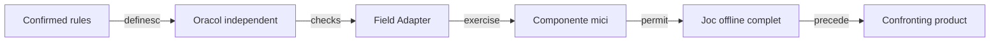

# Preparing another game to test

## Overview

We transfer the method: confirmed rules, allowed observation, independent oracle, small regression and evaluation on reserved data. The engine, policies and formats of the Whist have specific adapters; the start of another game requires identification and verification of these borders.

This guide holds the admission of a new domain. [Development of AIU](ATF_PolicyEvolution.md) holds the improvement of a policy and [the architecture of testing](../testing/ATF_Architecture.md) holds the choice of level of verification.

## What can we transfer now?

| Surface | Code status | What does another game require? |
|---|---|---|
| Classification and audit JUnit | [Kit](../../lib/README.TestKit.md#purpose-and-integration) independent of the Whist engine. | Own expectations and the adaptor to the publication of results. |
| Biblioteci comune | [Binary APIs](../platform/README.md), with local acceptance. | Configuration, provenance and verification on the profile of the new consumer. |
| Governance | [Adapted verifiers](../governance/README.md), with local policy and population; use [Documentary clipboard](../governance/ATF_Documentation.md#cli-for-governance-of-documentation) for editorial rules, and [JVM inventory clipper](../governance/README.md#jvm-inventory-via-cli) for sources. | Root, modules and explicit inventory plus negative controls on the new perimeter. |
| Intersection of the intervals | [Pure component](../../whist-lab-app/ai-lab/tools/qualification/half-open-interval.mjs), consumed by the register. | Valid whole entries and data identity adaptation. |
| Data exposure | [Registrul actual](ATF_EvaluationRegistry.md) sets the namespaceum of Whist distributions. | Identity contract, data space and migration; change of a name does not qualify as a generic register. |
| Policy and Observation | [AiPolicy](../../whist-lab-app/game-core/src/main/java/ro/whistlab/core/ai/policy/AiPolicy.java) projects status to the Whist models. | Types, actions, observation and objective of the new game. |
| Corpus and Comparison | [Corpusul](ATF_Corpus.md) and [arena](ATF_Arena.md) check distributions, contracts and Whist scores. | Schema and validator of own route with comparisons suitable for the domain. |
| Publication of the domain | [Consumatorul](../../atf-tests/README.md) performs records and results of the Whist. | Mapping of events and comparisons; the common renderer remains with the library's responsible. |

The method preparation allows the first adapter to be built. The compatibility statement between games requires at least two real adapters passing the joint contracts; an additional mock of the same model does not provide this confirmation.

## Entry route



<details>
<summary>Legend: each step has a verifiable output</summary>

The adapter exposes the behavior of the domain and preserves the difference between actor and oracle. The offline game qualifies the model and policy collaboration; minimum confrontation with the real product verifies the adaptor's fidelity and has separate training purpose.

</details>

| Step | Output criterion |
|---|---|
| Contract | The variant, roles, states, actions, termination and score have confirmed definitions and version. |
| Observation | Permitted information, visible history and source of the random are declared; the future and secrets of other roles are excluded from the decision. |
| Transition | A legal action changes the status as per the rule; refusal does not change the status. Repeating an order has its semantics declared. |
| Oracol | The expectation is a rule of independence, an invariant or an enumeration with a finite domain; the agreement of two copies of the same code is not sufficient. |
| Componente | The nominal case, the injected defect, the valid neighbor and the rule limit are differentiated without an interface. |
| Offline loop | All shifts lead to termination or an explicit limit; resources, score and preservation of the game objects are checked. |
| Produs real | A minimum selection of states and transitions shall be in line with the model of the product identified; differences shall be visible. |
| Evaluare AI | The basis, candidate, budget and criteria shall be fixed before the reserved data; the model adaptation shall open the affected qualification. |

## Adapter contracts

The names below describe design responsibilities without declaring a generic API already delivered. [Transfer feedback](../feedback/ATF_Ai.md#re-use-of-mechanisms) maintains the conditions for joint implementation.

| Port conceptual | Entry and exit | Independent Guard |
|---|---|---|
| Projection of the observation | Status, role and moment → information allowed. | The change of secrets shall keep the same observation when the visible information remains identical. |
| Legality and step | Status, role and action → refusal or transition. | The action refused shall preserve the status; the transition shall preserve the defined resources of the game. |
| Policy | Observation, configuration and budget → legal choice. | He doesn't get the oracle, the distribution seed- or the generator of future events. |
| Simulator | Status and policies → log until completion. | Actors have separate observations; the duration and number of steps have explicit limits. |
| Evaluator | Log and rules → comparisons and metrics. | Recalculate the result without using the policy verdict as a waiting. |
| Identity of data | Domain, generator, version and case → Stable identity. | The same set in different generators does not involve the same distribution; copying of data retains exposure. |

In a fully observable game, the observation may contain the entire permitted state. In a simultaneous game or with hidden information, the isolation of roles and the order of disclosure are own contracts, verified before comparison of strategies.

## Lessons to be transferred

| Lesson | New application | Verification |
|---|---|---|
| The comment does not establish the intention of the product | Separate requirement **confirmed **, behaviour **observat** and hypothesis **assumed **. | A known defect is detected without copying the current pending response. |
| Mock has declared limits | Modulate states, transitions and refusals, then face a selection with the actual product. | The pattern difference and the violation of a requirement receive distinct diagnoses. |
| Defeat locates analysis | Reduce the first divergence to a property and its border. | The valid neighbor rules out too wide a rule; a party's victory does not become an optimal label. |
| Prediction differs from decision | The model estimates behaviour; policy follows the stated objective. | The predictive error, legality and strategic progress have separate criteria. |
| The parameter and context have different rhythms | Recalculate the features of events; change parameters only by identified candidate. | The same source and configuration shall retain the definition of characteristics, units and fallback. |
| Comparison controls context | Use comparable inputs and resources, rotated roles and families of opponents. | The environment is separated from the exploration of policy; the routes may diverge after the first choice. |
| Reserved data shall maintain exposure | Identify the generator, versions and partitions independently of the director. | Motion or renaming does not reopen the data seen; related observations do not become independent samples. |
| Extraction requires consumers | Move a common mechanism only with explicit field and parity evidence. | The source inventory includes imported dependencies; a change in them changes the identity of the candidate. |
| The numerical identity has a contract | Distance the mathematical value, the allowed tolerance and structural representation. | Zero signed, precision and unfinished values have explicit rules; serialisation and equality do not by default choose the meaning of the domain. |

## Rules and weightings in another game

Transfer semantics of a feature, not numerical value. Each rule declares the condition, unity, normalisation, priority, consumer, limits and verification; [ghidul YAML](../ai/ATF_RulesConfiguration.md) distinguishes the legal filter, the order of objectives, the mixture of estimates and the coefficient learned.

- Redefine the objective and the terminal criterion before a weighting: points, risk and duration may have different units.
- Recalculate the context from the information available to the role; access to the future does not become acceptable through normalisation.
- Qualify separately the activation, data lack, cancellation and budget depleted; a new feature changes the identity of the model.
- Keep the adjustment data distinct from the reserved valuation and include a simple, explainable basis.

<details>
<summary>Lecture sheet for any game or product</summary>

This is a drafting structure; current launchers do not interpret the scheme:

```yaml
lesson:
  id: "<identitate stabilă>"
  domain: "<joc sau produs și versiunea regulilor>"
  scope: "<precondiții și rol>"
  observation: "<informație permisă actorului>"
  claim: "<proprietate verificabilă>"
  claim_status: "<confirmat | observat | presupus>"
  contract_owner: "<responsabil și versiunea contractului>"
  oracle: "<sursă independentă a așteptării>"
  boundaries: "<când proprietatea nu se aplică>"
  negative_control: "<defect detectabil și vecin valid>"
  adapter: "<date și acțiuni specifice domeniului>"
  data_identity: "<generator, versiune, partiție și expunere>"
  promotion: "<criteriu fixat înaintea evaluării noi>"
```

For testing a new product, replace the shift with the operation, score with invariant or acceptance criterion and role with user permissions. An unconfirmed hypothesis remains an investigation; the contract's manager clarifies the wait before the automatic verdict.

</details>

## Verification of preparation

For pure range mechanism, from the project root, with Node.js available:

```powershell
node --test whist-lab-app/ai-lab/tools/qualification/half-open-interval.test.mjs
```

[Kite contracts](../../lib/README.TestKit.md#purpose-and-integration) and [acceptance of library guides](../platform/ATF_Integration.md#verification-of-examples-in-guides) check other reusable parts. The register, arena and corpus have their own Whist tests; their passage does not qualify for a new field.

Starting components for another game requires contract, observation projection and defined oracle. Starting training requires additional validated offline loop and separate data; connecting to the interface requires identified product and resource control, according to the [test strategy](../testing/README.md).

[Protocol offline](README.md) · [Policy developments](ATF_PolicyEvolution.md) · [Transfer gaps](../feedback/ATF_Ai.md#re-use-of-mechanisms)
