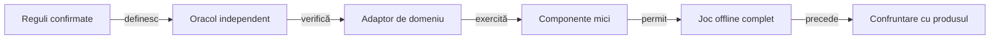

# Pregătirea testării unui alt joc

## Pe scurt

Transferăm metoda: reguli confirmate, observație permisă, oracol independent, regresii mici și evaluare pe date rezervate. Motorul, politicile și formatele Whist au adaptoare specifice; începerea unui alt joc cere identificarea și verificarea acestor frontiere.

Acest ghid deține admiterea unui domeniu nou. [Evoluția AI-ului](ATF_PolicyEvolution.md) deține îmbunătățirea unei politici, iar [arhitectura testării](../testing/ATF_Architecture.md) deține alegerea nivelului verificării.

## Ce putem transfera acum

| Suprafață | Stare în cod | Ce cere alt joc |
|---|---|---|
| Clasificare și audit JUnit | [Kit](../../atf-test-kit/README.md) independent de motorul Whist. | Așteptări proprii și adaptorul publicării rezultatelor. |
| Biblioteci comune | [API-uri binare](../platform/README.md), cu acceptanță locală. | Configurație, proveniență și verificări pe profilul noului consumator. |
| Guvernanță | [Verificatoare adaptate](../governance/README.md), cu politică și populație locale; API-ul comun împachetat este [criteriu deschis](../feedback/ATF_Governance.md#api-reutilizabil-pentru-verificatoare). | Rădăcină, module și inventar explicite, plus controale negative pe noul perimetru. |
| Intersecția intervalelor | [Componentă pură](../../whist-lab-app/ai-lab/tools/qualification/half-open-interval.mjs), consumată de registru. | Intrări întregi valide și adaptarea identității datelor. |
| Expunerea datelor | [Registrul actual](ATF_EvaluationRegistry.md) fixează namespace-ul distribuirilor Whist. | Contract de identitate, spațiu de date și migrare; schimbarea unui nume nu califică un registru generic. |
| Politică și observație | [AiPolicy](../../whist-lab-app/game-core/src/main/java/ro/whistlab/core/ai/policy/AiPolicy.java) proiectează starea către modelele Whist. | Tipuri, acțiuni, observație și obiectiv ale jocului nou. |
| Corpus și comparație | [Corpusul](ATF_Corpus.md) și [arena](ATF_Arena.md) verifică distribuiri, contracte și scor Whist. | Schemă și validator de traseu proprii, cu comparații potrivite domeniului. |
| Publicarea domeniului | [Consumatorul](../../atf-tests/README.md) interpretează înregistrări și rezultate Whist. | Maparea evenimentelor și comparațiilor; rendererul comun rămâne la responsabilul bibliotecii. |

Pregătirea metodei permite construirea primului adaptor. Afirmația de compatibilitate între jocuri cere cel puțin două adaptoare reale care trec contractele comune; un mock suplimentar al aceluiași model nu oferă această confirmare.

## Traseul de admitere



<details>
<summary>Legendă: fiecare etapă are o ieșire verificabilă</summary>

Adaptorul expune comportamentul domeniului și păstrează diferența dintre actor și oracol. Jocul offline califică modelul și colaborarea politicilor; confruntarea minimă cu produsul real verifică fidelitatea adaptorului și are scop separat de antrenare.

</details>

| Etapă | Criteriu de ieșire |
|---|---|
| Contract | Varianta, rolurile, stările, acțiunile, terminarea și punctajul au definiții confirmate și versiune. |
| Observație | Sunt declarate informația permisă, istoricul vizibil și sursa aleatorului; viitorul și secretele altor roluri sunt excluse din decizie. |
| Tranziție | O acțiune legală schimbă starea conform regulii; refuzul nu schimbă starea. Repetarea unei comenzi are semantica declarată. |
| Oracol | Așteptarea rezultă dintr-o regulă independentă, o invariantă ori o enumerare cu domeniu finit; acordul a două copii ale aceluiași cod nu este suficient. |
| Componente | Cazul nominal, defectul injectat, vecinul valid și limita regulii sunt diferențiate fără interfață. |
| Buclă offline | Toate turele conduc la terminare sau la o limită explicită; resursele, scorul și conservarea obiectelor jocului sunt verificate. |
| Produs real | O selecție minimă de stări și tranziții confruntă modelul cu produsul identificat; diferențele rămân vizibile. |
| Evaluare AI | Baza, candidatul, bugetul și criteriile sunt fixate înaintea datelor rezervate; adaptarea modelului redeschide calificarea afectată. |

## Contractele adaptorului

Numele de mai jos descriu responsabilități de proiectare, fără a declara un API generic deja livrat. [Feedback-ul transferului](../feedback/ATF_Ai.md#reutilizarea-mecanismelor) păstrează condițiile implementării comune.

| Port conceptual | Intrare și ieșire | Gardă independentă |
|---|---|---|
| Proiecția observației | Stare, rol și moment → informație permisă. | Schimbarea secretelor păstrează aceeași observație atunci când informația vizibilă rămâne identică. |
| Legalitate și pas | Stare, rol și acțiune → refuz ori tranziție. | Acțiunea refuzată păstrează starea; tranziția conservă resursele definite de joc. |
| Politică | Observație, configurație și buget → alegere legală. | Nu primește oracolul, seed-ul distribuirii sau generatorul evenimentelor viitoare. |
| Simulator | Stare și politici → jurnal până la terminare. | Actorii au observații separate; durata și numărul pașilor au limite explicite. |
| Evaluator | Jurnal și reguli → comparații și metrici. | Recalculează rezultatul fără a folosi verdictul politicii drept așteptare. |
| Identitatea datelor | Domeniu, generator, versiune și caz → identitate stabilă. | Același seed în generatoare diferite nu implică aceeași distribuție; copierea datelor păstrează expunerea. |

Într-un joc complet observabil, observația poate conține întreaga stare permisă. Într-un joc simultan sau cu informație ascunsă, izolarea rolurilor și ordinea dezvăluirii sunt contracte proprii, verificate înaintea comparației strategiilor.

## Lecții care se transferă

| Lecție | Aplicare în domeniul nou | Verificare |
|---|---|---|
| Observația nu stabilește intenția produsului | Separați cerința **confirmată**, comportamentul **observat** și ipoteza **presupusă**. | Un defect cunoscut este detectat fără copierea răspunsului curent în așteptare. |
| Mock-ul are limite declarate | Modelați stări, tranziții și refuzuri, apoi confruntați o selecție cu produsul real. | Diferența de model și încălcarea unei cerințe primesc diagnostice distincte. |
| Înfrângerea localizează analiza | Reduceți prima divergență la o proprietate și la frontiera ei. | Vecinul valid exclude o regulă prea largă; victoria unei partide nu devine etichetă de optimalitate. |
| Predicția diferă de decizie | Modelul estimează comportament; politica urmărește obiectivul declarat. | Eroarea predictivă, legalitatea și progresul strategic au criterii separate. |
| Parametrul și contextul au ritmuri diferite | Recalculați caracteristicile din evenimente; modificați parametrii numai prin candidat identificat. | Aceeași sursă și configurație păstrează definiția caracteristicilor, unitățile și fallback-ul. |
| Compararea controlează contextul | Folosiți intrări și resurse comparabile, roluri rotite și familii de adversari. | Aleatorul mediului este separat de explorarea politicii; traseele pot diverge după prima alegere. |
| Datele rezervate păstrează expunerea | Identificați generatorul, versiunile și partițiile independent de director. | Mutarea ori redenumirea nu redeschide datele văzute; observațiile corelate nu devin eșantioane independente. |
| Extragerea cere consumatori | Mutați un mecanism comun numai cu domeniu explicit și probe de paritate. | Inventarul sursei include dependențele importate; o modificare a lor schimbă identitatea candidatului. |
| Identitatea numerică are contract | Distingeți valoarea matematică, toleranța admisă și reprezentarea structurală. | Zero semnat, precizia și valorile nefinite au reguli explicite; serializarea și egalitatea nu aleg implicit semnificația domeniului. |

## Reguli și ponderi în alt joc

Transferați semantica unei caracteristici, nu valoarea numerică. Fiecare regulă declară condiția, unitatea, normalizarea, prioritatea, consumatorul, limitele și verificarea; [ghidul YAML](../ai/ATF_RulesConfiguration.md) distinge filtrul legal, ordinea obiectivelor, amestecul estimărilor și coeficientul învățat.

- Redefiniți obiectivul și criteriul terminal înaintea unei ponderi: punctele, riscul și durata pot avea unități diferite.
- Recalculați contextul din informația disponibilă rolului; accesul la viitor nu devine acceptabil prin normalizare.
- Calificați separat activarea, lipsa datelor, anularea și bugetul epuizat; o nouă caracteristică modifică identitatea modelului.
- Păstrați datele de ajustare distincte de evaluarea rezervată și includeți o bază simplă, explicabilă.

<details>
<summary>Fișa unei lecții pentru alt joc sau produs</summary>

Aceasta este o structură de redactare; lansatoarele curente nu interpretează schema:

```yaml
lesson:
  id: "<identitate stabilă>"
  domain: "<joc sau produs și versiunea regulilor>"
  scope: "<precondiții și rol>"
  observation: "<informație permisă actorului>"
  claim: "<proprietate verificabilă>"
  claim_status: "<confirmat | observat | presupus>"
  contract_owner: "<responsabil și versiunea contractului>"
  oracle: "<sursă independentă a așteptării>"
  boundaries: "<când proprietatea nu se aplică>"
  negative_control: "<defect detectabil și vecin valid>"
  adapter: "<date și acțiuni specifice domeniului>"
  data_identity: "<generator, versiune, partiție și expunere>"
  promotion: "<criteriu fixat înaintea evaluării noi>"
```

Pentru testarea unui produs nou, înlocuiți tura cu operația, scorul cu invariantă sau criteriu de acceptare și rolul cu permisiunile utilizatorului. O ipoteză încă neconfirmată rămâne investigație; responsabilul contractului clarifică așteptarea înaintea verdictului automat.

</details>

## Verificarea pregătirii

Pentru mecanismul pur de intervale, din rădăcina proiectului, cu Node.js disponibil:

```powershell
node --test whist-lab-app/ai-lab/tools/qualification/half-open-interval.test.mjs
```

[Contractele Kitului](../../atf-test-kit/README.md#niveluri-și-verificare) și [acceptanța ghidurilor de bibliotecă](../platform/ATF_Integration.md#verificarea-exemplelor-din-ghiduri) verifică alte părți reutilizabile. Registrul, arena și corpusul au propriile teste Whist; trecerea lor nu califică un domeniu nou.

Începerea componentelor pentru alt joc cere contractul, proiecția observației și oracolul definite. Începerea antrenării cere suplimentar bucla offline validată și date separate; conectarea la interfață cere produs identificat și controlul resursei, conform [strategiei de testare](../testing/README.md).

[Protocol offline](README.md) · [Evoluția politicii](ATF_PolicyEvolution.md) · [Lacunele transferului](../feedback/ATF_Ai.md#reutilizarea-mecanismelor)
