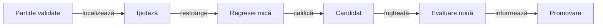
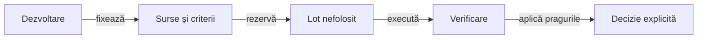

# Construirea și îmbunătățirea jucătorilor AI

## Pe scurt

Construim o politică de joc din reguli verificabile, o observație permisă și un criteriu de alegere explicit. O îmbunătățim offline: analizăm partide, izolăm o proprietate, modificăm un candidat și îl comparăm înaintea promovării.

Acest ghid deține procedura de evoluție. [Modelul deciziei](../ai/ATF_DecisionModel.md) explică alegerea din timpul jocului, iar [regulile și ponderile](../ai/ATF_RulesConfiguration.md) explică efectul fiecărui tip de parametru.

## Fundația pe care construim

| Strat | Ce construim | Limita păstrată |
|---|---|---|
| Reguli | Acțiuni legale, câștigător, puncte și serii în [motor](../../whist-lab-app/game-core/README.md). | Strategia nu poate modifica legalitatea sau scorul. |
| Observație | Mâna proprie și faptele publice, proiectate înaintea apelului politicii. | Cărțile reale adverse și viitorul rămân în simulator sau oracol. |
| Politică simplă | Normal urmărește necesarul contractului prin reguli locale. | Comportamentul transparent este o bază de comparație, fără căutare ascunsă. |
| Politică de căutare | Hard compară alternative pe lumi ipotetice compatibile. | Estimarea și certificatul finit au domenii diferite. |
| Reper separat | [Jucătorul independent](../../whist-lab-app/ai-lab/README.md) implementează propriile decizii și simulări. | Independența implementării ajută comparația; nu îl transformă într-un oracol perfect. |

Regulile obligatorii au teste înaintea interpretării performanței. O politică nu se califică prin simplul acord cu alt jucător automat.

## Două ritmuri de schimbare

| Când? | Ce se actualizează? | Ce rămâne identificat? |
|---|---|---|
| După o licitație sau carte publică | Necesarul, oportunitățile, cărțile necunoscute, restricțiile și estimările alternativelor. | Implementarea și parametrii politicii aflate în joc. |
| Între experimente offline | Ipoteza, o regulă, un comparator, un estimator sau coeficienții unui model candidat. | Baza de comparație, sursa candidatului și protocolul evaluării lui. |
| După revizia de promovare | Codul și contractele acceptate pentru utilizarea următoare. | Proveniența rezultatului care justifică schimbarea și posibilitatea revenirii la baza păstrată. |

Influența unei reguli poate varia cu situația, chiar dacă parametrul ei este fix. Învățarea offline și recalcularea contextului sunt operații distincte; aplicația nu își rescrie automat politica după fiecare partidă.

## Traseul unei îmbunătățiri



<details>
<summary>Legendă: fiecare trecere are un criteriu</summary>

Partida furnizează contextul, iar regresia cere o așteptare justificată independent. Candidatul este identificat înaintea evaluării rezervate; revizia poate accepta, respinge sau cere un experiment nou, fără schimbarea retrospectivă a pragurilor.

</details>

### Din partidă într-o întrebare precisă

1. Verificați distribuirea, licitațiile, cărțile, levatele și scorul prin [validatorul corpusului](ATF_Corpus.md).
2. Localizați prima alegere diferită ori prima condiție suspectă; separați efectul licitării de efectul cărții.
3. Reconstruiți observația disponibilă actorului atunci, fără informația apărută ulterior.
4. Clasificați întrebarea: legalitate, memorie publică, evaluarea lumilor, continuare, utilitate sau departajare.

O înfrângere motivează analiza, dar nu etichetează fiecare acțiune drept greșită. [Selecția](ATF_Selection.md) păstrează lecții distincte, fără reluarea implicită a întregii arhive.

### Din întrebare într-o regresie mică

[Componentele AI](../testing/ATF_AiComponents.md) dețin construcția martorului legal și separarea actorului de oracol. Cazul păstrează condiția, frontiera unde regula încetează să se aplice și așteptarea demonstrabilă.

| Așteptare justificată | Ce poate demonstra |
|---|---|
| Regulă de domeniu | Oferta interzisă sau cartea ilegală trebuie respinsă. |
| Invariantă | Aceeași observație a actorului nu poate primi cărțile reale ale adversarilor. |
| Enumerare finită independentă | O proprietate universală numai în domeniul complet verificat. |
| Comparație de estimator | Efectul calculului asupra acelui API, cu aceleași intrări și bugete. |

Acțiunea observată într-o partidă câștigată nu devine automat rezultatul așteptat al testului. Cazul mic rămâne în regresie; partida și diagnosticul detaliat rămân externe.

### Din regulă într-un candidat executabil

- Declarați în [manifestul responsabil](../ai/ATF_RulesConfiguration.md#cine-consumă-manifestele) condiția, statutul, consumatorul, limita și verificarea.
- Modificați mecanismul declarat într-o copie izolată; comparați cu baza păstrată pentru a atribui efectul schimbării.
- Pentru un model ajustat pe date, păstrați ordinea caracteristicilor, normalizarea, coeficienții, domeniul și identitatea generării.
- Verificați legalitatea, fallback-ul, anularea și costul; fixarea unui parametru nu dovedește singură progres strategic.

Lansatorul verifică [inventarul complet al bazei](../testing/ATF_Collections.md#identitatea-completă-a-bazei-candidatului) și sursele alternative. O modificare live după captură aparține unui candidat nou; nu schimbă identitatea copiei deja executate.

## Cum comparăm jocurile

[Arena](ATF_Arena.md) păstrează aceleași distribuții și locuri între bază și candidat. Fiecare actor decide din propria observație, iar continuările publice se pot despărți după prima alegere diferită.

| Comparație | Întrebarea la care răspunde |
|---|---|
| Același loc și aceeași distribuție | Ce schimbă politica, cu avantajul poziției controlat? |
| Locuri rotite | Cât depinde rezultatul de poziția în licitație și levată? |
| Alternative de licitare sau carte | Ce schimbă prudența, obiectivul sau continuarea, fără acces la viitor? |
| Familii de adversari | Îmbunătățirea se păstrează dincolo de un singur comportament advers? |
| Partide complete | Cum se propagă alegerile în puncte, contracte, serii și rezultat final? |

Punctele, exactele și victoriile se interpretează separat, pe rol și mărimea mâinii. Rotațiile aceleiași distribuții sunt observații corelate, iar un progres agregat poate ascunde o regresie locală.

## Când promovăm



<details>
<summary>Legendă: evaluarea rezervată nu ajustează candidatul</summary>

[Registrul comun](ATF_EvaluationRegistry.md) verifică expunerea înaintea execuției. Dacă rezultatul conduce la o nouă modificare, sursele și evaluarea se identifică din nou; lotul văzut rămâne expus, inclusiv după eșec sau mutarea corpusului.

</details>

Promovarea cere toate criteriile obligatorii și progresul declarat, fără regresii de reguli ori scor. Testele de componentă, costul JVM și evaluarea strategică au verdicte separate; niciunul nu le înlocuiește pe celelalte.

Revizia actualizează codul acceptat, manifestul și ghidul care deține comportamentul. Rezultatele neutre ori negative și baza anterioară se păstrează conform [retenției](ATF_Retention.md); ghidurile explică mecanismul, fără clasamente istorice de experimente.

## Lecții transferabile către alte jocuri și produse

[Ghidul transferului](ATF_GameTransfer.md#lecții-care-se-transferă) deține lecțiile, condițiile lor și verificarea în alt domeniu. Se păstrează separarea actorului de oracol, reducerea greșelii la o proprietate, identitatea datelor și promovarea candidatului; regulile și ponderile Whist se recalifică pentru noul obiectiv.

### Aplicarea unei lecții într-un produs necunoscut

[Contractul de admitere](ATF_GameTransfer.md#traseul-de-admitere) pornește de la o cerință confirmată și cere oracol, adaptor, componente și confruntare cu produsul real. O observație neconfirmată rămâne ipoteză urmărită; acordul dintre AI și propriul mock nu stabilește intenția produsului.

### Adaptorul care schimbă domeniul

[Porturile de domeniu](ATF_GameTransfer.md#contractele-adaptorului) separă observația, tranziția, politica, simulatorul și evaluarea. [Fișa lecției](ATF_GameTransfer.md#reguli-și-ponderi-în-alt-joc) păstrează proprietatea, frontiera, controlul negativ și identitatea datelor; este structură de redactare, nu schemă interpretată de lansatoare.

## Pregătirea reutilizării în cod

[Inventarul transferului](ATF_GameTransfer.md#ce-putem-transfera-acum) identifică mecanismele independente și adaptoarele Whist. Extragerea suplimentară cere un consumator real și probe de paritate; inventarul sursei include dependențele importate, astfel încât o mutare nu ascunde schimbarea candidatului.

## Reluarea lucrului fără zgomot

Din rădăcina proiectului, pentru verificarea mică a regulilor și a contextului:

```powershell
.\scripts\run-whist-collection.ps1 -Collection context
.\scripts\run-whist-collection.ps1 -Collection strategy
```

[Catalogul colecțiilor](../testing/ATF_Collections.md) deține parametrii efectivi pentru regresie, arenă și evaluarea candidatului. Analiza și ajustarea citesc numai intrările de dezvoltare declarate; evaluarea rezervată are admitere proprie.

- În proiect: cod, reguli, scheme, componente și protocoale reutilizabile.
- În arhiva configurată: partide JSON, selecții, calibrări, surse înghețate și decizii de promovare.
- În [feedback-ul AI](../feedback/ATF_Ai.md): numai lacunele deschise, cu responsabil și criteriu verificabil.

[Orientare offline](README.md) · [Reguli și ponderi](../ai/ATF_RulesConfiguration.md) · [Modelul deciziei](../ai/ATF_DecisionModel.md)
