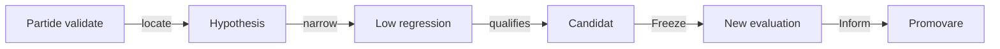
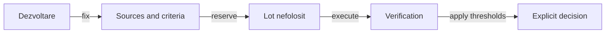

# Building and improving AI players

## Overview

We build a game policy from verifiable rules, an allowed observation and an explicit choice criterion. We improve it offline: we analyze parties, we isolate property, we change a candidate and we compare it before promotion.

This guide holds the evolution procedure. [Modelul deciziei](../ai/ATF_DecisionModel.md) explains the choice during the game, and [rules and weights](../ai/ATF_RulesConfiguration.md) explains the effect of each type of parameter.

## Foundation on which we build

| Strat | Ce construim | Preserved limit |
|---|---|---|
| Rules | Legal actions, winner, points and series in [Engine](../../whist-lab-app/game-core/README.md). | The strategy cannot change the legality or the score. |
| Observation | Hand and public deeds, designed before the call for policy. | Real adverse cards and the future remain in the simulator or oracle. |
| Simple policy | Normal follows the contract's need by local rules. | The transparent behavior is a basis of comparison, without hidden search. |
| Search policy | Hard compares alternatives to hypothetical compatible worlds. | The estimation and the finished certificate have different fields. |
| Reper separat | [Independent Player](../../whist-lab-app/ai-lab/README.md) implements its own decisions and simulations. | The independence of implementation helps the comparison; it does not make it a perfect oracle. |

Mandatory rules have tests before performance is interpreted. A policy does not qualify by simply agreeing with another automatic player.

## Two shifting rhythms

| When? | What's up-to-date? | What remains identified? |
|---|---|---|
| After an bid or public card | Necessary, opportunities, unknown cards, restrictions and estimates of alternatives. | Implementation and parameters of the policy at stake. |
| Between offline experiments | The hypothesis, a rule, a comparator, an estimate or coefficients of a candidate model. | Basis of comparison, candidate's source and evaluation protocol. |
| After the promotion review | Code and contracts accepted for the following use. | The result of the change and the possibility of returning to the base held. |

The influence of a rule may vary with the situation, even if its parameter is fixed. Overflow learning and context recalculation are separate operations; the application does not automatically rewrite its policy after each game.

## The route of improvement



<details>
<summary>Legend: each crossing has a criterion</summary>

The party provides the context and regression requires a justifiable independent expectation. The candidate is identified prior to the reserved evaluation; the revision may accept, reject or request a new experiment without retrospective change of thresholds.

</details>

### From game to question specific

1. Check distribution, bids, cards, tricks and score by [corpus validator](ATF_Corpus.md).
2. Locate the first different choice or the first suspicious condition; separate the effect of the bidding from the card effect.
3. Reconstruct the available observation to the actor then without the information that comes later.
4. Browse the question: legality, public memory, world assessment, continuation, utility or departement.

A defeat motivates analysis, but does not label every action as wrong. [Selection](ATF_Selection.md) keeps separate lessons without implicitly restarting the entire archive.

### From question to small regression

[Componentele AI](../testing/ATF_AiComponents.md) holds the construction of the legal witness and the separation of the actor from the oracle. The case shall be kept in condition, the border to which the rule ceases to apply and the demonstrable expectation.

| Justified expectation | What can prove |
|---|---|
| Field rule | The prohibited offer or illegal card must be rejected. |
| Input | The same observation of the actor cannot be given the actual cards of the opponents. |
| Independent finite number | A universal property only in the thoroughly verified field. |
| Comparison of the estimate | The effect of the calculation on that API, with the same inputs and budgets. |

The action observed in a winning game does not automatically become the expected result of the test. The small case remains regression; the detailed match and diagnosis remain external.

### Normal in an executable candidate

- Declaration in [manifestul responsabil](../ai/ATF_RulesConfiguration.md#who-consumes-the-manifests) condition, status, consumer, limit and verification.
- Change the declared mechanism in an isolated copy; compare it with the base kept to attribute the effect of the change.
- For a data-adjusted model, keep the order of characteristics, normalisation, coefficients, domain and identity of generation.
- Check legality, fallback, cancellation and cost; fixing a parameter does not prove the only strategic progress.

The launcher checks [Full inventory of base](../testing/ATF_Collections.md#full-identity-of-candidate-base) and alternative sources. A live change after capture belongs to a new candidate; does not change the identity of the copy already executed.

## How do we compare games?

[Arena](ATF_Arena.md) keeps the same distributions and places between base and candidate. Each actor decides from his own observation and public sequels can be separated after the first different choice.

| Comparison | Question to which he answers |
|---|---|
| Same place and distribution | What changes politics, with the advantage of the controlled position? |
| Rotated places | How much depends on the position in the bid and trick? |
| Bidding alternatives or card | What changes the prudence, objective or continuation without access to the future? |
| Families of opponents | Does improvement keep itself beyond one adverse behavior? |
| Partide complete | How do elections spread in points, contracts, series and final result? |

Points, exacts and victories are interpreted separately, in the role and the size of the hand. The rotation of the same distribution is related observations and aggregated progress can hide local regression.

## When we promote



<details>
<summary>Legend: reserved evaluation does not adjust candidate</summary>

[Registrul comun](ATF_EvaluationRegistry.md) checks exposure prior to execution. If the result leads to a new change, the sources and the evaluation shall be identified again; the consignment seen shall remain exposed, including after failure or removal of the body.

</details>

Promotion requires all mandatory criteria and stated progress, without regressions of rules or score. Component tests, JVM cost and strategic evaluation have separate verdicts; none replace the others.

The review shall update the accepted code, manifest and guide holding the behaviour. Neutral or negative results and previous base are kept according to [retention](ATF_Retention.md); the guides explain the mechanism without historical test rankings.

## Lessons to other games and products

[Transfer guide](ATF_GameTransfer.md#lessons-to-be-transferred) holds their lessons, conditions and verification in another field. The separation of the actor from the oracle, the reduction of the error in property, the identity of the data and the promotion of the candidate shall be maintained; the rules and weights of the Whist shall be recalibrated for the new objective.

### Application of a lesson in an unknown product

[Acceptance contract](ATF_GameTransfer.md#entry-route) starts from a confirmed requirement and requires oracle, adapter, components and confrontation with the real product. An unconfirmed observation remains a hypothesis; the agreement between IA and its own mock does not establish the intention of the product.

### The adaptor that changes the field

[Ports of domain](ATF_GameTransfer.md#adapter-contracts) separates observation, transition, policy, simulator and evaluation. [Lesson sheet](ATF_GameTransfer.md#rules-and-weightings-in-another-game) maintains ownership, border, negative control and data identity; it is a drafting structure, not a scheme interpreted by launchers.

## Preparation of re-use in cod

[Transfer inventory](ATF_GameTransfer.md#what-can-we-transfer-now) identifies independent mechanisms and the Whist adapters. Additional extraction requires a real consumer and parity evidence; source inventory includes imported dependencies, so that a move does not hide the change of candidate.

## Resumption of work without noise

From the root of the project, for small checking of the rules and context:

```powershell
.\scripts\run-whist-collection.ps1 -Collection context
.\scripts\run-whist-collection.ps1 -Collection strategy
```

[Catalogue of collections](../testing/ATF_Collections.md) has effective parameters for regression, arena and candidate evaluation. The analysis and adjustment shall read only the declared development inputs; the reserved assessment shall have its own admission.

- In the project: code, rules, schemes, components and reusable protocols.
- In the configured archive: JSON parties, selections, calibrations, frozen sources and promotion decisions.
- In [feedback-ul AI](../feedback/ATF_Ai.md): only open gaps with responsible and verifiable criteria.

[Offline Orientation](README.md) · [Rules and weightings](../ai/ATF_RulesConfiguration.md) · [Modelul deciziei](../ai/ATF_DecisionModel.md)
