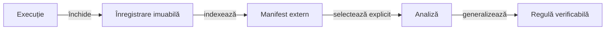

# Guvernanța arhivării

## Pe scurt

Arhivarea păstrează datele variabile ale execuțiilor în afara codului sursă. Documentația proiectului descrie contractele, mecanismele și condițiile de interpretare, fără inventare de rulări sau verdicte istorice.

## Ciclul de viață

Legendă și limite

Arhiva păstrează proveniența, partiția și integritatea datelor. O selecție pentru analiză nu schimbă sursele acceptate și nu resetează statutul unui lot rezervat deja consumat.

## Principii de retenție

- Conținutul unei execuții închise este imuabil și verificabil prin hash.
- Seturile pentru dezvoltare, referință și evaluare rezervată au roluri explicite.
- Repetițiile fără lecții noi pot fi scoase din selecția activă fără a pierde registrul originii.
- Referințele către selecția activă se actualizează separat de datele partidelor.
- Documentele stabile conțin reguli și limite; scorurile, exemplele și evaluările editoriale apar în arhiva externă.

[Arhitectura învățării](../ai/README.md) · [Guvernanța documentației](../governance/ATF_Documentation.md)
