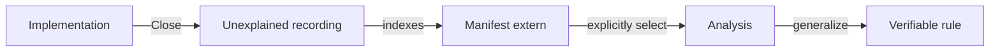

# Governance of archiving

## Overview

The archiving shall keep variable execution data outside source code. The project documentation describes contracts, mechanisms and conditions of interpretation, without inventing historical runs or verdicts.

## Lifetime

Legend and limits

The archive shall maintain the provenance, partition and integrity of the data. A selection for analysis shall not change the sources accepted or reset the status of a lot already reserved consumed.

## Principles of retention

- The content of a closed execution is immutable and verifiable by hash.
- The set for the reserved development, reference and evaluation has explicit roles.
- Rehearsals without new lessons can be removed from active selection without losing the origin register.
- References to active selection shall be updated separately from the games' data.
- Stable documents contain rules and limits; rolling scores, examples of games and editorial evaluations appear in the external archive.

[Learning architecture](../ai/README.md) · [Governance of documentation](../governance/ATF_Documentation.md)
