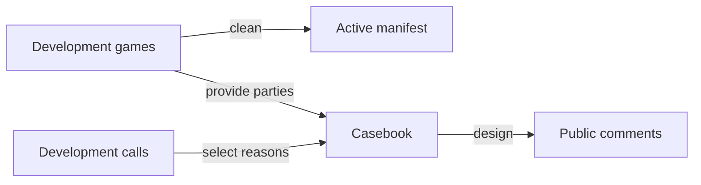

# Focused selection for learning

## Overview

Focused selection reduces the volume of analysis in games that bring distinct lessons about bidding and card. The algorithm, criteria and validators belong to the project; the concrete selection and its results are external data.

## Mechanisms and stage

The selection of data for analysis has distinct mechanisms with explicit status:

| Mechanism | Implementation and limit |
|---|---|
| Corpus activ | [whist-active-corpus](../../whist-lab-app/ai-lab/tools/corpus/whist-active-corpus.mjs): reshoring of traces, protected origins, rarity-weighted coverage and exchanges with strict progress in the declared budget. |
| Diagnostic examples | [whist-casebook](../../whist-lab-app/ai-lab/tools/corpus/whist-casebook.mjs): selects family gains and regressions, plus contract errors in the size of the hand; the chosen games extract the first eligible observations of the actor by size and type of decision. |
| Sub-set by category | Extension contract without generic selection qualified in the project; ask parent manifest, explicit criteria and [self-acceptance](../feedback/ATF_Ai.md). |

Legend: data variety and fairness of decision

The curator produces the active corpus, and the casebook consumes separately declared claims and development games. Both preserve provenance; the categories and examples extracted are not code coating and do not label an action as optimal.

## Diagnostic categories

- The role of policy, the size of the hand and the meaning of the difference between bid and win.
- The position in bid, the table imbalance and individual needs.
- Number of strengths, color gaps, sequences and legal outputs.
- The consequences for the base points and the set-up series.
- The first observable difference between two policies on the same distribution and the same place.

## Process Invariants

- [Corpusul](ATF_Corpus.md) holds the partition, identity, hashes and replicayes independently prior to analysis.
- [Componentele AI](../testing/ATF_AiComponents.md) holds the legal witness, the actor's projection and the justified expectation.
- [Protocolul offline](README.md#the-improvement-cycle) holds the freezing, reserved lot and promotion.

The selection for learning and [selection for presentation](../reporting/ATF_Presentation.md) have different purposes. The choice of examples in an HTML does not alter the executed population, active corpus or status of the reserved data.
