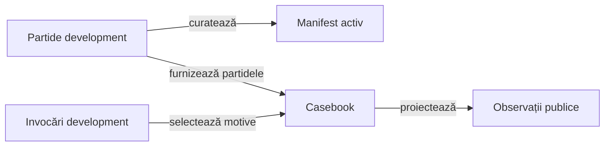

# Selecția focalizată pentru învățare

Selecția focalizată reduce volumul de analiză la jocurile care aduc lecții distincte despre licitare și carte. Algoritmul, criteriile și validatoarele aparțin proiectului; selecția concretă și rezultatele ei sunt date externe.

## Mecanisme și stadiu

Selecția datelor pentru analiză are mecanisme distincte, cu statut explicit:

| Mecanism | Implementare și limită |
|---|---|
| Corpus activ | [whist-active-corpus](../../whist-lab-app/ai-lab/tools/corpus/whist-active-corpus.mjs): deduplicare a urmelor, origini protejate, acoperire ponderată prin raritate și schimburi cu progres strict, în bugetul declarat. |
| Exemple de diagnostic | [whist-casebook](../../whist-lab-app/ai-lab/tools/corpus/whist-casebook.mjs): selectează câștiguri și regresii pe familie, plus erori de contract pe mărimea mâinii; din partidele alese extrage primele observații eligibile ale actorului după mărime și tipul deciziei. |
| Subset focalizat după categorii | Contract de extindere, fără selector generic calificat în proiect; cere manifest părinte, criterii explicite și [acceptanță proprie](../feedback/ATF_Ai.md). |

Legendă: varietatea datelor și corectitudinea deciziei

Curatorul produce corpusul activ, iar casebook-ul consumă separat invocări și partide de dezvoltare declarate. Ambele păstrează proveniența; categoriile și exemplele extrase nu sunt acoperire de cod și nu etichetează o acțiune drept optimă.

## Categorii de diagnostic

- Rolul politicii, mărimea mâinii și sensul diferenței dintre licitat și câștigat.
- Poziția în licitație, dezechilibrul mesei și necesarul individual.
- Numărul de atuuri, lipsurile de culoare, secvențele și ieșirile legale.
- Consecințele pentru punctele de bază și seria configurată.
- Prima diferență observabilă dintre două politici pe aceeași distribuție și același loc.

## Invariante de proces

- [Corpusul](ATF_Corpus.md) deține partiția, identitatea, hash-urile și replay-ul independent înaintea analizei.
- [Componentele AI](../testing/ATF_AiComponents.md) dețin martorul legal, proiecția actorului și așteptarea justificată.
- [Protocolul offline](README.md#ciclul-de-îmbunătățire) deține înghețarea, lotul rezervat și promovarea.

Selecția pentru învățare și [selecția pentru prezentare](../reporting/ATF_Presentation.md) au scopuri diferite. Alegerea unor exemple într-un HTML nu modifică populația executată, corpusul activ sau statutul datelor rezervate.
