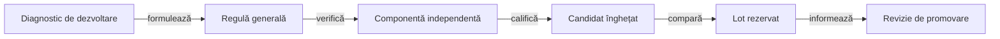

# Învățarea și evaluarea offline

## Pe scurt

Fiecare candidat reprezintă o modificare identificată a licitării sau a alegerii cărții. Protocolul precizează rolul evaluat, sursele, familiile de adversari, profilul de scor și distribuțiile înaintea execuției.

[Laboratorul AI](../../whist-lab-app/ai-lab/README.md) deține uneltele și sursele experimentale ale procesului. [Lansatoarele comune](../../scripts/README.md) selectează configurația și resursele pentru execuția izolată.

- [Corpusul](ATF_Corpus.md) definește partidele și integritatea intrărilor.
- [Selecția](ATF_Selection.md) restrânge analiza la lecții distincte.
- [Arena](ATF_Arena.md) compară politici pe distribuții și locuri controlate.
- [Retenția](ATF_Retention.md) păstrează rolul și proveniența datelor externe.

## Etapele calificării

| Etapă | Ce se verifică |
|---|---|
| Diagnostic | Se extrage o observație publică dintr-o partidă de dezvoltare. Un contraexemplu trebuie justificat independent de rezultatul înregistrat. |
| Componentă | Se verifică legalitatea mutării, necesarul contractului, cartea întoarsă și cazurile în care concluzia încetează să fie valabilă. |
| Dezvoltare | Fiecare pereche folosește distribuții și locuri identice. Rezultatele se separă pe rol, familie de adversari și mărimea mâinii. |
| Evaluare rezervată | Sursele sunt înghețate înainte de deschiderea intervalului. Registrul extern păstrează intervalele utilizate. |
| Decizie | Se aplică pragurile declarate și cerința de progres strict. Rezultatele neutre și negative rămân disponibile. |

## Interpretare

- Un seed cu locurile rotite dă mai multe partide corelate.
- Contractele exacte, punctele și victoriile împărțite la egalitate se citesc separat.
- Numărul lumilor fezabile enumerate este o măsură a domeniului demonstrației. O probabilitate necesită și un model al distribuției lor.
- O alegere diferită poate schimba licitațiile și scorurile mâinilor ulterioare. Prima divergență trebuie identificată înainte de atribuirea câștigului.

## Reproducere

[Lansatorul colecțiilor](../../scripts/run-whist-collection.ps1) selectează turneul după schema protocolului și verifică sursele înghețate. [Ghidul comenzilor](../testing/ATF_Collections.md#experimente-și-surse-înghețate) deține parametrii, modurile de suprapunere și precondițiile efective.

- O copie executată este identificată prin sursele și configurația capturate; o modificare live nu o recalifică retrospectiv.
- Reproducerea unei evaluări vechi folosește sursele ei păstrate și nu deschide o nouă evaluare neatinsă.
- Politica cere un registru comun al loturilor; runnerul implementează în prezent rezervarea sub corpusul transmis, cu [limitele de coordonare](../feedback/ATF_Ai.md) declarate explicit.

## Reguli stabile și date de experiment

[Regulile și configurarea AI](../ai/ATF_RulesConfiguration.md) dețin inventarul manifestelor și efectul lor executabil. Codul, schema și parametrii versionați identifică mecanismul; partidele, selecțiile concrete și rezultatele aparțin depozitului extern.

[Contractul corpusului](ATF_Corpus.md) definește formatul și partițiile, iar [retenția](ATF_Retention.md) definește păstrarea provenienței. Modificarea numelui sau locației unei selecții nu face un lot expus din nou neatins.

## Ciclul de îmbunătățire

Aceasta este procedura responsabilă pentru promovarea unei politici; ghidurile arenei, componentelor și colecțiilor o specializează prin propriile contracte.

Legendă: protocolul precede evaluarea

Rolurile, adversarii, scorul, distribuțiile, bugetele și criteriile sunt declarate înaintea lotului rezervat. Rezultatul acestuia informează promovarea fără ajustarea retrospectivă a candidatului sau a pragurilor.

1. Validați regulile și scorul jocurilor de dezvoltare înaintea analizei performanței.
2. Localizați prima divergență și reconstruiți observația permisă actorului la acel moment.
3. Formulați condiția generală, frontierele și așteptarea independentă; păstrați o regresie mică.
4. Verificați componentele și comparațiile pereche în domeniul declarat, apoi înghețați sursele și criteriile.
5. Verificați disponibilitatea și rezervați lotul de evaluare înaintea deschiderii; expunerea lui rămâne înregistrată.
6. Aplicați fiecare criteriu obligatoriu pe rol și familie, păstrând separat punctele, exactele și victoriile.
7. Promovați explicit codul și contractele numai după progresul cerut, fără regresii de reguli sau scor.

O înfrângere localizează analiza, fără a demonstra singură o eroare. Mâinile complete sunt admise în auditul de după joc, în timp ce politica rămâne limitată la [observația permisă](../ai/ATF_DecisionModel.md#contractul-unei-decizii).

[Arena](ATF_Arena.md) · [Componente AI](../testing/ATF_AiComponents.md) · [Comenzi](../testing/ATF_Collections.md)
